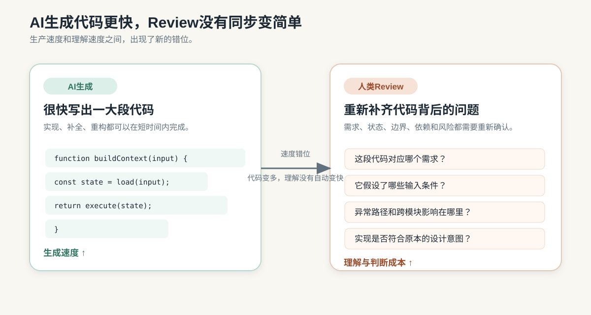
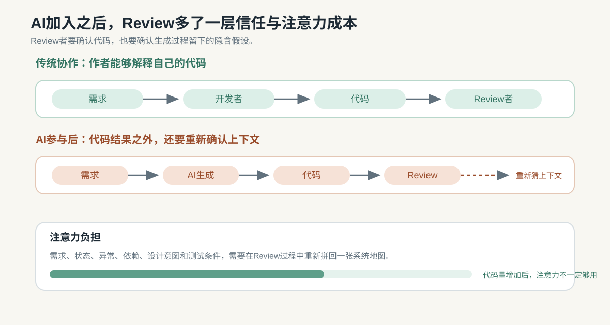
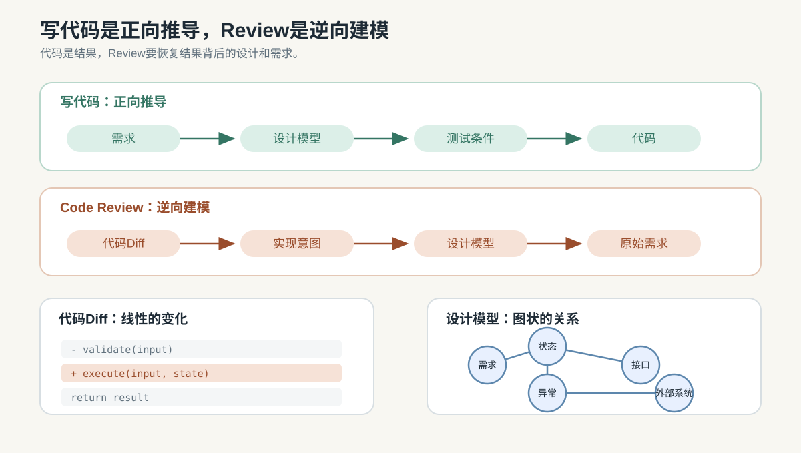
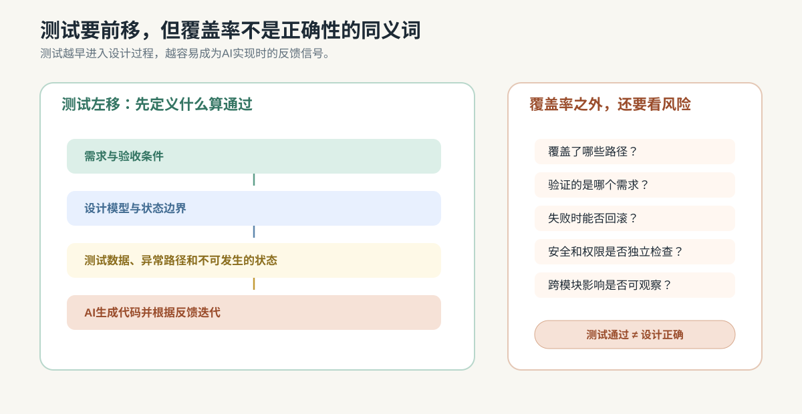
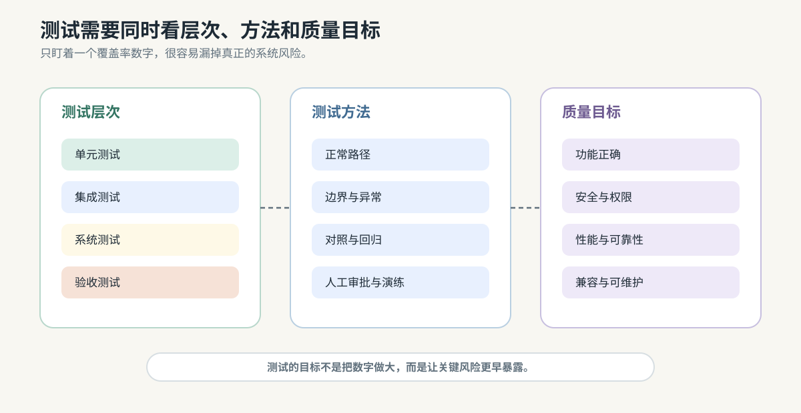
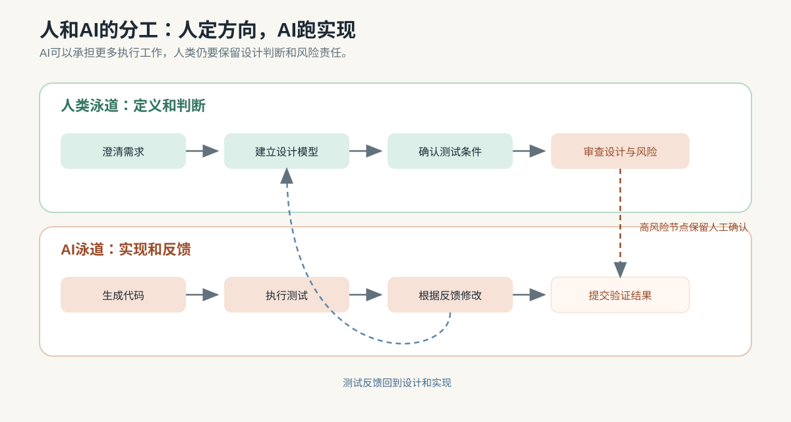
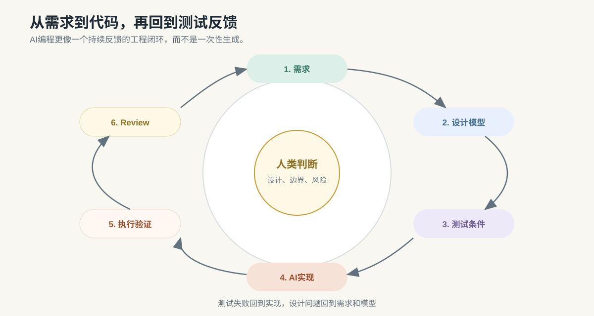
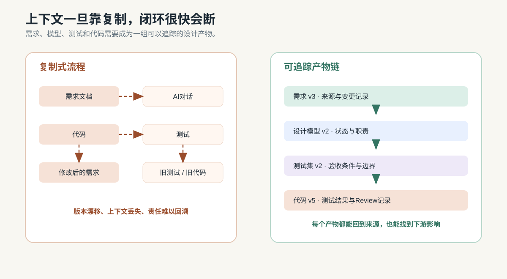
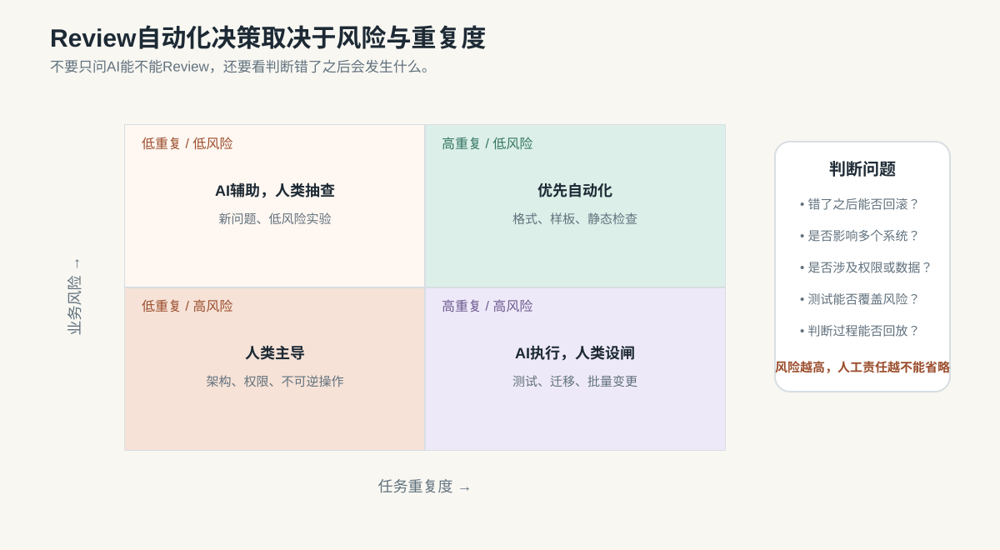

我最近读到一篇文章，标题很直接：《AI 时代，代码 Review 还有必要吗？》。文章发布于 2026 年 11 月 18 日，讨论的是一个越来越常见的开发场景：AI 可以在很短时间里生成几百行代码，但开发者真正开始 Review 时，往往还要重新理解需求、追踪上下文、猜测实现意图。

这件事让传统的 Code Review 出现了一点错位。

代码生成变快了，理解代码的速度却没有同步增加。AI 帮我们完成了更多实现工作，也把更多需要判断的内容一起推到了 Review 环节。

所以，这篇文章真正值得讨论的地方，不是“以后还要不要 Review”，而是：**AI 已经参与代码生产之后，我们究竟应该 Review 什么。**



本文不是对原文逐段复述，而是沿着其中几条比较重要的线索，重新整理一遍这个问题：为什么 AI 代码让 Review 变累，测试能够帮上什么忙，设计模型为什么需要前置，以及人和 AI 的职责应该怎样重新划分。

## 一、AI 把代码写快了，Review 却没有变简单

文章里描述了一个很具体的场景：AI 用很短时间写完一大段代码，开发者打开代码后，却需要花更长时间确认它到底做了什么。

这不是因为代码一定写错了。很多时候，代码甚至能够正常运行，结构也看起来完整。困难在于，Review 者面对的是一份已经生成好的结果，而不是一个可以随时解释设计过程的作者。

人类写代码时，脑子里通常保留着一些没有写进代码的内容：为什么要这样拆模块，某个字段为什么这么命名，某个异常为什么选择重试，某个看似多余的判断到底在防什么。AI 生成的代码也可能包含类似的设计，但这些设计不会自动出现在 Review 者的视野里。

于是，Review 不再只是检查“这段代码有没有问题”，还要重新补齐下面这些背景：

- 这段代码对应哪个需求？
- 它假设了哪些输入条件？
- 它有没有遗漏业务边界？
- 它与其他模块之间是什么关系？
- 生成它的模型是否真正理解了上下文？

AI 越擅长一次性生成大量内容，Review 阶段就越不能只依赖快速浏览。代码的生产速度和人的理解速度之间，出现了明显的差距。

## 二、Review 变累，背后是信任和注意力问题

传统 Code Review 有一个不太显眼的前提：写代码的人通常能够解释自己的代码。

Review 者可能会因为熟悉作者的能力、习惯和业务背景，而降低一部分审查成本。这里的信任并不意味着完全不看代码，而是意味着很多判断可以建立在已有协作经验上。

AI 参与之后，代码链路发生了变化：

```text
需求 → 开发者 → 代码 → Review者

需求 → AI生成 → 代码 → 人类Review
```

中间多了一个概率模型。Review 者要确认的，不只是代码作者有没有考虑某个问题，还包括 AI 有没有理解这个问题、有没有遗漏隐含条件，以及它给出的解释是否只是另一段生成结果。



这会直接增加注意力成本。

Review 不是把每一行代码从上到下读一遍，而是持续建立一张局部的系统地图：数据从哪里来，经过哪些节点，状态在哪里改变，异常会沿着哪条路径传播，最后又会影响哪些外部行为。

当 AI 一次生成的代码量变大，这张地图也会随之变大。开发者需要在更多文件、更多函数和更多隐含假设之间来回切换。代码能不能运行，变成了一个相对容易回答的问题；代码为什么这样运行，以及它是否符合系统原本的意图，才是更费精力的部分。

## 三、Code Review 其实是在做一次逆向建模

写代码通常是一条正向路径：

```text
需求 → 设计 → 测试条件 → 代码
```

而 Review 更像是一条反向路径：

```text
代码 → 实现意图 → 设计模型 → 原始需求
```

开发者需要从已经存在的实现，反推它想解决什么问题。这也是为什么 Review 一段陌生代码，常常比写一段自己熟悉的代码更累。



代码 Diff 通常是线性的。一行被修改了，另一行被新增了，某个函数被拆开了。但真实系统的关系往往是图状的：一个字段可能被多个接口使用，一个状态变化可能影响几条流程，一次数据库迁移可能牵动缓存、消息和异步任务。

如果只盯着 Diff，容易看到局部变化，却看不到局部变化和整体设计之间的关系。

所以，真正困难的 Review 往往不是寻找语法错误，而是回答几个更靠近设计的问题：

- 这段代码从哪个需求推导出来？
- 它依赖的状态是否真实存在？
- 它与其他模块的职责边界是否一致？
- 它处理的是正常路径，还是也考虑了失败路径？
- 如果需求发生变化，当前设计能否承受下一次修改？

从这个角度看，Code Review 其实是一种逆向建模工作。AI 生成的代码越多，越需要先把模型和上下文补出来，否则 Review 很容易退化成对局部文本的检查。

## 四、测试可以减轻 Review 压力，但不能替代设计判断

### 1. 100%的测试不是一个现实目标

原文借停机问题和 Rice 定理讨论了一个边界：对于足够复杂的程序，不存在一组测试用例，可以完备地证明它不存在任何缺陷。

这并不意味着测试没有用。测试的价值在于降低不确定性，尽早暴露错误，并为代码修改提供可以重复执行的反馈。

但有几个概念需要分开：

- 测试覆盖率不等于业务覆盖度；
- 测试通过不等于设计合理；
- 单元测试通过不等于系统边界没有问题；
- 一组测试存在，不等于测试验证了正确的需求。



### 2. AI 生成的测试，可能只是验证错误的代码

如果 AI 先生成了一段错误代码，再根据这段代码生成测试，就可能出现一个看似合理、实际封闭的循环：

```text
AI写错代码
    ↓
AI根据错误实现写测试
    ↓
测试通过
    ↓
开发者误以为实现正确
```

问题不在于 AI 不能写测试，而在于测试不能只从代码本身推导出来。它还需要受到需求、设计模型、验收条件和失败场景的约束。

如果一个测试只是证明“代码按照自己的假设运行了”，它并没有证明代码符合真正的业务要求。

### 3. 测试需要左移，也需要立体化

更合理的做法，是在代码生成之前先明确测试条件：

- 什么结果算通过？
- 哪些状态不能出现？
- 哪些输入必须被拒绝？
- 哪些错误需要重试？
- 哪些操作必须回滚？
- 哪些路径需要人工确认？

这样，测试才能成为 AI 编程闭环中的反馈信号，而不只是代码完成后的验收表格。

测试还需要从多个维度展开。除了单元、集成、系统和验收这些层次，还要根据系统风险考虑安全、性能、可靠性、兼容性和数据一致性。



测试可以替开发者承担更多机械验证工作，但它仍然需要一个正确的问题定义。没有设计和验收标准，测试本身也可能只是在自动化地重复错误假设。

## 五、Review 对象要向上游移动：设计、测试与一致性

一段代码功能上可以通过测试，不代表它就是一段值得长期维护的代码。

它可能职责混乱，可能把多个状态揉在一起，可能让一个模块承担了不属于它的业务判断，也可能只是暂时满足了当前用例，却给下一次需求变化留下很高的修改成本。

因此，AI 时代的 Code Review 可以先拆成三个层次：

1. **代码层：** 实现是否正确，错误处理是否完整；
2. **测试层：** 测试是否覆盖真正的风险，是否存在假通过；
3. **设计层：** 当前实现是否符合需求、模型和系统边界。

可以把这件事概括成一个公式：

> **Code Review = 设计模型 Review + 测试集 Review + 设计模型与代码的一致性 Review**

这并不是说人类必须逐行阅读所有代码，而是说，Review 的重点需要向上游移动。

人类更需要负责的是需求澄清、设计建模、边界判断、风险取舍和最终责任。AI 更适合承担明确约束下的代码实现、测试执行和反馈修改。



这里的分工不是绝对规则。小型脚本、低风险模块和重复性代码，可以让自动化检查承担更多工作；涉及权限、数据迁移、资金、删除和跨系统影响时，人类仍然需要保留决策权。

## 六、把 AI 写代码变成一个可反馈的闭环

如果把前面的观点落到工程流程里，可以得到一条相对清晰的路径：

### 第一步：先把需求说清楚

除了描述“要做什么”，还要补充输入、输出、状态变化、边界条件和失败处理。需求越模糊，AI 越容易用自己的默认假设填补空白。

### 第二步：建立必要的设计模型

不一定要为每个小功能画完整架构图，但至少应该明确数据结构、模块职责、状态流转和关键依赖。

### 第三步：从模型推导测试条件

先写下哪些结果必须成立，哪些行为不能发生，哪些异常需要被捕获。这样测试就不再只是代码的附属物。

### 第四步：让 AI 实现并执行验证

AI 根据需求、模型和测试条件生成代码，然后运行测试。失败结果应该回到代码修改，而不是被简单地忽略。

### 第五步：人类审查设计和风险

人类重点确认：实现是否真的符合需求，测试是否覆盖关键边界，AI 是否绕开了问题，以及这次修改是否破坏了系统其他部分。



这个闭环里，AI 负责的内容可以越来越多，但人类不能只在最后看一眼结果。设计越晚被发现问题，返工成本越高；风险越高的操作，越需要在执行前设置人工确认点。

## 七、上下文管理决定这个闭环能不能跑起来

流程看起来完整，实际落地时还会遇到一个更大的问题：需求、设计、测试和代码之间的上下文如何传递。

现实开发中经常出现这样的链路：产品需求在一个文档里，开发者把它复制到 AI 对话中；AI 生成代码之后，测试人员再从代码反推需求；需求发生修改后，原来的测试和设计文档却没有同步更新。



这会带来几种常见问题：

- 需求改了，测试没有改；
- 测试改了，代码没有同步；
- 代码变了，设计文档还是旧版本；
- 不同 AI 会话拿到的上下文不一致；
- 出现问题时，没人能说清楚某个实现依据的是哪一版需求。

更稳妥的做法，是把需求、设计模型、测试集、代码和验证结果看成一组相互关联的设计产物：

```text
需求
 ↓
设计模型
 ↓
验收标准 / 测试集
 ↓
代码实现
 ↓
测试结果
 ↓
Review记录
```

每个环节都应该尽量保留来源、版本、变更记录和关联关系。这样，当需求发生变化时，团队可以知道哪些测试、代码和设计需要一起调整；当线上出现问题时，也能够回溯模型究竟看到了什么，代码又是根据什么生成的。

原文后半部分把这个问题继续推向了产品化：如果设计产物之间没有统一的上下文管理，AI 写代码越快，流程中的信息漂移可能越严重。

这也是一个很容易被忽略的地方。AI 编程的瓶颈不一定在生成能力本身，也可能在于我们有没有能力管理生成代码所依赖的上下文。

## 八、哪些 Review 可以交给 AI，哪些仍然需要人负责

可以先用“重复度”和“风险等级”做一个粗略判断。

| 更适合交给 AI 或自动化工具 | 仍然需要人类主导  |
| --------------- | --------- |
| 代码格式检查          | 需求是否清楚    |
| 简单静态分析          | 设计模型是否合理  |
| 重复代码识别          | 模块边界是否正确  |
| 明确逻辑下的单元测试      | 业务异常是否覆盖  |
| 样板代码生成          | 权限与数据安全   |
| 局部重构建议          | 数据迁移与回滚   |
| 测试执行与结果整理       | 跨模块、跨服务影响 |
| 根据反馈修改实现        | 最终风险与合并决策 |



低风险、重复度高的任务，可以尽量自动化。高风险、上下文复杂、后果不可逆的任务，则应该由人类保留主要判断权，同时让 AI 承担资料整理、局部实现和测试执行。

这比简单地问“AI 能不能做 Code Review”更有用。真正需要判断的是：**当前这项 Review，错了之后会产生什么后果，判断过程是否能够被测试和回放。**

## 九、结语：Review 不会消失，重点会从代码行移到代码背后的模型

AI 让代码生成更快，却没有自动让代码更容易理解。

传统 Code Review 在 AI 代码面前变得更累，原因不只是代码质量问题，还包括信任链变化、注意力消耗和上下文缺失。测试可以帮助我们减少机械检查，也可以为 AI 提供持续反馈，但它无法替代需求判断和设计审查。

更合理的 AI 编程流程，应该把 Review 拆开：

- 让 AI 承担更多明确约束下的实现工作；
- 让测试更早进入开发流程；
- 让设计模型和验收条件先于代码存在；
- 让人类重点检查设计、边界、风险和一致性；
- 让需求、测试、代码和结果之间保持可追踪。

所以，AI 时代仍然需要 Code Review，只是我们需要 Review 的，已经不只是代码本身。

真正值得审查的，是代码背后的需求、设计模型、测试条件，以及它们之间有没有保持一致。