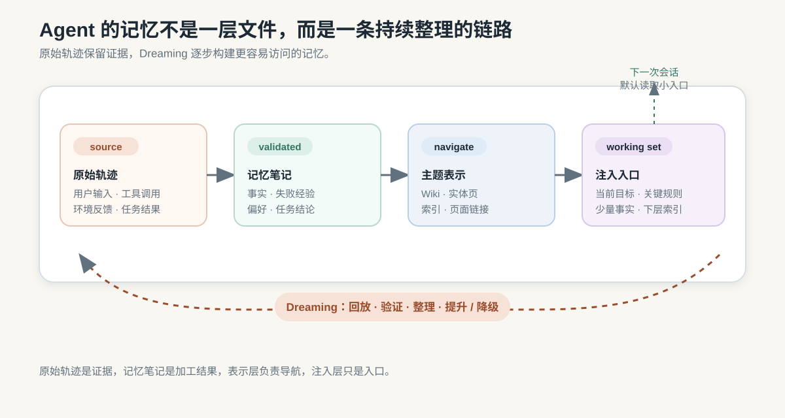
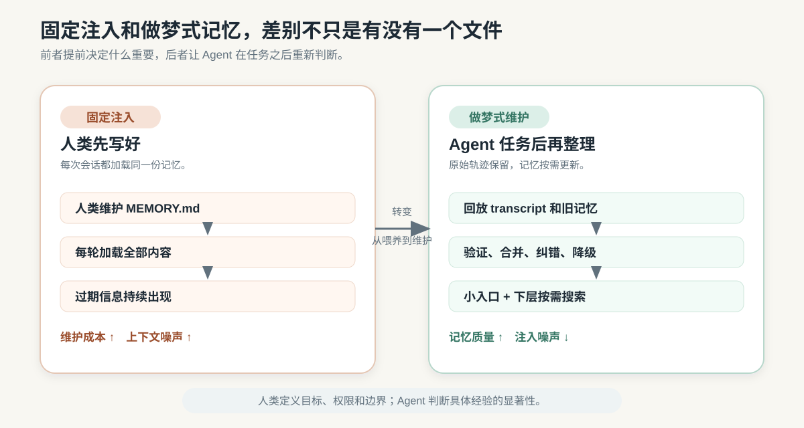
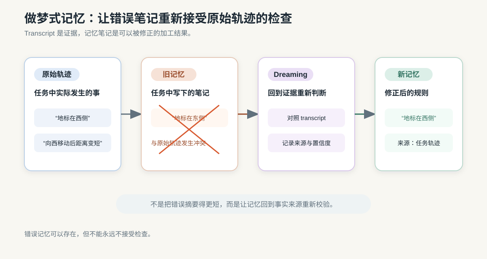
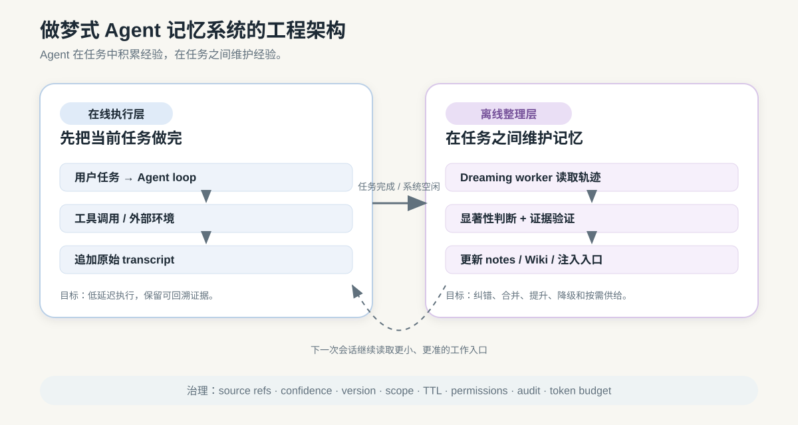

我最近读到 Anthropic 的一篇文章，它讨论的不是如何再接入一个向量数据库，也不是如何把上下文窗口做得更大，而是一个更基础的问题：**Agent 在完成任务之后，应该怎样整理自己的经历？**

我们现在给 Agent 配记忆，常常像给一个新员工发一份越来越长的交接文档。用户偏好、历史决定、工具结果、失败原因和各种操作规则，都可以继续往里面追加。每次启动时，再把这些内容固定塞进上下文，期待 Agent 下一次不要忘记。

这套方法当然有用，尤其是在原型阶段。问题是，记忆文件越长，并不代表 Agent 越懂。过期的偏好可能被当成当前事实，已经修正过的错误可能继续影响下一次任务，当前环境里随时可以读取的状态也可能被重复保存成长期记忆。

Anthropic 提出的 **dreaming**，让我觉得有意思的地方就在这里：它把 Agent 的工作分成了两段。Agent 正在执行任务时，优先把事情做完；任务结束或系统空闲时，再回头检查自己的工作轨迹，修正记忆、提炼经验、整理索引，并决定什么内容值得带到下一次任务里。

这不是让 Agent 获得了某种神秘的“睡眠意识”，而是给记忆系统增加了一段独立的维护时间。



## 一、Agent memory 不是一份更长的 MEMORY.md

先把几个容易混在一起的概念分开。

模型权重是训练阶段形成的能力和知识；当前上下文是模型这一轮推理能够看到的输入；会话压缩是为了让当前任务继续运行而对旧对话进行的压缩。它们都可能影响 Agent 的表现，但不等同于 Agent memory。

Anthropic 在文章中给出的定义更接近工程语境：**记忆是 Agent 从任务和交互中获得、并能够跨会话保留和再次使用的知识。** 这意味着，记忆不仅要“存下来”，还要能够在未来被找到、被验证、被更新，甚至被撤销。

我更愿意把它拆成四层。

### 1. 原始轨迹：Transcript

这是 Agent 做过什么的记录，包括用户输入、模型输出、工具调用、环境反馈和任务结果。它不一定适合直接喂给模型，但应该尽量作为可回溯的事实来源保留下来。

原始轨迹的价值，不是让模型每次都重新阅读一遍，而是在某条记忆出现争议时，能够回头确认：事情当时到底是怎么发生的。

### 2. 记忆笔记：Memory notes

这是从原始轨迹中提炼出来的事实、失败经验、用户偏好、任务结论和操作规则。它比原始日志更短，也更容易复用，但它已经是加工结果，不能自动等同于事实本身。

### 3. 表示层：Representations

当笔记越来越多，单纯的文件堆积会变得难以导航。Agent 可以进一步构建 Wiki、主题索引、实体页面和页面之间的链接，让记忆不只是“搜到一段文字”，还可以沿着结构找到相关内容。

### 4. 注入层：Injected context

这是下一次会话默认加载的那一小部分记忆。它应该像一个入口，而不是整个仓库。真正需要的细节，可以在任务进行时再按需检索。

所以，Agent memory 更像一条信息加工链：

```text
原始经历 → 记忆笔记 → 主题表示 → 小型注入入口
```

固定注入的问题，不在于“注入”本身，而在于很多系统把最后一层误当成了全部记忆。

## 二、固定喂记忆，为什么会越来越脆弱

固定注入的做法很直观：人类先判断哪些内容重要，写进一份文件，然后让每次会话都读取它。

它的问题主要有三个。

### 人类很难提前知道未来什么最重要

一条信息在刚产生时，往往还看不出长期价值。

一次工具调用失败，未来可能成为非常有用的避坑规则；一次看起来重要的偏好，也可能只是用户在某个临时任务中的表达。记忆的价值通常要等到未来任务再次出现时，才能被真正判断出来。

如果所有写入规则都在任务发生之前由人类规定，系统就很容易错过那些当时不显眼、后来却很有用的经验。

### 记忆会过期，也会互相冲突

用户偏好会改变，项目技术栈会更新，过去有效的解决方案也可能因为环境变化而失效。

只会追加、不做校验的记忆系统，最后一定会遇到冲突：旧偏好和新偏好同时存在，两个任务对同一个结论给出不同描述，某条早期笔记把临时猜测写成了长期事实。

这时，问题已经不是“有没有记住”，而是“应该相信哪一条”。

### 固定注入会放大错误和成本

一条过期记忆如果只留在下层存储里，影响可能还比较有限；但如果它进入顶部注入层，每一次会话都会重新读取它。

错误内容被重复带入，既消耗上下文预算，也会让模型在错误的前提上继续推理。上下文越长，重要信息越容易被无关内容淹没。



这并不意味着应该取消预加载记忆。更合理的做法，是把注入层控制成一个小型工作入口：放当前任务最可能需要的规则、少量稳定事实和通往下层记忆的索引，其他内容留在可搜索、可验证的地方。

## 三、做梦：把执行和记忆维护分成两段

Dreaming 最重要的不是“后台运行”这四个字，而是它改变了记忆的职责分工。

在线执行阶段，Agent 需要尽快完成当前任务。它可以记录事件、写入状态，必要时留下几条即时笔记，但不应该在每一步都停下来做一轮复杂的自我总结。

离线整理阶段，系统再用额外计算回看这些轨迹。这时 Agent 不再只问“下一步要做什么”，还可以问：

- 我刚才写下的这条记忆，真的被原始记录支持吗？
- 这次失败是偶然错误，还是可以复用的规律？
- 哪些内容只是当前任务状态，没必要长期保存？
- 哪些笔记属于同一个主题，应该合并成一个页面？
- 哪些经验应该被提升到下一次会话的入口？
- 哪些内容已经过期，或者只应该保留在冷存储里？

### 1. 纠正记忆

Agent 在任务中写错一条笔记并不奇怪。真正重要的是，系统有没有机会让它重新检查。

Anthropic 用一个地图导航任务说明了这一点：Agent 曾经错误记录了某个地标的位置，导致后续路线判断不断出错。离线整理时，它重新对照原始轨迹，发现笔记与事实不一致，然后修正了记忆。

这里有一个很重要的工程原则：**原始 transcript 是证据，记忆笔记是可被检查的推断。**



### 2. 从经历中提炼规则

记录“发生了什么”只是第一步。更有价值的记忆通常还要回答：为什么会这样，以后遇到类似情况应该怎么判断。

例如，Agent 不是简单记住“这次命令失败了”，而是尝试形成一条有边界的经验：

> 当项目使用某种配置方式，并且工具运行在某个环境中时，先检查某个条件；如果条件不满足，再执行后续操作。

这条规则是否值得长期保留，还需要看它有没有足够证据，是否在其他任务里被复用，是否已经被后续结果验证。

### 3. 构建更容易访问的表示

记忆的数量增加以后，继续创建孤立的 Markdown 文件并不能自动解决问题。Agent 还需要建立主题索引、实体页面、Wiki 和链接关系。

表示层的作用不是把原文再抄一遍，而是帮助 Agent 在需要时找到正确的入口。它可以告诉 Agent：某个主题有哪些相关经验，某条规则来自哪些任务，两个结论是否存在冲突，某个页面是否已经过期。

### 4. 提升、降级和淘汰

不是所有记忆都应该被固定加载。

长期稳定、频繁使用的规则，可以进入注入层；偶尔使用的历史案例，可以留在检索层；已经过期但仍有审计价值的记录，可以归档；没有复用价值的临时状态，则应该自然退出长期记忆。

这也是“做梦”和普通摘要压缩的区别。压缩只是在想办法让当前上下文变短，做梦则是在决定未来应该保留什么。

## 四、谁来判断什么值得记住？

这里有一个看起来有点反直觉的观点：**记忆其实是一种对未来的预测。**

当 Agent 把某次失败写成“以后都要先检查某个条件”，它是在预测未来还会遇到类似任务；当它把一段当前状态放进长期记忆，它也是在预测这段信息之后仍然有用。

所以，与其给 Agent 写一份过于具体的规则清单，不如给它一个更明确的目标：记忆要服务于什么任务，什么内容需要可验证，什么信息不能跨范围传播，哪些操作必须经过人工确认。

Anthropic 在文章中介绍了 CL-Bench 等评估。文章报告，在这些任务里，具备记忆能力的模型通常比无记忆基线表现更好；更强的模型还能够记录错误、提出假设、验证假设，再把验证过的结论沉淀为后续规则。文章也提到，强行规定 Agent“只能记录失败”可能会限制记忆效果，让模型自己判断显著性反而更有效。

这里的重点不是“模型永远比人类更会做决定”，而是：**人类不必提前规定每一次任务里到底应该写哪一句记忆。**

人类更适合负责边界，Agent 更适合负责在具体语境里判断显著性。

一条可以落地的记忆记录，至少应该带着这些信息：

```yaml
type: strategy | fact | episode | index
content: "在当前环境下，先检查配置来源，再执行工具调用。"
source_refs:
  - transcript-2026-11-22-0042
confidence: verified
scope: project
last_verified: 2026-11-22
goal: code-agent
status: active
```

这样做的目的不是把 Agent 变成一个表单填写器，而是为未来的冲突解决、版本管理和记忆回溯留下依据。

## 五、少记一点，反而可能走得更远

Anthropic 在 Pokémon 任务中给出了一个很直观的对照。

Sonnet 3.7 试图记录几乎所有可能有用的信息，最后写下了 413 个文件和 225 个文件夹。它确实积累了大量状态，但也开始花很多时间维护这些快速过期的内容。

另一个模型 Fable 5 只留下了少量文件，并用一个顶层 `global.md` 记录目标、计划和记忆规则。它没有努力保存每一个屏幕状态，而是更集中地保留策略和经过验证的经验。文章报告，在这项任务中，后者的表现更好。


这个案例最值得借鉴的地方，不是“文件越少越好”，而是它区分了两类信息。

### 可以随时从环境中读取的状态

例如：

- 当前地图位置；
- 当前血量或资源数量；
- 屏幕上已经显示出来的菜单；
- 当前任务系统能够直接查询到的字段。

这些信息不一定值得进入长期记忆。保存它们只会让记忆系统承担环境本来就能提供的工作。

### 需要从经验中提炼的策略

例如：

- 某个地点应该如何判断路线；
- 某类敌人适合什么战术；
- 某个操作失败时，哪些尝试可以直接跳过；
- 某个任务阶段应该优先保留什么资源。

这些才是 Agent 从经历中获得、而环境不会直接告诉它的内容。

所以，记忆不是“我见过什么”，而更像是“我从见过的事情里提炼出了什么”。

## 六、从笔记到 Wiki：记忆需要自己的表示层

如果 Agent 只会不断新增笔记，最终得到的可能只是一个更难搜索的文件垃圾场。

当记忆规模变大，系统还需要解决几个问题：

- 哪些笔记属于同一个主题？
- 哪些页面引用了同一份来源？
- 哪些结论互相冲突？
- 哪些页面只是重复了原始资料？
- 哪些链接已经失效？
- 哪些内容应该按实体、项目或时间重新组织？

这就是表示层的意义。Wiki、主题索引和实体页面并不是记忆本身，而是帮助 Agent 访问记忆的导航结构。

Anthropic 文章中的 Wiki 实验也说明了一个边界：当任务需要跨多个文档整合信息时，Wiki 和链接结构能够帮助 Agent 建立更好的全局视图；但如果答案直接存在于单个文档中，简单搜索可能已经足够，额外构建 Wiki 的收益就没有那么明显。

因此，不能把“构建 Wiki”当成一种固定流程。它应该取决于任务目标：

- 单文档查找，搜索可能更直接；
- 多文档比较，需要索引和主题页；
- 复杂领域探索，需要实体关系和多跳导航；
- 长期项目协作，需要把事实、决策和未解决问题分开维护。

文章还给了一个很有代表性的写入冲突案例。多个 Agent 最初同时把合同事实写入一张共享表格，互相覆盖之后，只保留了 41/57 条事实。调整为“每份合同单独建页，关键条款保留原文，再由共享页面做索引”之后，最终保留了全部 57 条事实。

这说明记忆体系不只需要“会总结”，还需要考虑写入边界和数据所有权。对重要事实来说，先保留来源级页面，再建立聚合索引，通常比所有 Agent 直接修改同一张总表更稳妥。

## 七、一个可落地的做梦式记忆架构

如果把前面的内容收束成一个工程方案，我会把系统拆成在线执行层、离线整理层和记忆存储层。



### 在线执行层：先把任务做完

在线阶段主要负责：

- 处理当前用户任务；
- 调用工具和外部环境；
- 更新当前任务状态；
- 写入原始 transcript；
- 在关键节点记录必要的事件。

这一层的目标是降低执行延迟，不需要每一步都做长篇反思。

### 离线整理层：在任务之间维护记忆

Dreaming worker 可以在会话结束、任务阶段完成或系统空闲时启动，读取最近的 transcript、旧记忆和已有表示，然后完成：

1. 找出可能具有长期价值的事件；
2. 检查旧记忆是否被原始记录支持；
3. 合并重复笔记；
4. 修正冲突和错误；
5. 把一次性状态和可复用经验分开；
6. 更新 Wiki、索引和实体页面；
7. 提升高价值内容，降级或归档过期内容；
8. 生成下一次会话需要的小型注入入口。

### 存储层：不同信息放在不同位置

可以先采用比较朴素的目录结构：

```text
transcripts/
  原始会话、工具日志、环境反馈

notes/
  已验证事实、失败经验、用户偏好、任务结论

representations/
  wiki、主题索引、实体页、链接关系

injected/
  当前会话默认加载的小型入口文件
```

重点不在于目录名字，而在于四层内容不要混成一个文件。

### 如何触发 dreaming

不建议简单地每隔固定时间全量整理。更合理的触发信号可以包括：

- 任务阶段刚刚结束；
- 某条记忆被频繁访问；
- 环境发生了明显变化；
- 多条记忆出现冲突；
- 长时间没有访问的记忆需要复核；
- 系统处于空闲状态，且有额外计算预算。

记忆变化快、访问频繁的部分，可以更快整理；长期稳定、很少访问的内容，则没有必要每次都重新生成。

## 八、做梦不是让模型随便写记忆

“让 Agent 自己整理”听起来很灵活，但它不是把所有写权限交给模型之后就结束了。

### 原始记录必须保留

如果只有整理后的笔记，没有原始 transcript，后续就很难判断某条记忆是事实、推断还是误解。

### 记忆需要来源和版本

一条长期记忆至少应该知道：它来自哪次任务，什么时候写入，最后一次什么时候被验证，属于哪个用户、项目或目标，当前是否已经被新的事实替代。

### 重要记忆不能无条件提升

不是所有“看起来像规则”的句子，都应该进入顶部注入层。高风险领域、权限信息、财务决策和不可逆操作，仍然需要更严格的验证，必要时保留人工确认。

### 表示层不能变成另一份全文副本

如果 Wiki 只是把原始文档重新抄一遍，它会带来额外存储和维护成本，却没有真正降低访问难度。表示层应该负责导航、关系和抽象，而不是把所有事实再复制一次。

### 记忆必须允许被删除

一个只会增长、不会遗忘的记忆系统，迟早会被过期信息污染。用户应该能够查看、修正和删除与自己有关的长期记忆；系统也应该支持 TTL、归档和版本回退。

所以，真正可靠的设计不是“让模型自由记忆”，而是：

> **让模型在明确的目标、证据、权限和成本边界内，自己判断什么值得被长期保留。**

## 结语：从“喂养 Agent”到“维护 Agent 的经验”

以前我们设计 Agent 记忆，关心的是：这一轮应该把哪些内容塞进上下文。

做梦式记忆把问题往后推了一步：任务完成以后，这些经历应该怎样被重新检查、重新组织，才能在未来真正派上用场？

这套思路的重点，不是让 Agent 像人一样睡觉，也不是让模型凭空获得自我意识。它更像是在 Agent 的运行周期里增加了一段独立的记忆维护时间：

- Agent 在工作时解决问题；
- 系统在后台保存原始轨迹；
- Agent 在空闲时整理经验；
- 记忆通过验证、重组和分层进入未来任务；
- 人类负责定义边界、目标和风险控制。

最终，我们要构建的可能不再是一份写死的 `MEMORY.md`，而是一套会变化、会纠错、会调整层级的记忆系统。

从“给 Agent 喂什么”转向“Agent 如何维护自己的经验”，这才是做梦式记忆真正有价值的地方。


