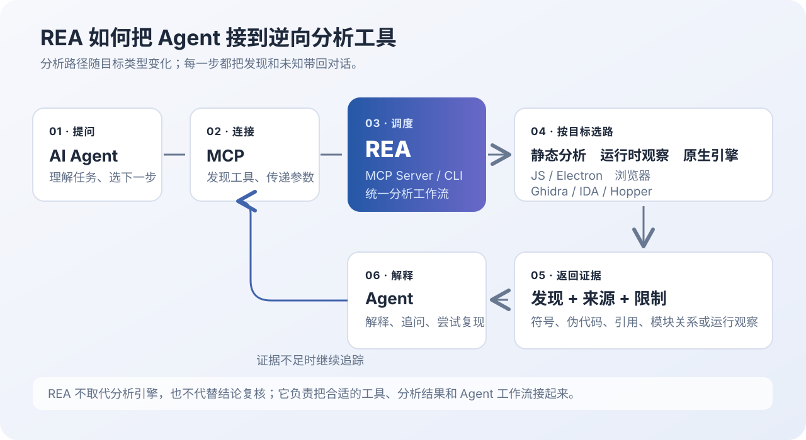
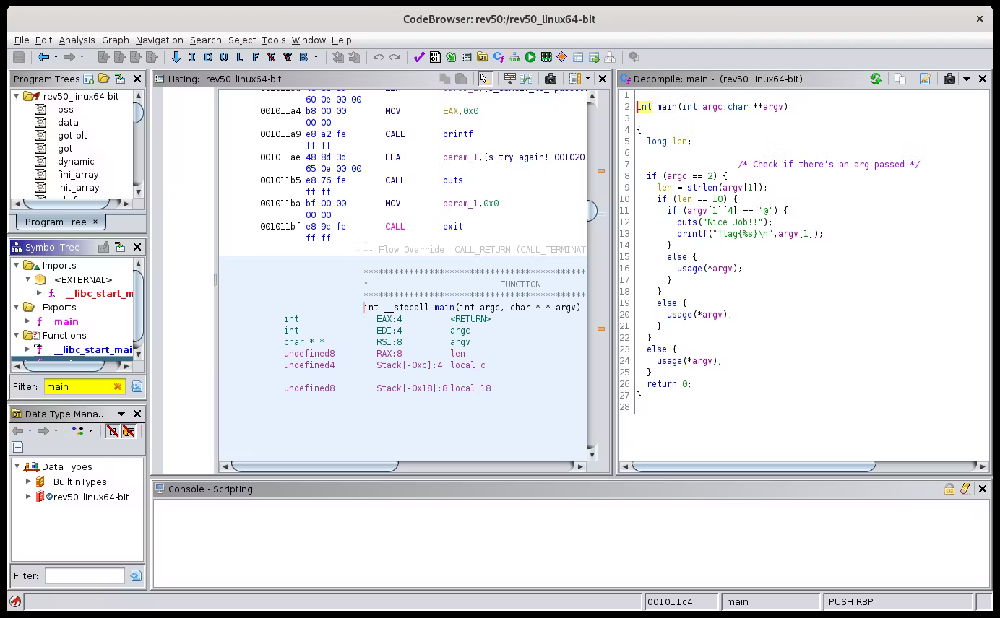
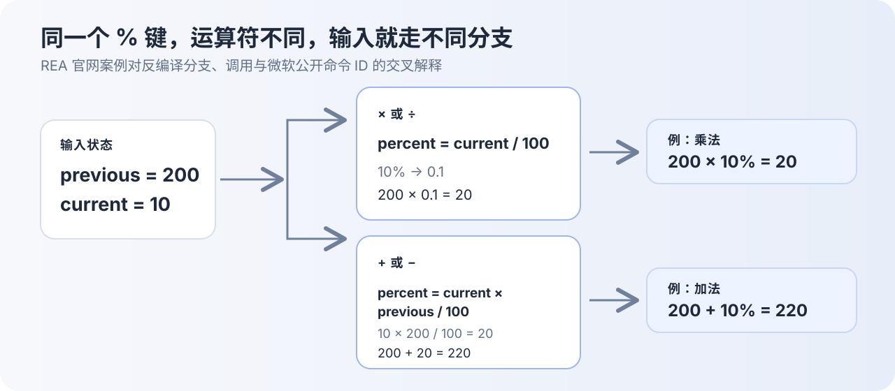

## 01. 前言：GitHub 爆火的 REA 到底是什么？

看到一款软件有个方便的小功能，想知道它具体怎么实现，却找不到源码——你会从哪里开始？网页还能借助开发者工具；桌面应用或二进制程序的线索，则散落在打包文件、反汇编和运行行为里。理解它们，需要知道该用什么工具、追哪些调用，以及结论有没有证据支持。

最近在 GitHub 上受到大量关注的 REA，正是冲着这个问题来的。截至 2026 年 10 月 31 日，官方仓库页面显示约 41.3 万颗 stars（页面显示 412.6k）；这个数字会继续变化，只能说明项目受到关注，不代表每种分析都准确或适用。[REA 仓库](https://github.com/morluto/rea)把自己定位为面向 AI Coding Agent 的逆向工程工具层：你用自然语言描述想弄明白的功能，Agent 再通过 REA 调用合适的分析工具，逐步找出证据、解释行为，必要时尝试重建。

这篇文章会回答三个问题：REA 到底是什么，它怎样把 Agent 和逆向工具接起来，以及如何安装并读懂一个真实案例。先把边界说在前面：REA 可以帮助你理解编译后的程序，却不能凭空还原作者当初写下的完整源码。

## 02. REA 是什么？它能做什么？

REA 是 **Reverse Engineer Anything** 的缩写，意思是“逆向分析任何软件”。它不是一种新的通用反编译器，而是面向 AI Agent 的逆向分析工具层。Agent 理解问题并规划步骤，REA 通过 MCP 或 CLI 调用分析工作流，再把伪代码、汇编、符号、引用、模块图或运行时观察等证据交回。[官方 README](https://github.com/morluto/rea)提供了这两种入口。

它能做的事，要按目标类型来看。原生二进制可交给 Ghidra、Hopper、IDA 或 Kuna 等 Provider，读取汇编、伪代码、字符串、符号和函数引用；JavaScript 或 Electron 包可以提取模块、导入、路由、IPC 和 Native Addon 关系；网站分析可以检查页面结构、脚本和网络活动；.NET、Android APK、固件等也有各自的静态分析流程。每条路径的前置条件并不相同：例如 Android APK 反编译需要 JADX 和 JDK，网站的运行观察需要 Chrome 系浏览器，静态 JavaScript 分析则不要求安装原生反编译器。

| 分析对象 | 常见结果 | 依赖与边界 |
| --- | --- | --- |
| 原生二进制 | 汇编、伪代码、字符串、符号、调用和交叉引用 | 需配置与目标匹配的 Ghidra、Hopper、IDA 或 Kuna Provider |
| JavaScript / Electron | 模块、导入、Source Map、路由、IPC 与应用关系图 | 静态分析不需原生引擎；目标可以是解包目录或 ASAR |
| 网站 / 浏览器 | 页面结构、脚本、网络观察、按需截图 | 运行时观察需要 Chrome 系浏览器及目标访问条件 |
| .NET / Android APK | 程序集元数据、CIL、方法引用或 APK 反编译结果 | .NET 静态读取可不依赖额外引擎；APK 反编译需 JADX 和 JDK |
| 固件及其他格式 | 视格式提取资源、布局信息或分析线索 | 通常依赖特定操作系统、解析器或调用方已有工具 |

简单区分：**Ghidra、IDA 负责分析程序；REA 负责让 Agent 组织并调用分析工具。**[Ghidra](https://github.com/NationalSecurityAgency/ghidra)是 NSA 开源的逆向工程框架，[IDA Pro](https://hex-rays.com/ida-pro)是 Hex-Rays 的反汇编、反编译与调试产品。REA 并不取代它们，也不是给所有输入文件套一个按钮就能生成源码。

反编译器根据机器码推测伪代码，变量名、类型和源文件结构可能丢失；编译优化、混淆、动态加载也会降低可读性。REA 的价值在于保留线索之间的关系，让 Agent 能继续追问“是谁调用它”“哪个条件进入这条分支”“这个模块如何到达界面按钮”。最终输出仍然是基于证据的解释与重建，不是作者当年写下的完整原始工程。

## 03. 核心原理：REA 是如何工作的？

### 3.1 整体架构

可以把一次 REA 分析理解为几层之间的协作：

关键是 Agent 获得了可逐步调用的专业工具。REA 把目标选择、分析器启动和结果整理串起来：打包后的 JavaScript 可以先看模块关系；原生程序则交由 Ghidra、Hopper、IDA 等分析。

架构里几个名字容易混在一起。Claude Code、Codex 或 Cursor 是 Agent 所在的应用，也就是 MCP 里的 Host；Host 中的 MCP Client 负责发现并调用服务端工具；REA 以 MCP Server 形式提供分析工作流。底层的 Ghidra、IDA 或浏览器并不是 MCP 本身，它们由 REA 按具体操作启动或连接。换句话说，MCP 负责“怎么请求工具”，REA 负责“把什么工具怎样组合起来”，分析引擎负责“从目标中取出什么证据”。

如果目标是已解包的 JavaScript 目录，REA 可以只读取静态文件并构建模块关系；如果问题涉及网站点击后的网络请求，就要有浏览器观察；如果关键规则藏在原生 DLL 的函数里，才需要对应的原生 Provider。这些不是同一条必经流水线，Agent 应按问题挑选路径，而不是每种分析都先启动 Ghidra。

### 3.2 一次完整的逆向分析流程

1. **把问题说具体。**提供目标目录或文件、版本、入口操作和一组输入输出。比如“搜索功能怎么做”太宽；“在搜索框输入大小写不同的同一个关键词时，哪些模块被调用、结果如何排序”更容易定位。
2. **Agent 通过 MCP 发现并调用 REA。**[MCP 架构](https://modelcontextprotocol.io/docs/learn/architecture)把 Host、Client 和 Server 分开：AI 应用是 Host，Client 负责与服务端建立连接并执行工具调用，REA Server 则公开可用工具及其参数约定。MCP 不规定模型怎么推理，也不替它决定目标函数。
3. **REA 按目标选分析路径。**静态 JavaScript 分析读取打包代码和模块关系；原生二进制调用已配置的分析引擎；网站或程序运行行为则需要相应的浏览器、进程或运行时观察。执行动态工作流时，工具会在当前用户权限和环境下运行或交互目标，所以需要把它当作实际程序运行来管理。
4. **分析器返回证据，而不是只给一句结论。**结果可能包含目标身份、模块图、调用地址、条件分支、字符串、交叉引用、伪代码、运行观察、覆盖范围、限制和未知项。一个字段的来源决定了它能支持多强的结论：静态解析到函数调用，不等于这条调用在用户刚才的操作中确实发生。
5. **Agent 沿证据继续追问。**如果看到一个可疑函数，它可以查询调用者、被调用函数或符号映射；如果模块关系不够清楚，可以沿字符串、路由或 IPC 通道追踪。之后还可以用另一种输入路径交叉检查，或拿运行时观察和静态图做对照。
6. **人检查解释，再决定是否重建。**Agent 可以把反编译结果解释成规则，也能写出相似实现；但代码是否等价，要用边界输入和目标版本检验。问题越重要，越应该把“工具证明了什么”“Agent 推断了什么”“仍未知什么”分别记下来。

### 3.3 三项关键技术

**MCP：标准化工具接口。**MCP 让 Agent 以统一方式发现工具、读取参数 schema 并传递结果，减少每个模型和每种分析工具之间重复对接的工作。以 REA 为例，Agent 不需要把 Ghidra 的脚本接口、网页脚本解析和 Node CLI 都硬编码进自己的提示词里；它只需看当前可用的工具，再提交目标路径、函数标识等参数。MCP 自己不反编译，也不判断某条伪代码是否可信。REA 还提供 CLI，让同一类分析脱离对话直接运行；两种入口复用工作流，但 CLI 一次运行的证据需要自行保存，方便后续查看。

**静态分析与动态分析：看程序文件，也看运行行为。**静态分析不运行目标，检查二进制、脚本或程序集；动态分析在程序运行时观察调用、数据变化、网络请求或界面行为。两种方式回答的问题不同：静态分析可以告诉我们“代码里存在这条分支”，但不能单凭它证明用户这次输入走过分支；动态观察可以看到某个场景里的调用，却不保证覆盖其他状态。

| 对比点 | 静态分析 | 动态分析 |
| --- | --- | --- |
| 输入 | 可执行文件、脚本、程序集、ASAR 等 | 正在运行的程序、浏览器连接或已录制会话 |
| 适合回答 | 有哪些模块、函数引用和条件分支？ | 这次操作实际调用了什么、发出什么请求？ |
| 容易遗漏 | 运行时拼接代码、动态加载、输入相关行为 | 未触发路径、环境差异、分析器自身观测盲区 |
| 常见成本 | 处理混淆、优化和缺失符号 | 启动目标、准备账号数据、复现并控制场景 |

有时先静态找候选函数，再用动态场景验证，结论会更有支撑；有时静态结构已经足够，运行目标只会带来额外成本。选哪种，取决于问题本身。

**Agent 工具调用与迭代推理：从碎片线索到功能。**流程类似“发现地址—看汇编—追调用—查符号”，只是由自然语言问题触发工具调用，再由模型总结结果、提出下一步。第一轮分析通常不能独立给出全部答案：若只得到一个无名函数地址，下一轮就要追它的调用者；若发现 `search` 字符串，还要确认它是 UI 标签、代码标识，还是无关文本。这个逐步缩小范围的过程，就是 Agent 工具调用的价值所在。

但“会调用工具”不等于“推理一定正确”。模型可能把邻近的伪代码误当成目标逻辑，也可能根据常见实现方式补出工具没有观察到的细节。因此较好的回答会分清三层：分析器直接返回的证据、Agent 从证据推导出的解释、当前结果还无法确认的部分。读者也可以针对每条推论继续要求模块位置、调用链或原始指令。

### 3.4 REA 与传统逆向工具的区别

| 维度 | 传统人工分析 | Agent + REA |
| --- | --- | --- |
| 操作方式 | 人在多个 GUI、脚本和调试器之间切换 | 用自然语言提问，Agent 调用统一工作流 |
| 分析效率 | 工具熟练度高时很灵活，重复追踪需手动完成 | 可快速整理重复线索并接续追问，环境配置仍需时间 |
| 准确性 | 由分析者经验和证据判断 | 仍依赖底层分析质量；模型可能误读伪代码，需人工复核 |
| 使用门槛 | 要熟悉指令集、工具和分析流程 | 入口更易上手，但复杂目标仍需要逆向知识 |

两种方式的差异更多在交互与工作流，不在“谁天生更准确”。熟悉 IDA 或 Ghidra 的分析者仍能直接精细控制分析环境；REA 让 Agent 接手文件清点、结果串联、调用关系追踪和重复解释等工作。遇到符号缺失、混淆严重或需要判断程序实际行为时，人工仍需回到分析引擎或准备更可靠的运行环境。

REA 更像“懂得如何使用工具的助手”，而非逆向工程师的替代品。自然语言降低了起步门槛，证据审查决定结论可信度。

## 04. 快速上手：5 分钟了解 REA 的基本用法

如果 Node.js 和编码 Agent 已就绪，接入可以很快；首次安装及原生分析器配置另计。**REA 官方 README 当前列出的 Node.js 版本为 22.23.4 及以上、24.22.1 及以上，或 26.12.1 及以上，并需要 npm。**安装器支持 Claude Code、Codex、Cursor 等 Agent。[官方快速开始](https://rea.tools/)要求先审阅并批准配置计划，再重启 Agent；Node.js 版本要求见[官方 README](https://github.com/morluto/rea#quick-start)。

### 4.1 安装并配置 Agent

在终端运行：

~~~bash
npx rea-agents@latest setup
~~~

按提示选择 Agent，检查安装计划并批准。安装过程会登记 REA 的 MCP Server 和工作流说明；完成后重启 Agent，让新工具被重新发现。批准前先检查将被修改的配置。

如果 Agent 仍看不到工具，先确认 `setup` 修改的是当前 Agent 正在读取的配置，再检查 Node.js 版本和 MCP 启动错误。重复运行安装命令并不一定能解决问题：配置写到了另一个用户目录、Agent 未重启或 MCP 进程启动失败，都会导致工具列表为空。

分析原生二进制时，还需要按目标配置 Ghidra、Hopper、IDA 或其他支持的分析 Provider。**若先分析 JavaScript 或 Electron 应用，静态分析不要求先装 Ghidra。**这让初次试用可以从较简单、依赖较少的目标开始。

### 4.2 用自然语言提出任务

给 Agent 一个具体目标，例如：

~~~text
使用 REA 分析这个 JavaScript 应用，
找出搜索功能的实现逻辑，
给出相关模块、调用关系和代码证据。
~~~

补充应用目录、版本、入口和一组搜索输入；Electron 程序还应说明是解包目录还是 ASAR。拿到结果后，先检查证据，再让 Agent 解释数据流。

### 4.3 直接通过 CLI 分析

不经由 Agent 对话，也可在终端执行官方提供的 JavaScript 应用分析命令：

~~~bash
npx -y rea-agents@latest analyze-javascript-application "/absolute/path/to/app" --json
~~~

Windows 路径可写为类似 `D:/apps/example` 的形式。JSON 结果会列出模块、导入关系、适用时的 Electron 边界以及相应证据；这不是完整源代码的导出。使用 CLI 时同样要检查目标路径，并依据实际输出判断依赖是否解析成功。分析原生二进制时应先完成 Provider 配置，再查阅相应的 CLI 工作流文档。

### 4.4 怎么读 CLI 的输出

`--json` 代表返回结构化证据，方便脚本或其他工具继续处理，不代表结果一定短小。完整 JavaScript 应用图可能包含大量模块、导入关系和来源位置；实际项目很大时，建议先保存结果，再查看摘要或挑选相关模块，不要把几百 MB 的 JSON 直接塞进 Agent 对话。

阅读时可以按这个顺序：

1. **先看目标身份。**核对分析的是你给出的目录或 ASAR，以及目标应用是否识别正确。
2. **看统计和覆盖。**检查解析了多少脚本、是否有失败项、有没有文件被排除；未覆盖区域意味着关系图也不完整。
3. **顺着模块关系找入口。**从页面路由、导出函数、Electron IPC 或用户可见字符串开始，沿引用跳到相邻模块。
4. **核对源位置和限制。**观察具体文件路径、行号或模块标识，再看 unresolved、unknown、limitations 等字段说明哪些关系没有被确认。

在 Agent 里可以把路径和关心的行为一起描述。比如：

~~~text
先分析这个 Electron ASAR 的静态模块关系。
从设置页面的“导出”按钮开始，追到 IPC handler 和文件写入函数。
请引用模块路径和代码证据；如果通道名是动态生成的，请标明未知，不要猜。
~~~

这比“总结一下这个 app”更容易得到能复核的调用链。REA 的当前文档还提醒，完整应用证据可能非常大，适合先保存证据再按需取摘要或模块视图。[JavaScript / Electron 分析指南](https://rea.tools/guides/javascript/)给出了 Electron IPC 追踪的完整示例。

## 05. 实战案例：REA 怎样解释计算器里的 10%？

REA 官网展示了一个很适合观察“从机器码到行为规则”的案例：在 Windows 计算器中输入 `200 + 10%`，结果为什么是 220？这里复述的是 [REA 官网公布的分析过程](https://rea.tools/)，不是本文在本机重新安装和运行后得到的实测结论。官网标注这次检查使用 REA 4.1.0 和 Windows Calculator 11.2508.4.0（x64），换版本时仍应重新确认行为。

### 第一步：从一个行为问题开始

官网给 Agent 的问题是：“用 REA 检查 Windows 计算器，为什么 `200 + 10%` 会得到 220？”它先启动计算器并定位安装程序打开的 `ms-calculator:` 路径，再选择相关 DLL 作为待分析文件。这样做的原因是，用户操作入口和百分号的核心计算未必写在同一个文件里：界面负责接收按键，实际计算逻辑可能位于程序调用的库中。

### 第二步：把分支和调用地址变成含义

反汇编窗口里首先看到的是类似 `0x180124945` 的地址和条件跳转。单看地址并不能知道它代表什么。REA 官网展示的过程先看函数从操作数状态里读取运算符，再对 `0x5C` 和 `0x5B` 做比较；这两个值对应微软公开代码里的乘法与除法命令 ID。两条跳转汇入同一处处理逻辑，说明乘法和除法走“先把当前数除以 100”的分支。

下一段里出现 `0x64`，也就是十进制的 100。仅看到这个常数还不能证明它就是百分号计算的除数，所以还需要继续追踪调用：一个辅助函数的反编译与符号信息表明它执行除法；另一个路径则把当前数和前一个数送进运算函数。这个“常量 + 参数流向 + 被调函数”的组合，才足以说明计算器不是随便在某处用了数字 100。

把这些片段连起来，Agent 才能提出更具体的解释：百分号处理逻辑先判断当前运算符，再用不同公式处理。根据官网给出的可读摘要，核心规则可以简化为：

~~~javascript
function percentValue(current, previous, operation) {
  if (operation === "*" || operation === "/") {
    return current / 100;
  }
  return current * previous / 100;
}
~~~

其中 `current` 是刚输入的数，`previous` 是前一个数。这个摘要不是程序原始源码，而是把反编译分支、调用和符号证据整理成便于理解的规则。Agent 还会用微软公开代码中的命令 ID 核对它对 `0x5B` 和 `0x5C` 的解释；否则，即使伪代码看起来像“乘法分支”，也可能因为操作符编号猜错而把公式对应反。

### 第三步：用两种运算核对解释

加法场景中，`previous = 200`、`current = 10`，运算符是加号：

~~~text
10 × 200 ÷ 100 = 20
200 + 20 = 220
~~~

乘法场景采用另一条规则：先将右侧 10% 转成 0.1，再算 `200 × 0.1 = 20`。百分号的含义随运算符变化。REA 官网的演示还检查了加法与乘法两条路径，并用微软公开代码中的符号名称核对分支。

这个案例展示了 Agent 逆向的价值：把指令线索转成可解释的规则，并据此写小型复现。但一个公式仍不是完整的计算器。要声称兼容，还得检查减法的符号、除法的运算顺序、连续输入时 previous 如何更新、浮点数舍入、清零或撤销等状态变化。

### 如果把同一流程用在自己的搜索功能

要练习从 JavaScript 模块图追一条 UI 功能，可以自己准备一个很小的待办列表页面。下面的代码只是一个用于说明分析目标的教学样例，不是 REA 的实测输出：

~~~javascript
function searchItems(items, query) {
  const keyword = query.trim().toLocaleLowerCase();
  if (!keyword) return items;

  return items.filter((item) => {
    const title = item.title.toLocaleLowerCase();
    const tags = item.tags.join(" ").toLocaleLowerCase();
    return title.includes(keyword) || tags.includes(keyword);
  });
}

searchInput.addEventListener("input", (event) => {
  const results = searchItems(items, event.currentTarget.value);
  renderResults(results);
});
~~~

把构建后的目录或测试 ASAR 交给 REA 后，可以让 Agent 从 `searchInput` 的 `input` 事件开始，依次确认事件处理器如何读取输入、`searchItems` 如何规范化关键词、哪些字段参与筛选，最后结果又交给谁渲染。若 bundle 有多个 chunk，检查入口模块与导入关系会比只对着一个压缩后的长文件搜索 `includes` 更有帮助。

接着要求 Agent 把分析结果和输入测试连起来：空字符串是否返回全部项目？大小写不同的关键词是否等价？关键词命中标题和标签是否一致？完全没有命中时 UI 显示什么？再让它实现一个独立的 `searchItems`，用相同的输入表跑原实现与新实现，比较结果顺序和内容。这一步才是在验证“看懂实现”是否变成了“行为一致”。对真实应用而言，还可能有防抖、拼音、权限过滤和分页逻辑，静态模块图不会自动替你决定哪些规则属于需求。

在自己的项目练习时，最好只选小型、可丢弃的数据样例，把“期望结果”先写下来，再检查 REA 给出的证据。这样既能知道工具是否读对路径，也能及时发现 Agent 是否把推测写成事实。

## 06. REA 的优势、局限与适用场景

REA 的优势是把自然语言任务、MCP 调用、专业分析器和证据整理接在一起。面对遗留软件、兼容性研究、安全审计、技术学习或功能复现，它能减少在多个工具间搬运线索的成本；同一工作流还可通过 CLI 脚本化。初次接触时，可以从静态 JavaScript 分析这类依赖较少的目标开始，再逐步接触 Electron IPC、网站运行观察或原生函数分析。

限制也很明确：底层分析工具可能没装、目标格式不受当前 Provider 支持，或者其商业许可不允许你的使用方式；编译优化、混淆和动态加载会让反编译结果失真；Agent 可能对不完整证据做出过度解释。复杂工程还可能产生非常大的证据文件，读取与传递也要控制范围。涉及关键判断时，要回到具体指令、交叉引用、输入输出和多组测试，必要时让熟悉逆向的人复核。

还要留意授权和数据边界。只对自己有权研究的软件开展分析，并确认适用的许可条款。REA 官方说明分析在本地进行，但 Agent 会拿到工具结果；如果 Agent 使用云端模型，返回的代码片段、路径或分析证据仍可能按 Agent 和模型提供方的配置进行传输与处理。敏感目标应先检查相应隐私设置和数据政策，必要时使用隔离的本地模型。

## 07. 总结：REA 给软件开发带来了什么？

REA 把 AI Coding Agent、MCP、逆向分析工作流和 Ghidra、IDA 等底层工具连起来，让开发者可以从自然语言问题出发，逐步追踪程序结构与运行规则。它降低的是发起分析、串联线索和解释证据的门槛，并不会消除分析工具的限制，也不会让不确定的伪代码自动变成可靠结论。

AI Agent 不仅可以帮我们写新代码，也开始协助阅读缺少文档或源码的既有软件。值得期待的是工具提供更清楚的证据，Agent 将其组织成可复查的解释，人再据此判断。

同时也启示我们，AI 时代下的代码版权安全开始受到冲击，未来的闭源商业软件形态很可能会发生新的变化来应对此问题。
