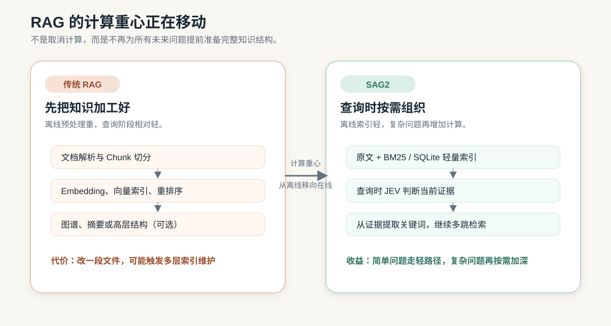
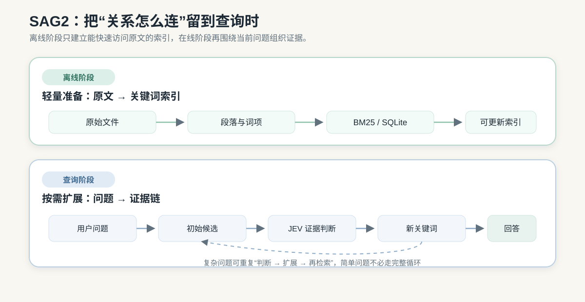
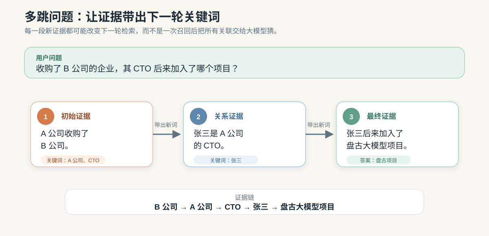
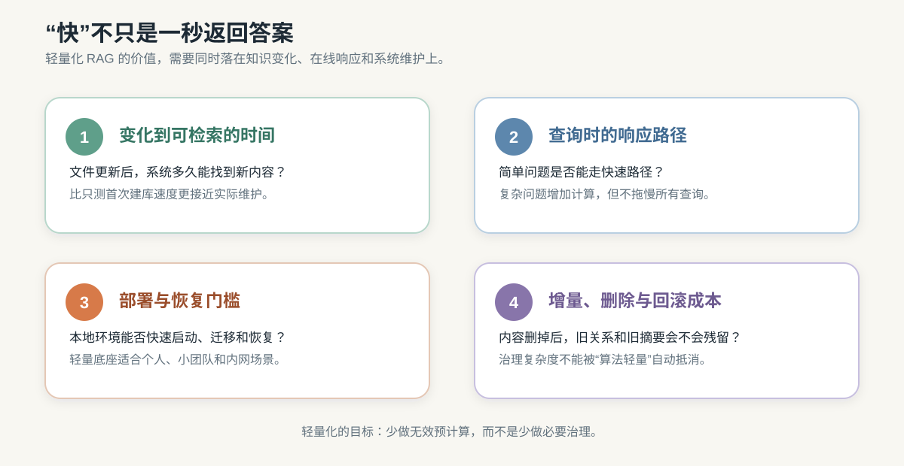
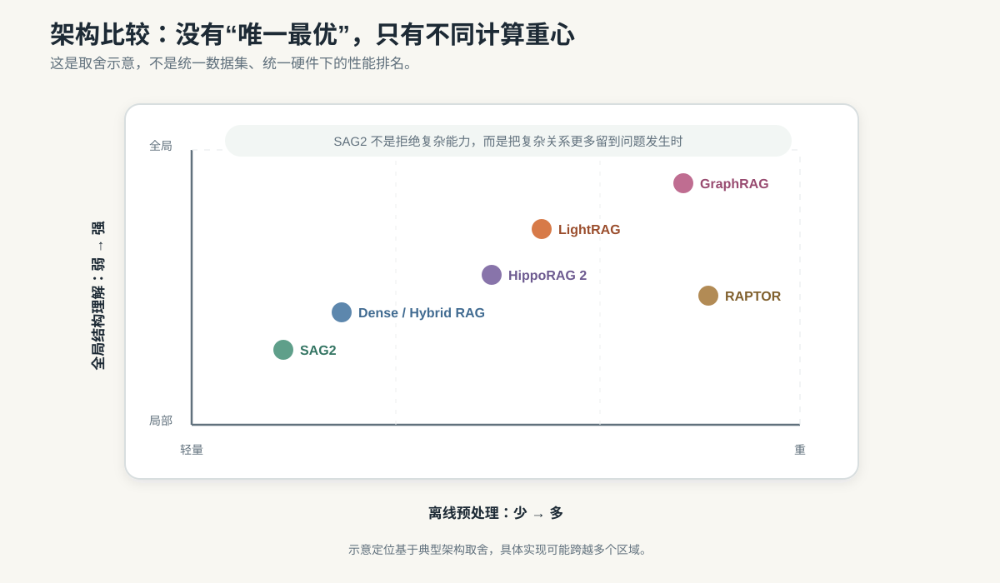
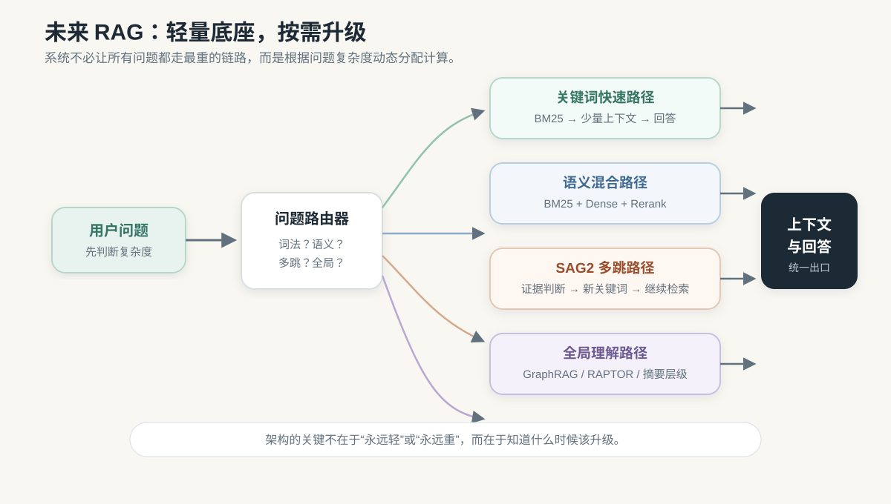

最近读到一篇介绍 SAG2 的文章，标题很有冲击力：**RAG 这次真死了**。

“死了”当然是一个很适合传播的说法，但它没有说清楚真正发生了什么。RAG 并没有消失，向量检索、混合检索和重排序仍然是大量知识问答系统的基础。真正值得讨论的是：RAG 为什么越做越重，以及 SAG2 为什么选择了一条相反的路。

我的判断是，SAG2 的意义不只在于某个数据集上的指标，也不只在于它能不能替代某一种向量数据库。它更像是一个方向信号：**未来的 RAG 必须同时变得更轻、更快、更容易更新，并且只在问题真正需要时才调用更重的计算。**

这里的“轻”不是功能变少，而是少做一些无效的提前准备；这里的“快”也不只是接口返回快，还包括文件更新快、索引恢复快、部署启动快，以及系统在本地环境中能够真正运行起来。



## 一、RAG 为什么越做越重？

RAG 最初的思路很简单：把外部资料找出来，放到上下文里，再让模型基于这些资料回答问题。

真正落地之后，链路很快变成了另一副样子：

```text
文档解析
→ Chunk 切分
→ Embedding
→ 向量索引
→ 用户查询
→ 向量召回
→ 混合检索或 Rerank
→ 上下文组装
→ 大模型生成
```

每增加一层，系统通常都会得到一些新的能力。

Embedding 可以处理同义表达；BM25 可以补足错误码、版本号和专有名词的精确匹配；Rerank 可以把粗召回结果重新排序；GraphRAG 试图把实体和关系提前组织起来；RAPTOR 则通过递归聚类和摘要构建多层知识结构。

问题在于，能力增加的同时，很多计算也被提前堆到了建库阶段。

一份 PDF 进来，系统可能要先解析版面、恢复标题层级、切分 Chunk、计算向量，再写入索引。文件改了一段，受影响的向量需要更新；如果系统还维护知识图谱或摘要树，实体关系、社区摘要和高层节点也可能需要重新计算。

这些工作不一定没有价值。对于稳定的大型语料库，提前把知识加工好，确实可以换取更快的查询。但很多个人知识库、小团队资料库和企业内部文档并不是静态数据。它们会不断新增、修改和删除，真正让人疲惫的往往不是第一次建库，而是之后的维护。

于是，一个值得重新问的问题出现了：

> 我们是否真的需要在用户提问之前，把所有可能用到的知识都提前加工一遍？

## 二、SAG2 的关键变化：把计算放到查询时

SAG2 给出的答案不是“完全不要计算”，而是把计算重心换了一个位置。

传统 RAG 更像是：

```text
离线多计算，查询少计算
```

SAG2 更接近：

```text
离线少计算，查询时按需判断
```

先把三个容易混淆的名字分开。

- **SAG** 是较早一代的架构，核心思路是让模型抽取事项和实体，再通过 SQL 串联线索。
- **SAG2** 是本文讨论的检索架构，重点是尽量取消离线阶段的重型语义预处理。
- **SAG-Wiki** 是基于 SAG2 的桌面知识库应用，负责文件夹接入、索引、问答和引用展示。

SAG2 的论文将它描述为一种基于关键词索引、BM25、JEV 和查询时动态关联的多跳检索方法。它不提前为所有段落计算 Embedding，也不提前构建一张完整的全局知识图谱，而是在用户真正提问时，逐步组织当前问题所需要的证据关系。

这里还要澄清一个容易被误解的地方：**不做 Embedding，不等于完全不需要模型。** 索引阶段可以不调用模型，但查询阶段仍然可能使用 JEV 判断候选证据，最终回答也可以调用独立的问答模型。SAG-Wiki 官方仓库还提供了本地 Jev 服务的配置方式，因此“本地知识库”和“全链路离线”也不是同一个概念。



## 三、SAG2 是怎么工作的？

SAG2 的工作过程可以拆成两个阶段。

### 1. 离线阶段：建立轻量索引

离线阶段主要做几件朴素的事情：

- 读取原始文件。
- 将内容整理成可以检索的段落。
- 基于关键词建立 BM25 索引。
- 将索引和原始内容保存到轻量存储中。

它不需要提前把每段文本都转成向量，也不需要调用大模型把所有实体、事件和关系抽取出来。文件仍然需要被解析和建立索引，但这和“先把整个知识库编译成一张复杂图谱”是两种完全不同的工程负担。

### 2. 在线阶段：让证据带出下一步线索

用户提问后，SAG2 不只是拿问题做一次相似度检索，而是尝试让检索过程自己向前走：

1. 从问题中找到初始关键词。
2. 用 BM25 找到候选段落。
3. 让 JEV 判断哪些段落是真正有用的证据。
4. 从有效段落中找出新的关键词。
5. 用新的关键词继续搜索。
6. 重复这个过程，直到证据链足够完整。

所以，SAG2 的关键不是“关键词搜索比向量搜索更先进”，而是：**当前检索结果可以成为下一轮检索的输入。**

### 3. 用一个多跳问题看懂它

假设知识库中有三份文档：

```text
文档 1：A 公司全资收购了 B 公司。
文档 2：张三被任命为 A 公司的 CTO。
文档 3：张三后来加入了盘古大模型项目。
```

用户的问题是：

> 收购了 B 公司的企业，其 CTO 后来加入了哪个项目？

如果只做一次相似度检索，系统可能只能找到文档 1 或文档 2。SAG2 的检索过程则可以是：

```text
收购、B 公司
    ↓
A 公司收购 B 公司
    ↓
A 公司、CTO
    ↓
张三是 A 公司的 CTO
    ↓
张三
    ↓
张三加入盘古大模型项目
```

每找到一段证据，就从这段证据中获得下一轮关键词。最终答案并不是来自某个单独的 Chunk，而是来自一条可以回到原文的证据链。



## 四、为什么轻量化会成为 RAG 的下一阶段？

我认为，SAG2 最值得讨论的地方，并不是它提出了一个新的关键词算法，而是它回应了 RAG 当前越来越明显的工程矛盾。

### 1. 知识变化速度，正在超过索引变化速度

企业制度、代码仓库、产品文档、会议记录和个人资料都在变化。

如果每次文件变更都要重新切块、重新向量化、重新抽取关系、重新生成摘要，那么系统的主要成本就不再是回答问题，而是追赶知识变化。

未来评价一个 RAG 系统，不能只看 Recall、准确率和回答质量，还应该看这些指标：

- 文件变化后多久可以被检索到。
- 增量更新需要多少计算资源。
- 删除和回滚是否简单。
- 索引损坏后能否快速恢复。
- 新用户能否在本地快速部署。

从这个角度看，轻量索引不是“退回传统搜索”，而是让知识系统重新获得可维护性。

### 2. 不是每个问题都需要一张完整知识图谱

很多问题只需要找到几段原文，或者沿着两三跳线索追下去。为了这些问题，提前为整个知识库建立完整实体关系图，可能会产生大量没有被使用的预计算结果。

SAG2 的思路是：只有在用户真正提出复杂问题时，系统才为这个问题临时组织需要的关系。

这就是按需计算的价值。简单问题走简单路径，复杂问题才增加检索轮次。计算不再平均摊到所有文档上，而是根据问题复杂度动态分配。

### 3. 本地知识库需要更低的基础设施门槛

未来的 RAG 不会只存在于云端企业平台，也会运行在个人电脑、开发者工作站、小团队服务器和隐私敏感的内网环境里。

这些场景不一定需要向量数据库集群、图数据库和完整的分布式索引服务，但需要：

- 文件放进去就能用。
- 更新后很快可以查询。
- 系统启动和恢复足够快。
- 数据尽量留在本地。
- 不要求用户先搭一套复杂基础设施。

SAG-Wiki 的产品形态，正好体现了这类需求：把本地文件夹作为知识源，通过轻量索引和查询时决策完成问答。它未必适合所有企业场景，但它让“个人电脑上的本地 RAG”变得更接近普通软件，而不是一套需要单独运维的基础设施。



## 五、SAG2 的优势：它为什么像是一个方向性信号？

### 1. 把重建库变成快速更新

传统方案的重点是“先把知识加工好”，SAG2 更关注“知识变化之后能不能马上继续用”。

这对本地文件和动态资料尤其重要。文件更新时，不需要默认重做整套 Embedding、实体抽取和摘要生成，索引层可以保持相对简单。

### 2. 把全量预计算改成按需计算

传统架构会为未来可能出现的问题提前准备很多内容。SAG2 则把复杂度留到查询时：问题简单就少走几步，问题复杂再继续追踪证据。

这种方式的核心价值不是让每个查询都更快，而是让系统不再为“可能永远不会被问到的问题”付出全部预处理成本。

### 3. 对本地部署更友好

SAG2 使用 BM25、SQLite 和查询时决策模型这类相对简单的组件，部署侧不必默认依赖完整的向量数据库或图数据库服务。

这会降低个人和小团队的使用门槛，也让数据留在本地变得更容易。当然，最终问答模型和 JEV 是否本地运行，仍然取决于实际配置。

### 4. 多跳问题不再只能交给一个大模型硬想

普通 RAG 往往把若干召回片段拼进 Prompt，再期待模型自己完成跨文档关联。SAG2 则把“继续寻找证据”变成了检索过程的一部分。

这使它更适合以下问题：

- 一个结论分散在多份文档中。
- 下一步关键词需要从上一段证据中获得。
- 需要保留中间路径和原文出处。
- 知识库规模很大，但用户的问题通常只涉及其中一小段关系。

## 六、轻量化之后，新的问题会出现在哪里？

轻量化不是把问题消灭，而是把问题从离线阶段移到了在线阶段。SAG2 值得关注，但它也有需要继续解决的地方。

### 1. 查询时计算可能增加在线延迟

传统向量检索通常可以在一次召回中返回候选。SAG2 的复杂问题可能需要多轮检索和多次 JEV 判断，因此在线延迟不一定总是更低。

这要求系统增加一些工程控制：

- 最大跳数。
- 单次查询超时。
- 查询结果缓存。
- 多路检索并行。
- 简单问题的快速路径。

所以，“建库快”和“查询快”必须分开讨论，不能用前者替代后者。

### 2. 关键词路径可能弱于语义泛化

BM25 对错误码、版本号和专有名词很稳，但用户的问题不一定使用文档中的原词。

如果用户用了完全不同的说法，或者关系只是在语义上隐含存在，系统可能需要额外的 Query Rewrite、同义词扩展或轻量语义召回。

这并不否定轻量化方向。更可能的未来形态是：以轻量索引为底座，遇到语义差异较大的问题时，再按需调用 Embedding 或小模型，而不是默认把所有文件都提前向量化。

### 3. 全局总结仍然需要更高层的结构

SAG2 擅长沿着证据链查找答案，但“这批文档整体在讨论什么”“整个系统有哪些主题”这类全局问题，可能更适合 GraphRAG 或 RAPTOR。

因此，未来的 RAG 不一定只有一条固定路线，而可能是：

```text
轻量索引作为基础层
        ↓
简单问题走快速路径
        ↓
多跳问题触发动态检索
        ↓
全局问题再触发图结构或层级摘要
```

轻量化的目标不是拒绝复杂能力，而是不要让复杂能力默认覆盖所有数据。

### 4. 算法轻量，不等于治理简单

权限、版本、删除、审计、缓存和多租户隔离，不会因为索引从向量变成 BM25 就自动消失。

尤其是企业场景，权限过滤必须在检索进入模型之前完成。一个检索算法可以减少部署组件，但不能替代源系统 ACL、文档版本和数据治理。

## 七、SAG2 与主流 RAG 架构的对比

### 1. Dense / Hybrid RAG：成熟的现实基线

Dense Retrieval 擅长处理同义表达，BM25 擅长精确词匹配，Rerank 负责候选精排。三者组合起来，仍然是大量生产系统的稳妥选择。

它的问题是需要 Embedding、向量索引和一定的文档预处理。它更像一种成熟的中间路线：查询阶段比较稳定，但轻量化和快速更新能力取决于具体实现。

### 2. GraphRAG：用提前构图换取关系理解

GraphRAG 会从文本中抽取实体、关系、社区和摘要，在查询时通过 Local Search 或 Global Search 组织答案。

它适合关系密集、需要全局总结的场景，例如供应链、组织关系、法规关联和科研文献分析。但它的代价也很明显：构图、社区发现和摘要生成都发生在查询之前，数据更新时还需要维护这些结构。

### 3. LightRAG 与 HippoRAG 2：图检索的轻量化尝试

LightRAG 通过低层和高层检索结合图结构与向量表示，试图降低图检索的使用成本。HippoRAG 2 则更接近关联记忆和多跳检索，强调知识之间的长期连接。

它们说明图检索本身也在变轻，但整体思路仍然是“先组织一部分知识结构，再用这套结构检索”。SAG2 则更进一步，把大量关系组织推迟到查询阶段。

### 4. RAPTOR：以层级摘要换取长文档理解

RAPTOR 通过递归聚类、摘要和层级组织，把文档整理成一棵不同抽象层次的摘要树。

它适合长报告、论文和需要全局主题理解的问题，但索引阶段需要 Embedding、聚类和摘要，文件更新时还要考虑高层摘要如何同步。

### 5. SAG2：以轻量索引换取查询时动态检索

SAG2 的取舍可以概括为：

- 少做离线预处理。
- 尽量保留原文。
- 通过 BM25 快速找到候选。
- 用 JEV 判断当前证据是否有用。
- 根据证据继续产生下一轮关键词。
- 只为当前问题建立需要的关系。

它不是所有场景的最优解，但它把 RAG 的演进方向从“继续增加离线结构”转向了“保留轻量底座，查询时按需升级”。



### 6. 多维度对比

| 维度     | Dense / Hybrid RAG | GraphRAG | LightRAG / HippoRAG 2 | RAPTOR       | SAG2           |
| ------ | ------------------ | -------- | --------------------- | ------------ | -------------- |
| 离线建库成本 | 中                  | 高        | 中高                    | 高            | 低              |
| 文件更新速度 | 中                  | 较慢       | 中                     | 中高           | 快              |
| 在线查询速度 | 通常较快               | 中        | 中                     | 中            | 简单问题快，复杂问题可能增加 |
| 部署复杂度  | 中                  | 高        | 中高                    | 中            | 低到中            |
| 语义泛化能力 | 强                  | 中到强      | 强                     | 依赖 Embedding | 需要结合场景验证       |
| 精确术语检索 | Hybrid 较强          | 中        | 中                     | 中低           | 较强             |
| 多跳检索   | 中，需要额外编排           | 强        | 强                     | 中到强          | 强              |
| 全局主题理解 | 弱到中                | 强        | 中到强                   | 强            | 不是主要优势         |
| 原文证据保留 | 强                  | 中到强      | 中到强                   | 需要回溯叶节点      | 强              |
| 增量维护   | 中                  | 复杂       | 中                     | 复杂           | 相对简单           |
| 轻量化方向  | 中                  | 偏重       | 中                     | 偏重           | 明显             |
| 按需计算方向 | 中                  | 中        | 中                     | 中            | 明显             |

这张表比较的是架构取舍，不是统一硬件、统一模型和统一数据集下的性能排名。

## 八、如何看待 SAG2 的实验结果？

SAG2 论文报告，在 11,656 个段落的实验中，索引时间为 2.36 秒，数据库大小约为 25.87 MiB，索引过程不调用模型。论文还报告了 MuSiQue、2WikiMultihopQA 和 HotpotQA 等多跳数据集上的 Recall@10 结果：

- MuSiQue：86.62%
- 2WikiMultihopQA：97.43%
- HotpotQA：99.00%

> 在论文给出的数据规模、硬件和实现条件下，SAG2 展现了很低的索引成本和较强的多跳召回能力。这说明轻量索引与查询时证据组织是可行路线，但不能直接等同于所有场景中的普遍性能承诺。

## 九、未来的 RAG：轻量底座加按需升级

如果把前面的讨论放在一起，未来的 RAG 可能不会是一条固定流水线，而会更像一个根据问题复杂度动态路由的系统。

简单问题走轻路径：

```text
关键词检索
→ 少量上下文
→ 快速回答
```

普通语义问题走混合路径：

```text
BM25 + Dense Retrieval
→ Rerank
→ 上下文组装
→ 回答
```

跨文档多跳问题再触发 SAG2 一类的动态检索：

```text
初始关键词
→ 证据判断
→ 新关键词
→ 多轮检索
→ 证据链回答
```

只有在确实需要理解全局结构时，才调用 GraphRAG、LightRAG 或 RAPTOR 一类的更重能力。

这会带来一套更合理的分工：

- BM25 负责低成本初筛。
- Dense Retrieval 处理语义差异。
- 小模型或 JEV 负责相关性判断。
- SAG2 负责查询时多跳证据组织。
- 图结构和层级摘要负责复杂的全局问题。
- 大模型负责最终解释和回答。



这条路线的核心，不是让所有问题都走最复杂的架构，而是让系统知道什么时候应该简单，什么时候值得变复杂。

## 十、结尾：SAG2 不是终点，但它指出了 RAG 的下一条路

RAG 并没有死。

但“把所有文件切成 Chunk、全部 Embedding、放进向量库，再不断叠加 Rerank、图谱、摘要和 Agent”这条路线，确实不应该成为唯一答案。

SAG2 提供了另一种思路：保留原文，建立轻量索引，把复杂的证据判断推迟到用户真正提问时；简单问题快速处理，复杂问题再增加计算；文件变化时尽量快速更新，而不是每次都重建一整套知识结构。

它的价值不只是某个 benchmark 上的数字，更在于它提出了一个值得长期追问的问题：

> 我们为什么要为所有可能的问题提前准备所有可能的知识关系？

未来的 RAG，我认为一定会朝着几个方向继续发展：

- 更轻的索引。
- 更快的更新。
- 更低的本地部署门槛。
- 更少的无效预计算。
- 更明确的查询时决策。
- 更灵活的按需升级。

SAG2 未必是 RAG 的最终形态，但它已经很清楚地说明了一件事：RAG 的下一阶段，不会只是变得更强，也必须变得更轻、更快、更容易维护。


