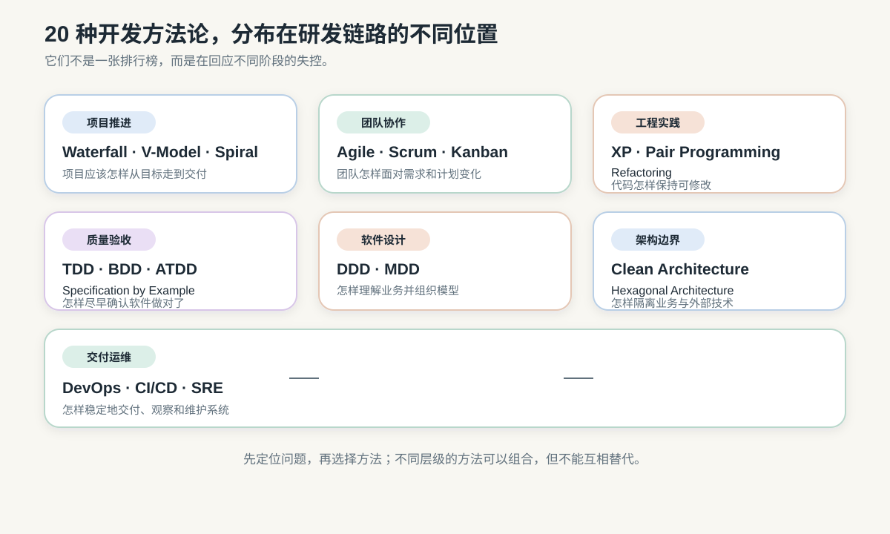
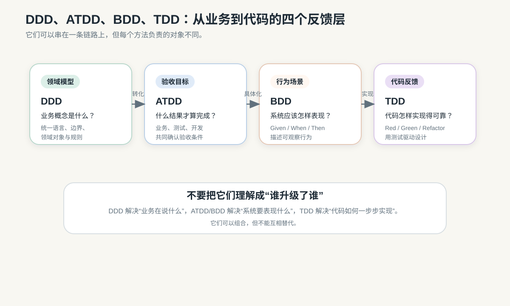
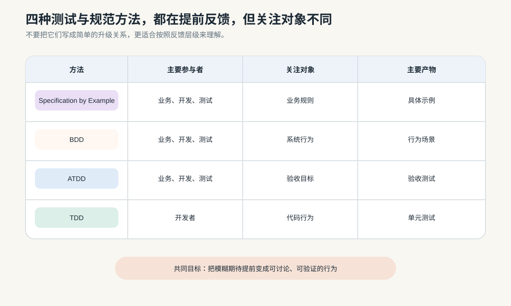
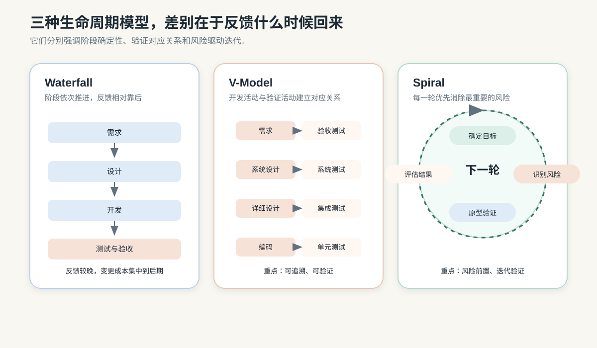
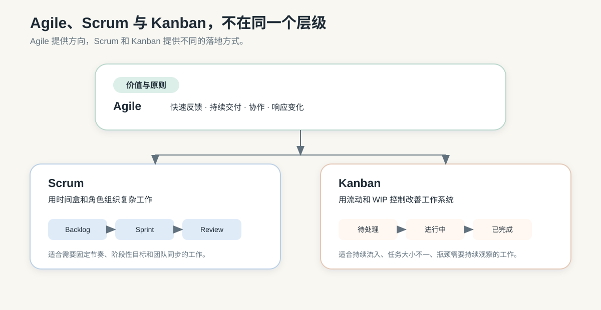
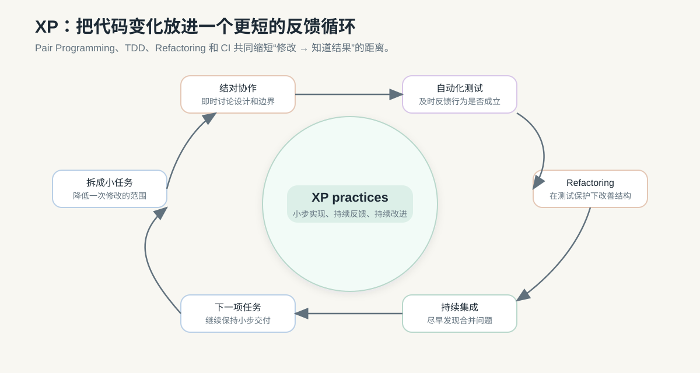
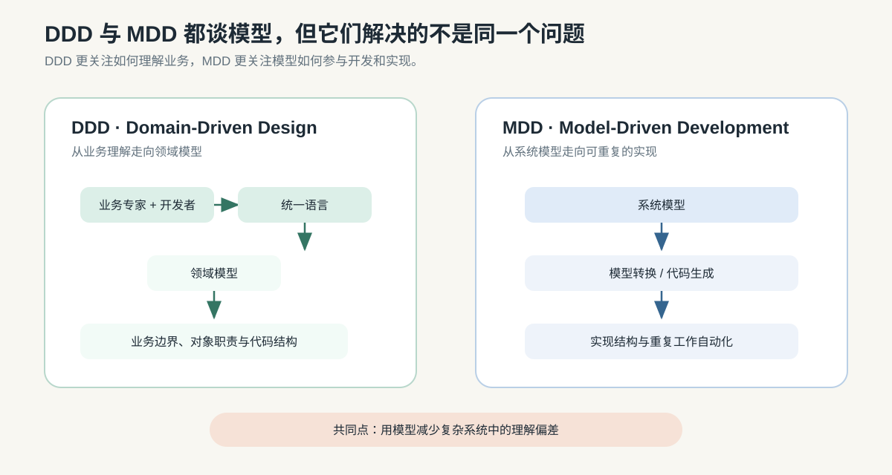
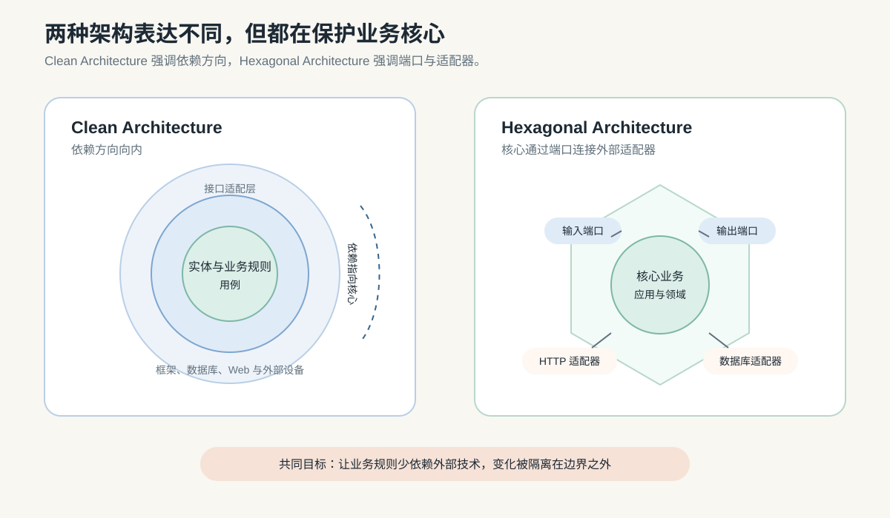
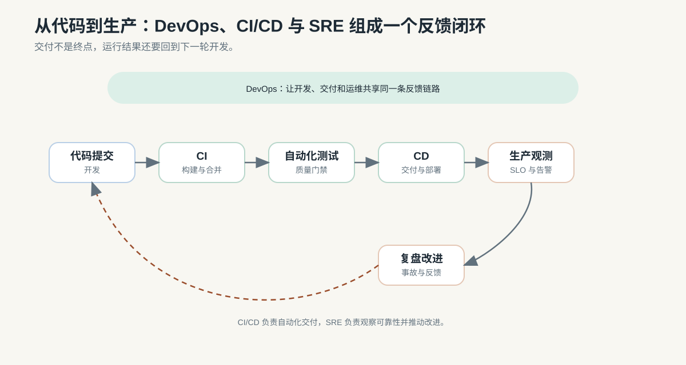
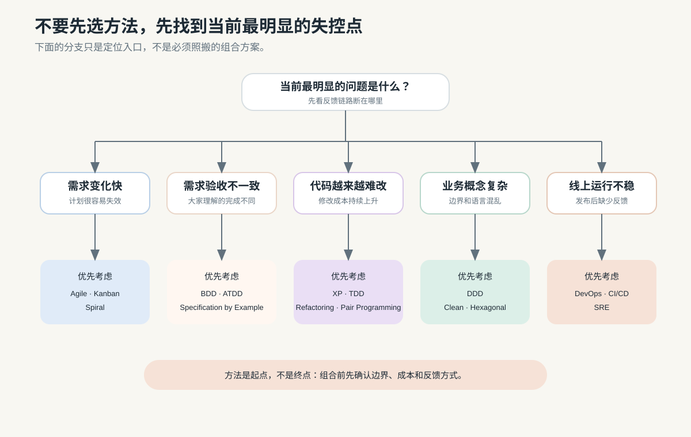

很多开发者第一次接触软件工程方法论时，都会遇到同一种困惑：书上说 Agile，团队落地的是 Scrum；代码里写着 TDD，产品讨论的却是 BDD；架构文档里出现 DDD、Clean Architecture 和 Hexagonal Architecture；发布流程又被称为 DevOps 或 CI/CD。

这些名词经常同时出现，于是看起来像一套完整的方法。但它们其实来自不同的问题：有的规定项目如何推进，有的规定团队如何协作，有的规定需求如何被描述，有的规定代码如何被实现，还有一些负责软件进入生产之后怎样运行。

如果不先把层级分开，TDD、BDD、ATDD、DDD 很容易被讲成“几个测试方法”，Scrum 也容易被当成 Agile 的同义词，CI/CD 更容易被误解为 DevOps 本身。

这篇文章按图片中列出的 20 种方法展开，不做简单的优点清单，而是尽量回答四个更基本的问题：**它是什么，改变了研发过程中的哪一部分，实际怎样运转，和其他方法有什么关系。** 文章会比较长，因为方法论只有落到动作、产物和边界上，才不是一串缩写。

## 一、先看全景：20 种方法分别管什么

软件开发可以拆成一条比较长的链路：项目如何规划，团队如何协作，业务如何被理解，需求如何变成验收标准，代码如何被设计和修改，系统如何组织边界，软件如何交付并长期运行。

这 20 种方法大致分布在下面这些位置。



| 层级 | 方法 | 主要管什么 | 常见产物或动作 |
| --- | --- | --- | --- |
| 生命周期 | Waterfall | 按阶段推进项目 | 需求、设计、开发、测试、发布阶段 |
| 生命周期 | V-Model | 让开发活动和验证活动对应 | 需求追溯、测试计划、验收关系 |
| 生命周期 | Spiral | 围绕风险进行迭代 | 风险清单、原型、实验、评估 |
| 价值观 | Agile | 面对变化时如何取舍 | 快速反馈、持续交付、调整计划 |
| 协作框架 | Scrum | 用固定节奏组织产品开发 | Backlog、Sprint、Increment、Review |
| 工作流方法 | Kanban | 改善工作流和在制品数量 | 看板、WIP 限制、流动数据 |
| 工程实践 | XP | 把快速反馈落实到编码过程 | 小步提交、测试、持续集成、简单设计 |
| 编码协作 | Pair Programming | 两名开发者如何共同写代码 | Driver/Navigator、共同设计和审查 |
| 代码维护 | Refactoring | 如何改善结构而不改变行为 | 提取函数、拆分职责、调整依赖 |
| 代码开发 | TDD | 如何用测试先行驱动设计 | Red、Green、Refactor、自动化测试 |
| 行为规格 | BDD | 如何描述可观察的系统行为 | Given、When、Then 场景 |
| 验收驱动 | ATDD | 如何提前确认完成标准 | 验收条件、验收测试 |
| 需求规范 | Specification by Example | 如何用具体例子澄清规则 | 输入、条件、结果、边界示例 |
| 领域建模 | DDD | 如何理解业务概念和边界 | 统一语言、限界上下文、聚合 |
| 模型驱动 | MDD | 如何让模型参与实现 | 模型、转换规则、代码生成 |
| 架构组织 | Clean Architecture | 如何控制依赖方向 | 内层业务规则、外围基础设施 |
| 架构组织 | Hexagonal Architecture | 如何隔离核心和外部系统 | 端口、适配器、核心业务 |
| 交付协作 | DevOps | 如何共同面对交付和运行结果 | 自动化、共同责任、运行反馈 |
| 交付自动化 | CI/CD | 如何自动集成、测试和部署 | 构建、测试、发布、回滚流水线 |
| 可靠性工程 | SRE | 如何用工程方法管理线上稳定性 | SLI、SLO、错误预算、事故复盘 |

这张表不是分类游戏。它解释了为什么这些方法不能横向比较：Scrum 和 TDD 解决的不是同一种问题，DDD 和 CI/CD 也不是替代关系。理解方法论的第一步，不是选择“最先进”的一个，而是确定当前问题处在哪一层。

## 二、主轴：DDD、Specification by Example、ATDD、BDD、TDD

这五个方法最适合放到一条需求链路里理解。假设产品要开发一个会员折扣功能，最初的需求只有一句话：

> 白银会员下单时可以享受折扣。

这句话还不能直接进入开发。它里面至少有几个没有回答的问题：白银会员如何定义？订单金额是否影响折扣？折扣和满减能否叠加？退款之后优惠是否重新计算？什么结果才算功能完成？代码应该怎样被验证？

不同方法会接住不同的问题：

```text
DDD
  ↓ 业务概念、规则和边界
Specification by Example
  ↓ 具体例子和边界条件
ATDD
  ↓ 验收目标和完成标准
BDD
  ↓ 可观察的行为场景
TDD
  ↓ 代码单元和实现设计
```



### 1. DDD：先回答“业务到底在说什么”

DDD 是 Domain-Driven Design，通常译为“领域驱动设计”。它的核心不是把数据库表换成更漂亮的类名，也不是把系统拆成很多微服务，而是**围绕业务领域建立模型，并让业务模型影响系统边界、对象职责和代码结构**。

这里的“领域”可以理解成系统要解决的业务问题。例如，电商系统里可能有商品目录、订单履约、库存分配、支付结算和售后退款等领域。它们都可能出现“订单”这个词，但每个上下文对订单的关注点并不一样：销售关心商品和价格，仓储关心拣货和发货，售后关心退款和退货状态。

如果团队把所有地方的“订单”都当成一个万能对象，代码很快会出现一种熟悉的状态：一个类里面堆满了不同部门的规则，修改一个功能时总要担心会不会影响完全无关的流程。DDD 要处理的，就是这种业务概念和边界的混乱。

#### 从统一语言开始

DDD 常被提到的第一个概念是统一语言。它不是要求所有人使用一套书面术语，而是让业务人员、产品经理、测试人员和开发者对关键业务词汇有相同的理解，并且尽量让这种语言出现在需求、测试和代码中。

比如，团队需要先明确：

- “会员等级”是用户属性，还是一段时间内的权益状态？
- “折扣”是价格计算结果，还是一种可以叠加的优惠规则？
- “订单完成”发生在支付成功、发货完成，还是用户确认收货之后？
- “退款”是否会重新触发价格计算？

这些问题没有唯一的技术答案，但必须有人和团队一起做出业务上的判断。DDD 的价值并不是替团队自动回答这些问题，而是提供一个持续讨论和沉淀模型的方式。

#### 战略设计：先划边界，再谈对象

DDD 的战略设计关注业务边界。最常见的概念是限界上下文，也就是一个模型和一套语言的有效范围。

同一个词在不同限界上下文里可以有不同含义。比如，在“订单履约”上下文里，订单可能包含发货地址、仓库状态和物流信息；在“财务结算”上下文里，订单可能主要用于计算应收金额、退款金额和税费。它们不必共享一个巨大的订单对象，而可以通过明确的接口、事件或数据转换进行协作。

这也是 DDD 和微服务经常被联系起来的原因：限界上下文有时适合对应一个服务。但两者不是同义词。限界上下文可以存在于单体应用内部，微服务也可能只是按团队或部署方式拆分，并没有真正形成清晰的领域边界。

#### 战术设计：对象应该承担什么责任

当边界大致清楚之后，DDD 还会继续讨论模型中的对象：

- **实体**有稳定身份，同样的属性变化后仍然可以被认为是同一个对象；
- **值对象**没有独立身份，更关心属性组合和不可变性，例如金额、地址或时间范围；
- **聚合**把需要一起维护一致性的对象组织起来，并通过聚合根对外提供操作入口；
- **领域服务**表达不适合归属于单个实体的业务规则；
- **领域事件**表达已经发生、并且可能需要被其他边界感知的业务事实。

这些概念不是必须全部使用的目录模板。它们的目的，是帮助团队回答“谁应该负责这条规则”和“哪些对象必须一起保持一致”。如果一个简单模块不需要聚合、领域事件或复杂服务层，少用一些抽象通常更清楚。

#### DDD 不解决什么

DDD 不会自动解决以下问题：

- 不会自动选择数据库；
- 不会自动把系统拆成微服务；
- 不会自动生成正确的架构；
- 不会替代验收测试和自动化测试；
- 不会让业务专家和开发者自动达成共识。

它解决的是建模和边界问题。模型是否正确，仍然需要持续和真实业务对照。

### 2. Specification by Example：把抽象规则写成具体事实

Specification by Example 通常译为“通过示例描述规范”。它不是一个单独的测试框架，而是一种**通过具体例子发现、澄清和表达业务规则的需求工作方式**。

抽象需求的问题在于，每个人都可以用自己的经验解释它。比如：

> 白银会员享受九折优惠。

至少需要继续问：

- 订单金额是按原价计算，还是按优惠后的价格计算？
- 退款时优惠如何处理？
- 商品优惠和会员优惠能否叠加？
- 促销活动期间是否仍然使用会员折扣？
- 金额四舍五入发生在每件商品、订单，还是最终支付金额？

Specification by Example 会把这些规则写成一组具体例子：

| 前提 | 输入 | 预期结果 |
| --- | --- | --- |
| 白银会员，普通商品 | 商品原价 100 元 | 会员价 90 元 |
| 普通用户，普通商品 | 商品原价 100 元 | 不使用会员折扣 |
| 白银会员，订单达到满减门槛 | 原价 100 元 | 是否叠加，必须明确规定 |
| 白银会员，发生退款 | 已按折扣支付 | 退款金额按哪条规则计算，必须明确规定 |

这些例子有两个作用：一是帮助团队发现需求中的空白，二是为后续的验收测试和自动化测试提供共同素材。

它和传统的“写一份长需求文档”不同。长文档当然可以保留背景、流程和约束，但具体例子更容易让分歧暴露出来。团队争论的对象从“我理解的折扣应该是这样”变成了“这个输入下，结果究竟应该是多少”。

### 3. ATDD：把“完成”变成可检查的验收条件

ATDD 是 Acceptance Test-Driven Development，验收测试驱动开发。它强调**在实现之前，由业务、测试和开发共同定义验收条件，再用这些条件驱动开发和验证**。

ATDD 的“测试驱动”并不等于开发者先写单元测试。它驱动的是产品级或功能级的验收目标。

一个比较完整的 ATDD 过程通常包括：

1. 明确用户或业务希望获得什么结果；
2. 找出正常路径、异常路径和边界情况；
3. 把这些情况写成可以判断通过或失败的验收条件；
4. 开发根据验收条件拆分任务和实现；
5. 在功能完成后用自动化或人工方式验证验收条件。

以会员折扣为例，一条合格的验收条件不能只写“支持会员折扣”，而要更接近：

```text
当用户是白银会员，且商品不参加其他促销活动时，
用户提交订单后，系统应按照白银会员折扣规则计算应付金额。
```

如果规则涉及多个条件，还要继续补例子。ATDD 的结果通常不是一份抽象的“完成了”声明，而是一组可以让产品、测试和开发共同检查的验收条件。

#### ATDD 和用户故事的关系

用户故事通常描述“谁希望做什么，以及为什么”。ATDD 进一步追问“怎样才算真正完成”。用户故事可以写成：

> 作为白银会员，我希望下单时享受会员折扣，以便获得与会员等级相符的价格。

ATDD 则会继续补充：

- 哪些商品适用？
- 哪些用户身份适用？
- 折扣如何和其他优惠组合？
- 计算结果如何取整？
- 失败时系统如何反馈？

它把“愿望”变成“可验收的行为”。

### 4. BDD：用行为场景减少翻译损耗

BDD 是 Behavior-Driven Development，行为驱动开发。它关注的是**系统在特定上下文中应该呈现什么可观察行为**。

BDD 往往通过业务、测试和开发共同讨论场景，再把场景整理成自然语言或半结构化的 Given、When、Then：

```text
场景：白银会员购买普通商品
Given 用户已经达到白银等级
And 商品不参加其他促销活动
When 用户购买一件标价 100 元的商品
Then 系统应计算出 90 元的会员价
```

这个场景描述了前提、动作和结果，但没有描述系统内部怎么实现。它不关心折扣规则放在哪个类，也不关心数据库查询用了什么 SQL；这些属于实现层面。

BDD 的真正价值不在于语法看起来像自然语言，而在于它让不同角色围绕同一个行为谈话。产品人员可以检查场景是否符合业务，测试人员可以检查场景是否覆盖边界，开发人员可以把场景映射到实现和自动化验证。

#### BDD 不等于“给 UI 写脚本”

很多团队使用 Cucumber、SpecFlow 或类似工具，就把项目称为 BDD。但如果场景只是：

```text
点击登录按钮
输入用户名
输入密码
点击提交
检查页面上出现某个元素
```

这更像 UI 自动化脚本。它可能有价值，但没有充分体现 BDD 的行为抽象。BDD 更关心“用户完成登录后系统应该处于什么状态”，而不是“浏览器按了哪几个按钮”。

好的 BDD 场景应该尽量稳定在业务行为层，避免把页面结构和内部实现细节写进去。

### 5. TDD：用一个很短的循环推动代码设计

TDD 是 Test-Driven Development，测试驱动开发。它把自动化测试放在实现之前，用一个很短的循环逐步推动代码设计：

```text
Red：写一个失败的测试
Green：用最小实现让测试通过
Refactor：在测试保护下改善结构
```

#### Red：先把当前行为说清楚

Red 阶段不是为了故意制造失败，而是为了明确当前要实现的最小行为。一个好的测试应该表达“当输入是什么时，系统应该产生什么结果”，而不是先把内部实现写死。

例如，测试可以表达“白银会员购买普通商品时得到九折价格”，而不是表达“DiscountService 必须调用某个 Calculator 的某个方法”。前者保护行为，后者容易把实现细节误当成契约。

#### Green：只实现当前需要的部分

Green 阶段强调最小实现。开发者不是一次性设计完整的折扣引擎，而是让当前测试通过，再继续补充下一个行为。

这会带来一种不同的设计节奏：接口不是先凭空设计出来，再想办法写测试，而是在具体使用场景的压力下逐步形成。它也要求团队能够接受“先让最小行为成立，再逐步抽象”的过程。

#### Refactor：测试通过之后再整理结构

当测试通过后，开发者可以改善命名、拆分职责、消除重复、调整依赖。只要测试仍然通过，外部行为就有一层保护。

但测试通过不代表设计一定好。测试可能覆盖不足，也可能只验证了错误的业务假设。因此 TDD 必须建立在正确的需求和行为理解上，不能把测试本身当成正确性的来源。

#### TDD 的几种常见形态

TDD 可以从不同方向展开：

- **Outside-In**：从外部行为或较高层用例开始，逐层替换依赖，最后落到内部单元；
- **Inside-Out**：先从领域对象或底层逻辑开始，再逐步组合成更大的行为；
- **经典单元 TDD**：围绕函数、对象和模块设计细粒度测试；
- **测试先行的探索式设计**：用测试帮助判断接口是否自然、职责是否清晰。

它们的共同点不是测试工具，而是测试先于实现，并且测试承担了设计反馈的作用。

#### TDD 不等于高覆盖率

覆盖率只能说明某些代码路径被执行过，不能证明业务规则已经被正确理解。一个错误的需求如果被写成测试，再用 TDD 实现，团队只会更快地得到一套“测试全绿但方向错误”的代码。

所以 TDD 解决的是代码设计和实现反馈，不负责解决业务目标、验收标准和领域边界。

### 6. 四个核心方法究竟差在哪里

| 维度 | DDD | ATDD | BDD | TDD |
| --- | --- | --- | --- | --- |
| 关注对象 | 业务领域和模型 | 用户验收目标 | 系统可观察行为 | 代码单元和内部设计 |
| 主要参与者 | 领域专家、产品、开发 | 业务、测试、开发 | 业务、测试、开发 | 开发者为主 |
| 典型问题 | 这个概念和规则属于哪里 | 什么结果才算完成 | 在什么场景下应该出现什么结果 | 代码如何实现并保持可修改 |
| 常见产物 | 统一语言、上下文、领域模型 | 验收条件、验收测试 | 行为场景 | 单元测试、增量实现 |
| 不能替代 | 验收和自动化测试 | 领域建模和代码设计 | 领域建模和所有测试 | 业务分析和验收 |

它们可以组合成一条链，但不要把这条链理解成必须完整执行的流水线。简单功能可能只需要清楚的验收标准和普通单元测试；复杂业务才可能需要 DDD、Specification by Example、ATDD、BDD 和 TDD 协同工作。



## 三、生命周期模型：Waterfall、V-Model、Spiral 不是“新旧之争”

这三个模型常被简单地写成“瀑布过时，敏捷先进”。这种说法既不准确，也无法帮助团队做决定。它们真正的区别在于：项目怎样被拆分，反馈怎样回来，风险什么时候暴露。

### 1. Waterfall：把项目拆成阶段，依赖前期确定性

Waterfall，瀑布模型，是一种阶段顺序型生命周期模型。项目通常先完成需求，再进行系统设计，之后进入开发、测试和发布。每个阶段有相对明确的输入、输出和评审点。

它的核心假设是：项目在前期能够形成相对稳定的需求和方案，后续变更不会频繁破坏已经完成的工作。这个假设成立时，Waterfall 有几个现实优势：计划容易编制，责任边界清楚，文档和审批流程容易管理，项目也比较容易按阶段进行合同或合规交付。

它的问题不在于“阶段”本身，而在于反馈经常被推迟。需求理解的偏差可能要到集成测试甚至用户验收时才暴露。此时修改已经牵动设计、代码、测试和文档，返工成本自然变高。

Waterfall 适合需求稳定、流程固定、验收标准清楚的工程，也适合某些需要严格阶段审批的项目。它不适合把高度探索性的产品研发假装成一开始就能完全计划好的工作。

### 2. V-Model：让每个开发决策都有对应的验证方式

V-Model，V 模型，可以看作一种强调验证和追溯的生命周期模型。它把左侧的开发活动和右侧的验证活动对应起来：

```text
需求分析       ↔       验收测试
系统设计       ↔       系统测试
详细设计       ↔       集成测试
编码           ↔       单元测试
```

V-Model 关注的不是“最后有没有测试”，而是测试是否从项目早期就参与设计。团队在写需求和系统方案时，就要考虑以后如何验证这些内容。这样做可以建立需求、设计、实现和测试之间的追溯关系。

它特别适合质量、合规、责任追踪要求较高的项目，例如需要证明每个需求都经过验证的系统。它的代价是流程和文档相对较重，而且同样依赖较早明确的需求。如果项目还处于探索期，团队可能会花很多时间设计尚未稳定的验证结构。

V-Model 和 TDD 有相似之处，但不是同一个层级。V-Model 讨论的是项目和系统级别的开发—验证对应关系，TDD 讨论的是开发者如何围绕代码单元进行测试先行的循环。TDD 可以成为 V-Model 中“编码—单元测试”这一层的工程实践，但不能替代整个 V-Model。

### 3. Spiral：每一轮先处理最危险的未知数

Spiral，螺旋模型，是一种风险驱动的迭代生命周期模型。它不是简单地重复“需求—开发—测试”，而是每一轮都围绕一个目标和一组风险展开。

一轮 Spiral 通常可以拆成四个动作：

1. 明确本轮要达到的目标和约束；
2. 找出最可能导致项目失败的技术或业务风险；
3. 用原型、实验、模拟或小范围实现验证风险；
4. 根据结果决定继续、调整方向，还是停止这条路线。

比如，团队要开发一个高并发支付系统，最先需要验证的可能不是页面功能，而是第三方支付接口的并发限制、幂等策略和异常恢复方式。Spiral 会把这些高风险未知数前置，而不是等所有页面和业务流程完成之后才发现技术路线不可行。

Spiral 的难点是需要较强的风险识别能力。每轮如果没有明确要消除的风险，也没有退出条件，项目就可能变成无休止的原型试验。它不是“允许永远迭代”，而是要求每次迭代都减少某种不确定性。



### 4. 三种模型放在一起看

| 你最担心什么 | 更接近哪种模型 | 因为它把反馈放在哪里 |
| --- | --- | --- |
| 阶段边界和计划失控 | Waterfall | 通过阶段输入、输出和审批管理过程 |
| 需求与验证无法追溯 | V-Model | 让开发活动和测试活动提前对应 |
| 技术或业务风险太晚暴露 | Spiral | 通过原型和实验把风险前置 |

这不是一个必须三选一的清单。大型项目可以在总体交付上使用阶段管理，在高风险子系统上使用 Spiral，在具体开发中使用 TDD 和 CI/CD。生命周期模型解决的是“项目如何组织反馈”，不是“团队只能使用一种工程实践”。

## 四、敏捷与协作：Agile、Scrum、Kanban 的层级关系

### 1. Agile：面对变化的一组原则

Agile 通常译为敏捷，但它首先是一组价值观和原则，而不是一套固定流程。它强调：

- 尽早交付能够工作的软件；
- 通过频繁反馈修正产品方向；
- 让人与人的协作优先于僵化流程；
- 接受需求变化，并把变化当作产品学习的一部分。

Agile 的关键不是“快”，而是缩短认知和现实之间的距离。团队不再假设最初的计划一定正确，而是通过小批量交付和真实反馈不断修正计划。

因此，Agile 不等于每日站会、两周 Sprint、燃尽图或某个项目管理工具。一个团队可以有完整的敏捷仪式，却仍然把每次迭代做成小型瀑布：迭代开始时冻结需求，开发和测试互相等待，评审只展示已经预先设计好的结果。这种流程看起来敏捷，实际并没有建立有效反馈。

### 2. Scrum：用经验主义组织产品开发

Scrum 是一个团队协作框架，不是完整的软件开发方法。它用一组角色责任、事件和工件，帮助团队在复杂和不确定的环境中形成检查与调整的节奏。

现代 Scrum 的核心元素可以分成三组。

**责任角色：**

- Product Owner 负责最大化产品价值并管理 Product Backlog；
- Scrum Master 负责帮助团队理解和改进 Scrum，并移除影响团队有效性的障碍；
- Developers 负责在 Sprint 中创造可交付的 Increment。

**事件：**

- Sprint：承载其他事件的固定时间盒；
- Sprint Planning：明确本轮目标和计划；
- Daily Scrum：开发者检查当前进展并调整接下来的工作；
- Sprint Review：检查产出并与相关方讨论下一步；
- Sprint Retrospective：检查协作方式并寻找改进动作。

**工件和承诺：**

- Product Backlog 对应 Product Goal；
- Sprint Backlog 对应 Sprint Goal；
- Increment 对应 Definition of Done。

Scrum 的重要思想是经验主义：透明、检查、适应。团队不需要假装自己在项目开始时已经知道全部答案，而是通过每个 Sprint 的真实增量检查产品方向和工作方式。

Scrum 不规定数据库怎么设计，也不规定代码必须使用 TDD。它提供的是协作和检查的节奏。工程质量仍然需要 XP、TDD、自动化测试、持续集成等实践支撑。

### 3. Kanban：把工作系统本身变成可观察对象

Kanban 关注的不是“一个迭代承诺多少任务”，而是工作如何在系统中流动。团队通常会把工作状态可视化，例如待处理、分析中、开发中、测试中、待发布和已完成。

可视化只是开始。Kanban 真正关心三个问题：

- 工作项在每个环节等待了多久？
- 哪个环节经常形成堆积？
- 团队是否同时开始了太多工作，导致没有任何工作真正完成？

因此，Kanban 会使用 WIP，也就是 Work In Progress，在制品限制。限制不是为了让团队少做事情，而是为了防止“开始很多、完成很少”。当开发列已经达到上限时，团队应该优先帮助测试、排查阻塞或完成已有任务，而不是继续把新任务推入系统。

Kanban 还会关注 Lead Time、Cycle Time、吞吐量和阻塞时间等流动指标。它不是要求团队用数据代替判断，而是帮助团队看到凭感觉很难发现的瓶颈。

Kanban 适合持续流入的支持工作、运维工作、缺陷修复，也适合任务大小不一、发布节奏不固定的团队。它不要求团队取消目标和计划，但它把改进重点放在工作流，而不是固定迭代长度。

### 4. Scrum 和 Kanban 如何组合

Scrum 可以提供 Sprint 和目标，Kanban 可以帮助 Scrum 团队观察 WIP、等待时间和瓶颈。组合使用时，不能只把 Scrum 看板换成 Kanban 看板，而要明确团队究竟希望改善什么：是目标不清，还是工作流堵塞？是反馈节奏不足，还是在制品太多？



## 五、工程实践：XP、Pair Programming、Refactoring

### 1. XP：不是单个技术，而是一组工程纪律

XP，Extreme Programming，极限编程，是一组强调反馈、协作和持续改进的工程实践。它的核心不是“把工作做得更极端”，而是把反馈尽可能放到开发过程内部。

XP 常见的实践包括：

- 小规模、频繁的发布；
- 测试驱动开发；
- 持续集成；
- Pair Programming；
- 简单设计；
- 持续重构；
- 集体代码所有权；
- 代码标准；
- 现场客户或持续的业务反馈。

这些实践之所以经常一起出现，是因为它们互相提供前提。小步发布要求代码容易合并，频繁合并需要持续集成，持续变化需要测试保护和重构，复杂规则又需要持续的业务反馈。

XP 并不是一张必须全部打勾的清单。团队可以从最明显的反馈瓶颈开始：测试反馈慢，就先改善自动化测试；合并经常冲突，就先缩小提交并引入持续集成；知识集中在一个人手里，就在关键模块使用结对编程。

### 2. Pair Programming：把设计和审查放到编码现场

Pair Programming，结对编程，是两名开发者共同围绕一份代码工作。最常见的角色分工是 Driver 和 Navigator：

- Driver 负责当前的键盘操作和具体实现；
- Navigator 关注整体方向、边界条件、设计风险和下一步动作；
- 两人定期交换角色，而不是把一个人固定成“打字员”。

结对编程不是简单的“两个开发者一起看屏幕”。真正的协作过程会包含解释、提问、推演和即时调整。一个人可能刚准备把规则写进某个服务，另一个人会问：这个规则是不是属于领域对象？它是否会被其他流程复用？异常情况下应该怎样处理？这些问题在代码提交之前就被提出来了。

结对编程比较适合：

- 高风险或核心业务模块；
- 团队不熟悉的代码；
- 需要快速传递领域知识的任务；
- 复杂重构和疑难问题排查；
- 新人进入项目时的共同工作。

它不一定适合所有任务。简单、重复、边界非常清楚的工作，如果一直安排两个人同时投入，沟通成本可能超过收益。结对编程也不能替代架构决策、自动化测试和代码审查，它只是把一部分思考和审查提前到了编码过程。

### 3. Refactoring：不改变外部行为的结构改造

Refactoring，重构，是一种在不改变外部可观察行为的前提下，改善代码内部结构的技术。它的关键约束是：**重构完成后，系统对外应该表现得和之前一致。**

常见的重构动作包括：

- 提取函数或方法；
- 改善变量、函数和模块命名；
- 拆分过大的类；
- 合并重复逻辑；
- 移动函数或字段到更合适的对象；
- 引入参数对象；
- 用多态替代复杂条件分支；
- 反转依赖方向；
- 把外部技术细节隔离到适配层。

重构和重写不同。重写通常是在较大范围内重新实现系统，允许行为和结构一起变化；重构则希望把结构变化拆成小步，每一步都由测试、编译器或其他反馈机制保护。

重构也和“整理代码”不完全一样。格式化、改名和删除死代码可能只是清理；真正的重构通常是在改善代码的可理解性、可测试性、可扩展性或依赖关系。

没有测试保护时，重构风险会明显增加，因为团队很难判断“结构变了，但行为是否仍然成立”。这也是 Refactoring 经常和 TDD、CI/CD、小步提交一起使用的原因。

### 4. 三种工程实践如何形成闭环

可以把一次高风险修改看成下面的过程：

1. 通过 Pair Programming 共同理解代码和业务规则；
2. 用 TDD 或已有测试确认当前行为；
3. 进行小范围 Refactoring；
4. 运行自动化测试和静态检查；
5. 通过 CI 合并；
6. 继续处理下一小块变化。

XP 提供的是这套实践的组合思想，Pair Programming 解决协作和即时审查，Refactoring 解决结构持续恶化，TDD 则提供代码级反馈。它们不是四个互相独立的产品。



## 六、模型驱动：MDD 到底在驱动什么

MDD 是 Model-Driven Development，模型驱动开发。它的核心主张是：**模型不只是设计阶段给人看的文档，也可以成为开发、转换、生成和验证过程中的正式输入。**

### 1. 模型和普通设计图有什么区别

普通设计图的主要读者是人。开发者阅读类图、流程图或数据模型，然后手工把设计转成代码。模型驱动开发则希望模型进入工具链：模型可以被解析，可以触发代码生成，可以生成配置，也可以被规则检查。

例如，一个团队可能使用模型描述：

- 领域对象之间的关系；
- 状态机和状态转换；
- 数据结构和约束；
- API 契约；
- 工作流和规则；
- 设备或系统之间的连接关系。

之后，工具根据模型生成一部分代码、配置或测试骨架。

### 2. MDD 的典型工作流

一个模型驱动的开发流程通常包括：

1. 定义适合当前领域的模型；
2. 规定模型中的元素和约束；
3. 建立模型到实现之间的转换规则；
4. 生成代码、配置或其他工程产物；
5. 对模型、转换结果和生成结果进行验证；
6. 在模型变化后重新生成或同步实现。

这意味着团队需要维护的不只是代码，还包括模型语言、转换器和生成模板。模型驱动并没有消除复杂度，只是把一部分复杂度从手工代码转移到了模型和工具链。

### 3. MDD 适合什么场景

它比较适合结构重复、规则稳定、模型和实现需要长期保持一致的场景。例如大量相似的接口、设备配置、工作流或数据转换逻辑，可以通过模型减少重复手工工作。

如果业务还在快速探索，模型本身每天都在变化，生成链路可能反而变成额外负担。模型越正式，修改模型、验证转换规则和重新生成的成本就越不能忽略。

DDD 和 MDD 经常同时出现，但关注点不同：DDD 主要解决“业务概念如何被理解和组织”，MDD 主要解决“模型如何参与实现”。DDD 建立出来的领域模型，不一定要自动生成代码；MDD 使用的模型，也不一定是业务领域模型。



## 七、架构设计：Clean Architecture 与 Hexagonal Architecture

这两个方法经常与 DDD 一起出现，但它们解决的不是同一个问题。DDD 主要帮助团队理解业务和划分边界，架构模式则进一步规定：业务规则如何与数据库、Web 框架、消息系统和第三方服务隔离。

### 1. Clean Architecture：依赖方向指向内层

Clean Architecture，整洁架构，通常用同心圆或分层结构表达系统。中心是实体和业务规则，更外层是用例、接口适配和基础设施。

它真正重要的不是圆画了几层，而是依赖规则：**外层可以依赖内层，内层不应该依赖外部的具体技术。**

例如，业务用例可以依赖一个“保存订单”的抽象接口，但不应该直接依赖某个 ORM 的 Model 类。数据库实现放在外层，通过依赖反转接入。这样，当数据库、Web 框架或消息组件变化时，业务规则不需要一起重写。

Clean Architecture 常见的概念包括：

- Entities：跨用例相对稳定的业务规则；
- Use Cases：具体应用场景和业务流程；
- Interface Adapters：控制器、Presenter、Repository 实现等适配层；
- Frameworks and Drivers：数据库、Web 框架、消息队列和外部设备。

它的风险也很明确：如果团队只复制文件夹结构，却没有真正控制依赖方向，最后会得到很多接口、DTO 和转发类，但业务仍然和基础设施紧密耦合。架构边界应该服务于变化隔离，而不是增加目录数量。

### 2. Hexagonal Architecture：通过端口与适配器连接世界

Hexagonal Architecture，也叫 Ports and Adapters Architecture，六边形架构，强调核心业务与外部世界之间通过端口连接。

它通常把系统分成三类部分：

- **核心领域**：业务规则和应用逻辑；
- **端口**：核心对外提供的输入接口，以及核心需要外部提供的输出接口；
- **适配器**：把 HTTP、数据库、消息队列、命令行或测试替身接到端口上。

输入适配器接收外部请求，转换成核心能理解的输入；输出端口表达核心需要的能力，数据库适配器、消息适配器或第三方服务适配器负责具体实现。

Hexagonal Architecture 的重点不是“六边形”，而是让核心业务不必知道外部系统长什么样。核心可以在不启动真实数据库和网络服务的情况下测试，外部技术也可以在边界处替换。

### 3. 两种架构的区别

| 对比维度 | Clean Architecture | Hexagonal Architecture |
| --- | --- | --- |
| 主要表达 | 分层和依赖方向 | 核心、端口和适配器 |
| 重点问题 | 哪些代码可以依赖哪些代码 | 外部世界怎样接入核心 |
| 常见图形 | 同心圆、层次 | 六边形、端口 |
| 共同目标 | 保护业务规则，隔离技术细节 | 保护业务规则，隔离技术细节 |

两者可以同时使用。Clean Architecture 约束整体依赖方向，Hexagonal Architecture 具体描述核心与外部系统的交互方式。它们也可以只取其中一部分，不必把完整术语和模板全部搬进项目。



## 八、交付和生产运行：DevOps、CI/CD、SRE

### 1. DevOps：共同承担软件的交付和运行结果

DevOps 经常被误解成一套流水线工具，或者“开发和运维一起工作”。这些都不完整。

DevOps 更接近一种协作方式和工程文化：开发、测试、运维不把软件交付拆成互相甩手的几个阶段，而是共同面对软件从提交到生产运行的结果。

在传统交接模式里，开发说“代码已经写完”，运维说“已经部署上线”，但线上出问题时没人真正拥有完整上下文。DevOps 希望把配置、部署、监控、故障响应和改进都纳入软件交付过程，让运行反馈重新回到开发团队。

DevOps 关注的问题包括：

- 谁负责软件进入生产后的行为？
- 环境差异如何被控制？
- 变更怎样安全地发布和回滚？
- 故障信息怎样回到设计和开发？
- 团队怎样减少人工交接和重复操作？

因此，CI/CD 是 DevOps 常用的一部分，但 DevOps 不等于 CI/CD。没有责任边界和运行反馈，流水线可能只是把旧的交接流程自动化。

### 2. CI/CD：把代码变成可重复的交付过程

CI/CD 主要处理从代码提交到软件进入环境的自动化过程。

**CI，Continuous Integration，持续集成**，关注的是代码能否频繁合并。每次合并通常会触发构建、单元测试、静态检查和其他自动化验证，尽量把集成问题暴露在较小的范围内。

**CD** 有两种常见含义：

- Continuous Delivery，持续交付：代码随时处于可发布状态，但是否发布可能由人决定；
- Continuous Deployment，持续部署：通过自动化流程将满足条件的代码直接部署到生产环境。

一条完整的流水线可能包括：

```text
提交代码
  → 构建
  → 单元测试
  → 集成测试
  → 安全与质量检查
  → 构建制品
  → 部署测试环境
  → 验收或灰度
  → 发布生产
  → 观察指标
  → 必要时回滚
```

CI/CD 的价值不只是“发布更快”。它还把交付过程中的隐含步骤显式化：使用什么环境变量，执行哪些测试，制品如何生成，失败后如何恢复，哪个版本正在生产运行。

但流水线不能自动保证业务正确。它可能非常快地构建和发布一段错误代码。测试质量、验收条件、发布策略、回滚能力和生产观测仍然需要团队设计。

### 3. SRE：用可靠性目标管理生产系统

SRE，Site Reliability Engineering，站点可靠性工程，是一种使用软件工程方法管理生产系统可靠性的实践。

它不把“稳定”当成一句口号，而是尝试用指标、目标和资源约束讨论可靠性。

**SLI** 是服务等级指标，例如请求成功率、延迟、可用性或数据新鲜度。

**SLO** 是服务等级目标，例如某段时间内 99.9% 的请求成功，或者 95% 的请求延迟低于某个阈值。

**SLA** 通常是对外承诺，可能涉及合同和赔偿；SLO 是团队内部更直接的工程目标。三者不能简单画等号。

SRE 还会使用错误预算。简单理解，目标允许的失败空间就是错误预算。当系统可靠性已经消耗了太多预算，团队就应该减少高风险发布，把时间投入到稳定性修复；当系统运行稳定，团队可以利用预算进行一定程度的功能迭代和架构改进。

SRE 关注的工作还包括：

- 监控和告警；
- 容量规划；
- 自动化运维；
- 故障响应；
- 事故复盘；
- 减少重复、手工和容易出错的运维劳动，也就是 toil。

事故复盘的重点不是寻找一个人承担责任，而是弄清楚系统为什么允许问题发生，为什么监控没有更早发现，为什么恢复过程不够快，以及下一步应该修改什么。



### 4. 三者的关系

| 方法 | 关注范围 | 核心问题 |
| --- | --- | --- |
| DevOps | 组织协作和交付文化 | 开发、交付、运维如何共同负责 |
| CI/CD | 自动化交付链路 | 代码如何稳定、重复地进入环境 |
| SRE | 生产可靠性 | 系统如何在真实负载下保持可用和可恢复 |

DevOps 可以包含 CI/CD，SRE 可以使用 CI/CD，也可以推动 DevOps 团队改进责任边界。三者有交集，但不是三个不同名字的同一件事。

## 九、把 20 种方法放进一个真实项目

现在把前面的内容串起来。假设团队要开发一个涉及会员等级、订单金额、促销叠加和退款规则的会员折扣系统。

### 第一步：确认项目如何推进

如果需求大部分稳定、交付节点受合同约束，团队可能使用 Waterfall 的阶段管理方式。如果需要严格证明每个需求都被测试，可以借鉴 V-Model 的追溯关系。如果折扣规则、第三方价格系统或高并发计算存在较大未知数，可以用 Spiral 的风险迭代先做原型和实验。

这些选择解决的是项目级问题，不会直接告诉开发者如何实现折扣计算。

### 第二步：用 Agile、Scrum 或 Kanban 安排团队工作

团队可以采用 Agile 的反馈原则，用 Scrum 按 Sprint 组织产品目标，也可以用 Kanban 管理持续流入的需求、缺陷和运营任务。

如果产品目标需要在固定节奏中检查，Scrum 可能更合适；如果任务不断流入、大小差异明显，Kanban 可能更自然。无论采用哪一种，团队都应该持续检查真实结果，而不是只检查任务卡是否移动。

### 第三步：用 DDD 解决业务模型

团队和领域专家一起确认会员、等级、订单、优惠和退款的含义，决定哪些规则属于定价领域，哪些规则属于会员权益领域，哪些状态变化需要跨边界传递。

如果把所有规则都塞进一个 OrderService，短期可能完成得很快，但长期很难判断规则属于哪里。DDD 的任务，是让这些概念和职责有稳定的落点。

### 第四步：用 Specification by Example、ATDD 和 BDD 形成共同规范

团队先列出正常路径和边界例子，再把例子整理成验收条件和行为场景。业务人员可以检查折扣结果是否符合规则，测试人员可以补充异常情况，开发人员可以据此拆分实现任务。

到这里，团队应该已经知道“什么行为才是正确的”，而不是直接开始写代码。

### 第五步：用 TDD、XP、Pair Programming 和 Refactoring 实现

开发者用 TDD 从一个小行为开始，写失败测试、做最小实现、再重构。复杂的折扣组合可以通过 Pair Programming 共同设计；代码结构变差时，使用 Refactoring 小步改造；XP 的其他实践则帮助团队保持小批量提交、持续集成和频繁反馈。

### 第六步：用架构模式保护边界

如果折扣规则不应该依赖数据库、HTTP 或具体支付系统，可以使用 Clean Architecture 或 Hexagonal Architecture，把核心计算放在内部，把数据库、接口和外部服务放到适配器或外围。

如果某些模型结构重复且足够稳定，可以考虑 MDD，让模型参与代码或配置生成。但不要因为“模型驱动”听起来先进，就把仍在变化的业务过早固化成复杂生成链路。

### 第七步：用 DevOps、CI/CD 和 SRE 让系统进入生产

CI/CD 负责自动构建、测试和部署；DevOps 确保开发、测试、运维共同面对发布和运行结果；SRE 则通过折扣接口的错误率、延迟、容量和告警来判断系统是否满足可靠性目标。

这时，线上运行结果又会回到产品和开发过程：某种优惠组合经常导致人工介入，可能说明业务规则、领域模型、验收场景或实现结构需要继续调整。



## 十、常见误用：方法越多，系统不一定越成熟

### 把 Scrum 当成 Agile 的全部

团队每天开会、每两周演示一次，不代表已经根据真实反馈调整了产品。如果 Sprint 只是把瀑布阶段缩短，团队仍然没有真正交付可检查的增量。

### 把 TDD 当成“先补测试”

开发完成后补一批测试，可以提高覆盖率，但这不是 TDD。TDD 改变的是测试和实现的先后关系，并让测试参与接口和职责设计。

### 把 BDD 当成 UI 自动化脚本

如果场景写满了点击按钮、查找元素和页面 CSS 选择器，行为很快会被界面细节绑住。BDD 应该优先描述用户和业务能观察到的结果。

### 把 DDD 当成微服务拆分指南

DDD 可以帮助划分领域边界，但边界是否需要独立部署，还要看团队规模、数据一致性、发布方式和运维能力。先拆服务再找领域，通常只会得到一组边界模糊的远程调用。

### 把 Clean Architecture 当成目录模板

如果项目只是增加 entity、usecase、repository、adapter 文件夹，却没有真正控制依赖，架构只是换了名字。架构的价值来自边界和依赖规则，不来自目录层数。

### 把 CI/CD 当成质量保证

流水线只能自动执行你已经定义好的检查。如果验收条件不清楚、测试没有覆盖关键行为，CI/CD 只会更快地把错误代码推向环境。

### 把 SRE 当成“专门负责救火的人”

SRE 不是把线上问题全部交给一个运维小组，而是把可靠性目标、观测、自动化和复盘纳入整个软件生命周期。只有一个团队负责稳定性，其他团队继续只对代码提交负责，可靠性很难真正改善。

## 结语：理解方法是什么，比记住优点更重要

这 20 种方法不是一套必须全部安装的工具包，也不是从 Waterfall 一路升级到 SRE 的等级体系。它们分别改变研发过程中的不同部分：

- Waterfall、V-Model、Spiral 改变项目生命周期和反馈位置；
- Agile、Scrum、Kanban 改变团队面对变化和组织工作的方式；
- XP、Pair Programming、Refactoring 改变代码协作、修改和维护的节奏；
- Specification by Example、ATDD、BDD、TDD 改变需求、行为、验收和代码之间的反馈关系；
- DDD、MDD 改变模型理解业务和参与实现的方式；
- Clean Architecture、Hexagonal Architecture 改变依赖和外部交互的边界；
- DevOps、CI/CD、SRE 改变软件交付和生产运行的反馈链路。

其中最值得记住的四个主轴是：

> DDD 负责把业务概念和边界说清楚；
> 
> ATDD 负责把完成标准说清楚；
> 
> BDD 负责把系统行为说清楚；
> 
> TDD 负责让代码逐步实现清楚。

先问“这个方法究竟规定了什么”，再问“团队现在是否需要它”。如果连方法的作用对象、工作机制和边界都没有弄清楚，直接把缩写贴到项目流程上，得到的通常不是工程能力，而是一套看起来很完整、实际没有反馈的仪式。
