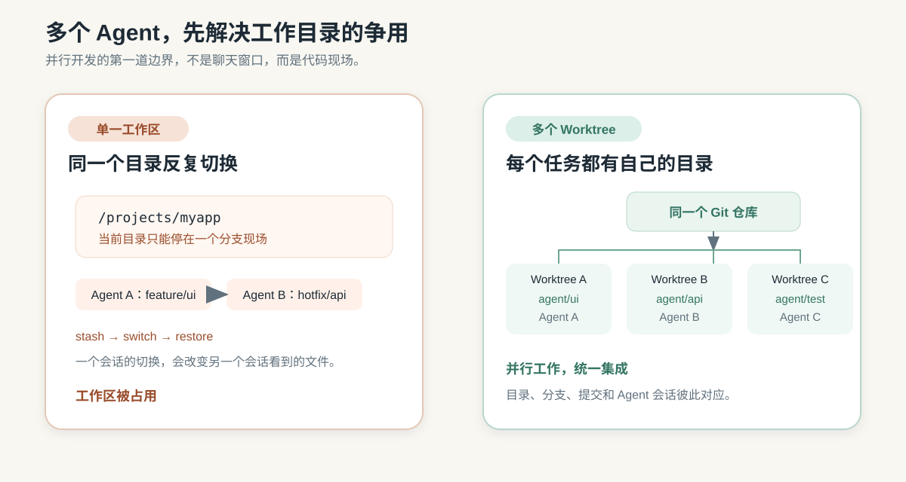
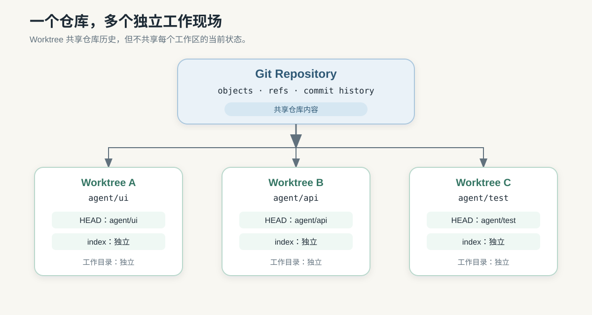
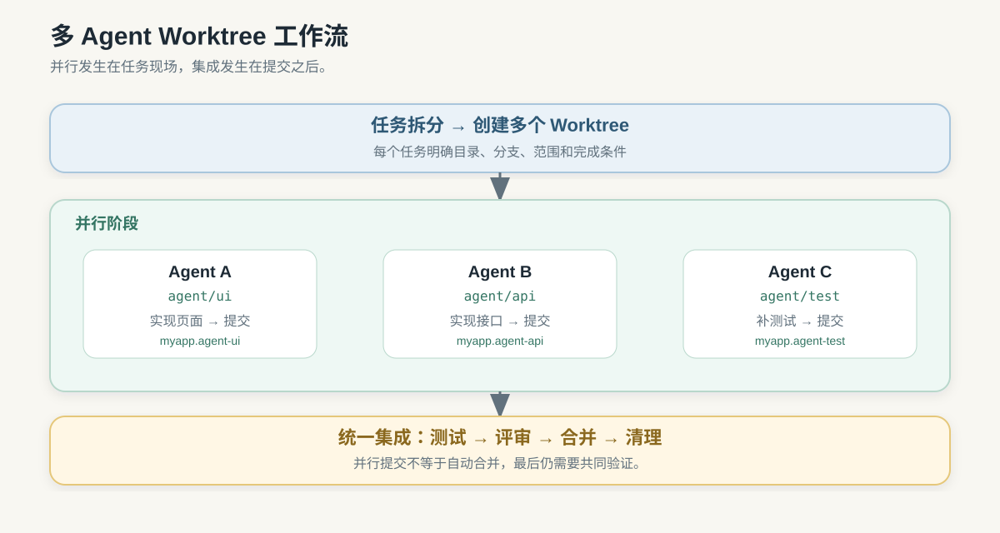
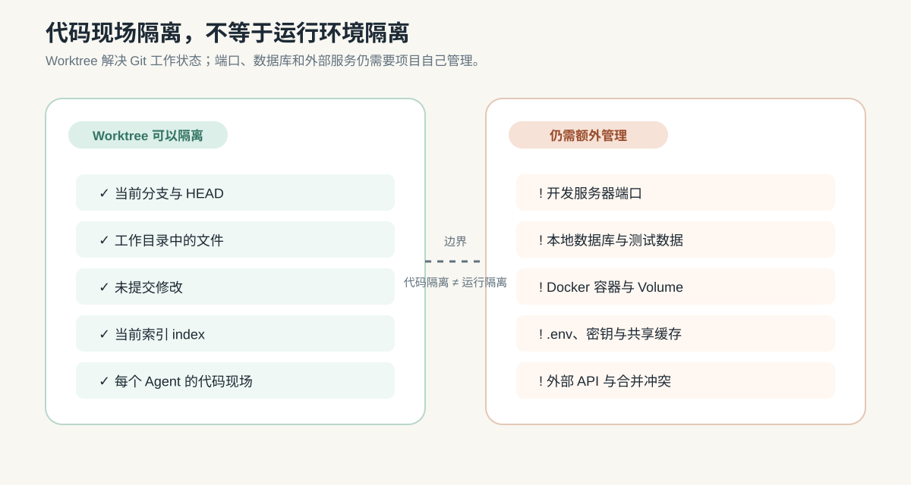
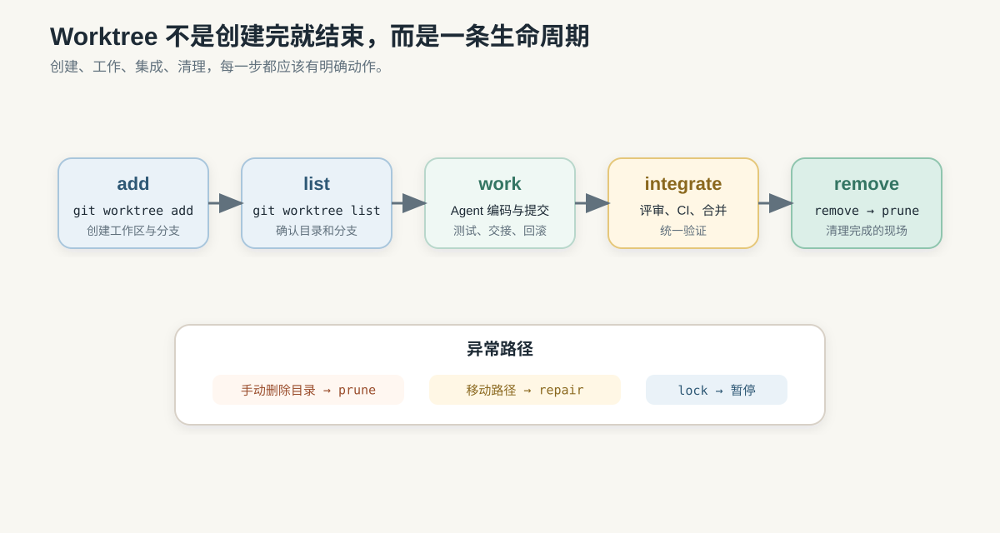

如果你只使用一个 Agent，Git 的普通分支流程通常已经够用：切到一个分支，完成修改，提交，再切到下一个分支。

但当你开始同时使用多个 coding agent，事情会很快变得不一样。

一个 Agent 正在开发新功能，另一个 Agent 正在修复紧急问题，还有一个 Agent 准备补测试。它们都需要访问同一个项目，却不能同时占用同一个工作目录。只要其中一个会话执行了切分支、重置文件或批量修改，其他会话的工作现场就可能被一起改变。

这时候，问题已经不是“如何多开几个 AI 对话”，而是：**如何给每个任务准备一个独立、稳定、可回滚的代码现场？**

Git Worktree 解决的正是这个问题。



对使用多个 coding agent 并行开发的人来说，Git Worktree 不再是 Git 里一个偶尔才会用到的冷门命令，而是一项应该尽早掌握的基础能力。

## 一、分支可以并存，工作目录却不能凭空变多

我们平时说“切到某个分支”，实际做了两件事：让当前工作目录的文件切换到另一套版本，同时让 `HEAD` 指向另一个分支。

这套流程适合顺序开发，却不适合并行开发。

假设当前目录是 `/projects/shop`。Agent A 在 `feature/payment` 分支上修改支付流程，Agent B 想在 `fix/order-timeout` 分支上修复订单超时。传统做法是让其中一个 Agent 暂停，然后执行：

```bash
git stash
git switch fix/order-timeout
```

等另一个任务完成后，再切回原来的分支并恢复修改。

这种方式的问题不只是麻烦。Agent 的上下文、正在运行的命令、未提交的文件和本地服务都可能依赖当前目录。你让它切换分支，实际上是在改变它正在观察和操作的对象。即使没有立刻丢代码，也很容易出现以下情况：

- 一个 Agent 看到的文件突然变了；
- 未提交修改和另一个任务混在一起；
- 测试使用了错误分支的代码；
- 开发服务器没有重启，却加载了另一套文件；
- 你已经记不清某个终端对应哪个任务。

所以，并行开发真正需要隔离的不是分支名，而是**工作目录和工作状态**。

## 二、Git Worktree 到底是什么

Git Worktree 可以理解成：在一个 Git 仓库里，同时维护多个独立的工作目录。

Git 官方文档把它描述为同一个仓库下的多个 working trees。它们共享仓库的提交对象和大部分历史信息，但每个 Worktree 都有自己当前检出的提交、索引和工作目录。这样，一个仓库就可以同时检出多个不同分支，而不需要反复切换同一个目录。

可以把它画成下面这样：

```text
一个 Git Repository
├── 主工作区              → main
├── Linked Worktree A     → agent/ui
├── Linked Worktree B     → agent/api
└── Linked Worktree C     → agent/test
```



创建 Worktree 的命令很直接：

```bash
git worktree add ../myapp.agent-ui -b agent/ui main
git worktree add ../myapp.agent-api -b agent/api main
git worktree add ../myapp.agent-test -b agent/test main
```

这几条命令分别做了三件事：

- 在当前项目旁边创建新的工作目录；
- 创建并检出对应的任务分支；
- 让这些分支都从 `main` 这个基准开始。

查看当前仓库有哪些 Worktree：

```bash
git worktree list
```

输出结果大致会是：

```text
E:/projects/myapp             abc1234 [main]
E:/projects/myapp.agent-ui    def5678 [agent/ui]
E:/projects/myapp.agent-api   789abcd [agent/api]
E:/projects/myapp.agent-test  012efgh [agent/test]
```

此时，三个 Agent 可以分别进入三个目录工作：

```text
终端 1 → myapp.agent-ui   → agent/ui
终端 2 → myapp.agent-api  → agent/api
终端 3 → myapp.agent-test → agent/test
```

它们仍然属于同一个 Git 仓库，但已经不再共享同一个代码现场。

## 三、为什么多 Agent 场景会放大 Worktree 的价值

如果没有多个并行任务，Worktree 只是让目录管理更灵活。但一旦多个 Agent 同时参与开发，它会直接改善几个最容易出问题的地方。

### 1. 每个 Agent 都有稳定的上下文

Agent 不是只读取一两个文件。它通常会观察目录结构、配置文件、测试结果、构建产物和当前的 Git 状态。

如果多个会话共享一个目录，其中一个会话的修改会悄悄改变另一个会话的上下文。Agent 下一次读取文件时，看到的可能已经不是它刚才理解的版本。

独立 Worktree 让每个会话的上下文保持稳定。它可以在自己的分支上反复修改、运行测试和回滚，不需要担心另一个任务突然切换了代码。

### 2. 把“不要改别人的文件”变成目录边界

仅靠提示词约束 Agent 当然可以工作，但提示词不是文件系统权限。

当 Agent A 和 Agent B 都在 `/projects/myapp` 中工作时，你只能告诉它们不要互相覆盖；当它们分别位于 `myapp.agent-ui` 和 `myapp.agent-api` 时，很多误操作会先被目录边界挡住。

这不是绝对的安全隔离。Agent 仍然可以访问父目录，也可能修改共享的外部资源。但至少，最常见的“在同一份工作区里互相覆盖代码”被拆开了。

### 3. 让任务和分支一一对应

并行开发最怕的不是任务多，而是任务和代码状态对应不上。

使用 Worktree 后，可以建立一个很清晰的映射：

```text
任务：实现用户资料接口
Agent：API Agent
目录：myapp.agent-api
分支：agent/api
提交：每完成一个可验证的小阶段就提交
```

当某个 Agent 报告“已经完成”时，你可以直接进入对应目录检查状态、查看提交和重跑测试，而不必先猜当前终端到底停在哪条分支上。

### 4. 并行不等于互相共享未完成状态

不同 Agent 可以同时工作，但不应该共享一堆还没有提交、也没有明确归属的修改。

一个更稳妥的边界是：

> Agent 之间通过分支、提交、测试结果和明确的交接说明传递工作，而不是通过同一个目录里的半成品文件传递工作。

## 四、一套可以直接使用的多 Agent 工作流

### 第一步：准备干净的基准分支

先更新本地仓库：

```bash
git fetch origin
git switch main
git pull --ff-only
```

如果项目使用 `origin/main` 作为统一基准，也可以直接从远程分支创建 Worktree。关键不是命令写法必须一致，而是所有并行任务要从同一个明确版本开始。

### 第二步：按任务创建 Worktree

```bash
git worktree add ../myapp.agent-ui -b agent/ui main
git worktree add ../myapp.agent-api -b agent/api main
git worktree add ../myapp.agent-test -b agent/test main
```

目录名最好包含任务含义，不要只使用 `worktree-1`、`worktree-2` 这样的编号。几小时之后，语义化命名会比编号更容易辨认。

一种简单的命名方式是：

```text
<项目名>.<任务名>
```

例如：

```text
myapp.agent-ui
myapp.agent-api
myapp.agent-test
myapp.agent-hotfix
```

### 第三步：为每个 Agent 写清工作契约

每个 Agent 会话开始时，至少明确四件事：工作目录、分支、任务范围和完成条件。

可以使用这样的模板：

```text
工作目录：../myapp.agent-api
工作分支：agent/api

任务：
- 实现用户资料接口
- 只修改 API 相关代码
- 不修改前端页面和数据库迁移

完成条件：
- 运行指定测试
- 提交代码
- 返回 commit hash
- 说明未完成事项和潜在风险

约束：
- 不切换分支
- 不修改其他 Worktree
- 不重置 main 分支
```

这段说明看起来很普通，但它把“任务范围”和“交付方式”都固定下来了。Agent 不再只是接收一句“帮我把功能写完”，而是知道自己在哪个工作现场、应该修改什么、最后要留下什么。

### 第四步：每个 Agent 在自己的目录中工作

```bash
cd ../myapp.agent-api
git status
git branch --show-current
```

确认目录和分支没有错，再开始修改代码。完成一个可验证的阶段后及时提交：

```bash
git add .
git commit -m "feat: implement user profile api"
```

提交不只是保存代码，也是一次交接点。它让其他人或其他 Agent 能够知道：从哪个版本开始检查，修改了什么，是否可以继续往下游传递。

### 第五步：统一集成

并行阶段结束后，回到主工作区进行集成：

```bash
git worktree list
git switch main
git merge agent/ui
git merge agent/api
```

如果项目使用 Pull Request，则可以让每个 Agent 分支分别推送、测试和评审，最后再合并到主分支。



### 第六步：删除已经结束的 Worktree

任务合并完成后，不要让旧 Worktree 一直堆在项目旁边：

```bash
git worktree remove ../myapp.agent-ui
git worktree remove ../myapp.agent-api
git worktree prune
```

如果只是暂时挂起任务，也可以保留 Worktree。是否删除，取决于这个分支后面是否还要继续使用。

## 五、哪些任务适合并行，哪些任务不适合

Worktree 能解决目录冲突，但不能让本来存在依赖关系的任务突然变成独立任务。

### 适合并行的情况

- 前端页面和后端接口修改范围基本独立；
- 一个 Agent 处理功能，另一个 Agent 补充不依赖实现细节的文档；
- 不同模块有清晰的文件边界；
- 一个 Agent 处理主流程，另一个 Agent 处理兼容性或边界测试；
- 多个任务可以从同一个基准版本独立验收。

### 更适合分阶段的情况

- 两个 Agent 都要修改同一个核心文件；
- 后一个任务依赖前一个任务尚未确定的接口；
- 测试必须建立在实现提交之后；
- 两个任务会修改同一套数据库迁移；
- 其中一个 Agent 还没有确定数据结构，另一个 Agent 却已经开始围绕它开发。

可以用一个简单标准判断：

> 任务之间是否有清晰的输入、输出和文件边界？如果没有，先拆任务，再谈并行。

不要为了“多开几个 Agent”而强行并行。多个互相等待、反复解决冲突的 Agent，最后可能比一个顺序工作的 Agent 更慢。

## 六、Worktree 隔离了什么，没隔离什么

这是使用 Worktree 时最容易被忽略的边界。

### Worktree 可以隔离的内容

- 当前检出的分支；
- 当前工作目录；
- 未提交的文件修改；
- 当前 `HEAD`；
- 当前索引；
- 每个 Agent 的代码现场。

### 仍然需要额外管理的内容

- 开发服务器端口；
- 本地数据库和测试数据；
- Docker 容器与 Volume；
- 工作目录之外的构建缓存；
- `.env` 中的共享配置和密钥；
- 外部 API、消息队列和测试环境；
- 远程分支；
- 最终的合并冲突。

例如，三个 Worktree 虽然拥有三套文件，但如果它们都启动在 `3000` 端口，仍然会互相抢占资源。如果它们连接同一个本地数据库，也可能出现测试数据互相覆盖。

因此，项目可以进一步约定：

```text
Agent A：端口 3001，数据库 app_ui
Agent B：端口 3002，数据库 app_api
Agent C：只运行测试，不启动开发服务器
```

Git Worktree 隔离的是代码现场，不是整个运行世界。



## 七、几个容易踩到的坑

### 1. 不要让多个 Worktree 使用同一个分支

Git 默认会阻止一个已经在其他 Worktree 中检出的分支再次被检出。这个保护很有价值，因为同一个分支同时被多个工作目录修改，最终会让分支指针和工作状态变得难以理解。

推荐这样：

```text
myapp.agent-ui   → agent/ui
myapp.agent-api  → agent/api
myapp.agent-test → agent/test
```

不要把多个工作目录都指向 `main`。除非你非常清楚自己在做什么，否则也不要把 `--force` 当作绕过保护的常规手段。

### 2. 不要让多个 Agent 修改同一个文件

如果两个 Agent 都需要修改同一个核心文件，Worktree 只能把冲突延后到合并阶段，不能消除冲突。

更好的做法是先拆出接口和职责，或者让其中一个 Agent 先完成基础改动，再让另一个 Agent 基于新的提交继续工作。

### 3. 不要忘记检查当前目录

每次开始任务时，都可以先执行：

```bash
pwd
git branch --show-current
git status --short
git worktree list
```

很多“代码怎么改错了”的问题，最后并不是 Agent 的逻辑错误，而是人进入了错误的目录。

### 4. 不要直接删除目录后就不管

如果手动删除了 Worktree 目录，Git 可能仍保留对应的管理记录。可以使用：

```bash
git worktree prune
```

如果只是移动了 Worktree 路径，则可以了解一下：

```bash
git worktree repair
```

### 5. 不要把 Worktree 当成自动协作系统

Worktree 解决了物理隔离，但下面这些事情仍然需要工程师设计：

- 任务如何拆分；
- 分支如何命名；
- Agent 如何交接；
- 哪些提交可以合并；
- 哪些风险必须人工确认；
- 测试和发布由谁负责。

工具降低的是一类成本，不会替你完成整个协作流程。

## 八、什么时候应该使用 Git Worktree

如果只是修改一个小脚本，只有一个 Agent，任务几分钟就能完成，那么普通分支流程已经足够。

如果出现下面这些情况，Worktree 就值得成为默认选择：

- 两个以上任务需要同时推进；
- 多个 Agent 会持续运行较长时间；
- 不希望频繁切换分支破坏当前上下文；
- 需要同时运行多个版本进行对照；
- 功能开发、Bug 修复和测试任务存在一定并行空间；
- 希望每个任务都有独立的提交和回滚边界。

它不是所有 Git 操作的默认答案，但只要你开始认真做并行开发，Worktree 就不再是“知道有这么个命令”就够了的知识点。

## 结语：先给 Agent 分配工作现场，再谈并行效率

AI 让写代码的速度提高了，却没有自动解决代码之间的边界问题。

多个 Agent 同时工作时，真正容易出问题的地方往往不是模型能不能生成代码，而是它们是否在正确的目录、正确的分支和正确的上下文里工作。一个 Agent 如果连自己的代码现场都没有，所谓并行很容易变成互相覆盖、重复修改和最后一起解决冲突。

Git Worktree 提供了一种很朴素的解决方式：让每个任务拥有自己的目录，让每个目录对应自己的分支，让每个分支留下可以检查和回滚的提交。

它不会替你拆分任务，也不会替你解决合并冲突。但它能把“多个 Agent 同时修改同一个项目”从一种容易失控的尝试，变成一套有边界的工作流。

对进入 AI 编程时代的程序员来说，真正值得记住的不是某一条命令，而是这一组对应关系：

```text
一个任务
    ↓
一个 Agent
    ↓
一个 Worktree
    ↓
一个分支
    ↓
一组可验证的提交
```



当你需要让多个 Agent 并行工作时，先给它们分配不同的工作现场。剩下的，才是任务拆分、代码实现和最终集成。


