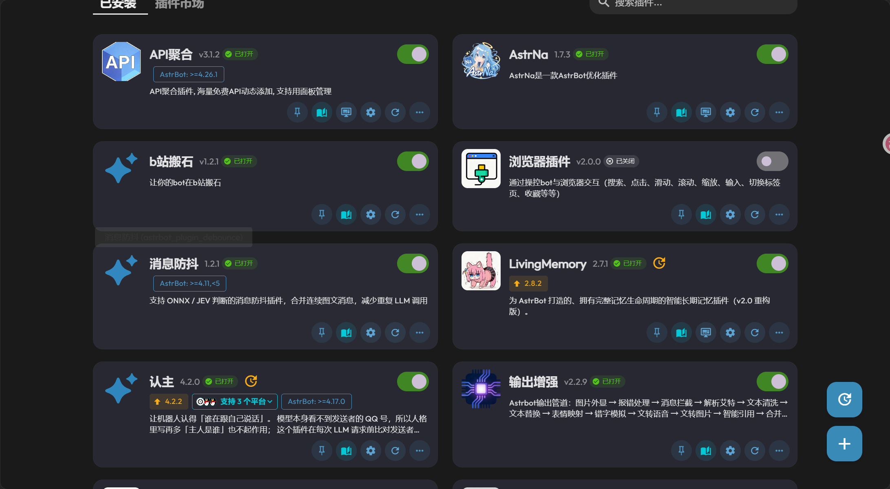
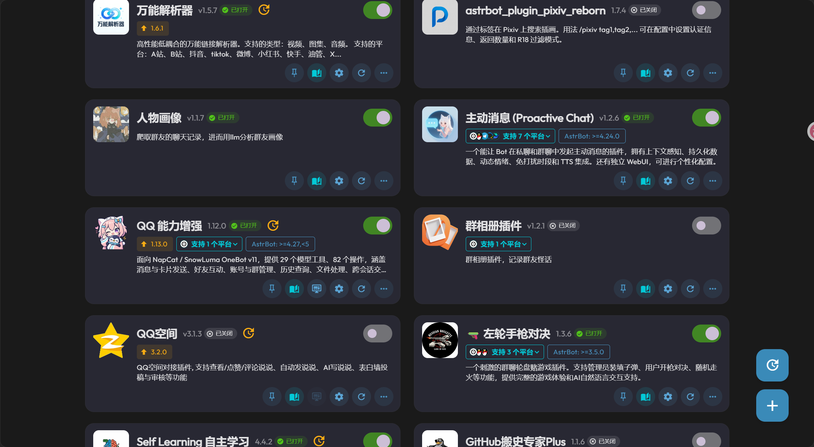
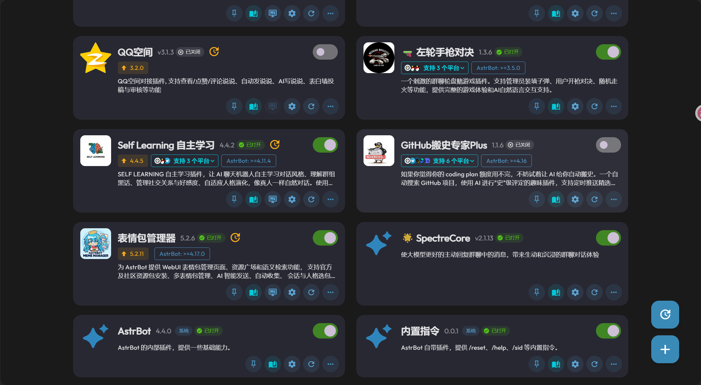

最近在抖音和哔哩哔哩上，能看到不少把 AI 放进社交场景的玩法：有人给 QQ 小号设定一套人格，让它像一个独立角色那样聊天；有人把机器人拉进群里，让它接梗、斗嘴、发图；还有人把 AI 接到账号运营或直播互动中。

这些玩法看起来五花八门，做的事情却差不多：不再每次都打开一个网页，主动输入问题、等待回答，而是把模型放进一个已经有人、有话题、有来有往的聊天环境里。

本文用 AstrBot 和 NapCatQQ 说明这类机器人的基本搭法，再看看插件怎样把一只只会答话的鱼，慢慢养成更像群友的样子。

## 把模型放进好友列表，发生了什么

### 鱼没有换脑，只是多了身体和工具

AI QQ 机器人通常没有重新训练一套模型。它做的是把一个现成的大语言模型接入聊天平台，再给模型配上人格、上下文、记忆和工具。

如果把 LLM 看作负责理解和生成文字的大脑，那么 QQ 只是它能够出现的一个场景。模型原本待在网页对话框里，现在有了一个 QQ 账号作为身体，能够接收私聊和群消息，再把回复发回去。

真正把这些环节接起来的，是运行框架。本文把这层统称为 Harness：它负责接收消息、组织上下文、调用模型、安排插件工具，并把最终结果交回聊天平台。AstrBot 就承担了这类运行中枢的工作。

### 一条消息要经过哪些地方

以 AstrBot + NapCatQQ 为例，几个部分各做一段：

- **LLM**：理解消息、生成回复，或判断是否需要调用工具。
- **OneBot v11**：一种机器人应用接口标准，约定事件和 API 如何交互。它让上层框架不必直接理解 QQ 客户端内部细节。
- **AstrBot**：管理模型、人格、会话上下文和插件，并编排一次完整的机器人回复。
- **NapCatQQ**：连接 QQ 的协议端。它把 QQ 消息转换为 OneBot 事件，也负责将 AstrBot 的回复送回 QQ。

消息的基本路径可以画成这样：

~~~mermaid
flowchart LR
    Q["QQ 私聊 / 群聊"] --> N["NapCatQQ 接收并发送 QQ 消息"]
    N <-->|"OneBot v11 反向 WebSocket"| A["AstrBot Harness 运行中枢"]
    A --> C["人格 / 上下文 / 记忆"]
    C --> L["LLM"]
    L --> A
    A --> P["插件与工具"]
    P --> A
    A --> N
    N --> Q
~~~

OneBot 是接口标准，不是模型，也不是 QQ 本身；NapCat 是协议实现端，AstrBot 则是接收这套协议并调用模型的框架。把它们分开看，后面的配置就没那么像一堆端口和开关了。

### 为什么好友窗口比网页聊天更有临场感

网页聊天通常由一个人提出问题，再等模型回答。QQ 群里的消息却来自不同的人，前后还有共同话题、表情包和旧梗。机器人如果能分清谁在说话、当前聊到哪一件事，回复就不再只是回答一个问题，也会参与一段持续发生的对话。

好友列表还改变了使用方式。你不用专门打开一个 AI 工具；它和其他联系人待在同一个窗口里，想起来时就能发一句话。这个便利很容易让人觉得自己在养一个角色。

不过，感觉上的亲近和模型是否拥有人的感受，是两件事。消息更自然，也不代表它因此成了一个真实的人。

## 先让第一条消息顺利往返

### 准备一台常开的鱼缸

入门需要一台能长期运行的电脑或服务器、一个专门测试用的 QQ 账号、一套 AstrBot + NapCatQQ，以及一个可用的 LLM 服务。模型可以使用云 API，也可以接本地部署的模型；选择前先确认模型能满足文本对话需求，之后再考虑图片、语音或工具调用。

成本也分几块：

- 电脑或服务器需要保持运行并能访问模型服务。
- 云端模型按服务商和模型的计费规则产生费用，输入上下文越长、回复越多、图片或语音处理越频繁，调用成本也可能越高。

### 先把 AstrBot 跑起来

如果电脑上已经装好 Docker Desktop，可以按 AstrBot 官方 Docker Compose 文档启动服务。常见流程如下，具体配置以官方仓库当前版本为准：

~~~bash
git clone https://github.com/AstrBotDevs/AstrBot
cd AstrBot
docker compose up -d
~~~

启动后从日志中找到管理面板地址和初始密码，首次登录后先修改密码。接着在 WebUI 的模型提供商设置里新增服务商，填写服务商提供的 API Key 和 API Base URL，获取并启用模型，再把它设为当前对话模型。先在管理面板里发一条测试消息，确认模型连接正常，再接 QQ 会容易排查得多。

API Key 应保存在服务配置中，不要写进博客、公开仓库或截图。AstrBot 的部署方式和页面字段会随版本变化，安装步骤以[官方部署文档](https://docs.astrbot.app/deploy/astrbot/docker.html)和[模型接入说明](https://docs.astrbot.app/providers/start.html)为准。

### 再让 NapCatQQ 接上 QQ

AstrBot 需要一个消息平台适配器，才能收到 QQ 事件。NapCatQQ 则作为协议端连接 QQ，并通过 OneBot 把消息交给 AstrBot。

按 [NapCatQQ 官方仓库](https://github.com/NapNeko/NapCatQQ)选择适合自己系统的安装方式，启动后打开 NapCat WebUI。默认 WebUI 端口通常是 6099，启动日志会提供访问地址和登录 Token。用准备好的小号扫码登录；WebUI 首次登录后按页面要求修改密码，再进入“网络配置”页面。

### 把端口、路径和口令对齐

AstrBot 与 NapCatQQ 使用 OneBot v11 反向 WebSocket。两边的角色是：AstrBot 开 WebSocket 服务，NapCat 作为客户端主动连接。

在 AstrBot WebUI 的机器人管理中创建 **OneBot v11** 适配器，启用它，并设置反向 WebSocket 监听地址和端口。监听地址通常填 0.0.0.0，让服务在网卡上接收连接；NapCat 里填的则是 NapCat 实际能够访问到的 AstrBot 地址，两者不要混为一谈。官方文档中的默认端口是 6199，常用路径是 /ws。如果连接需要鉴权，在 AstrBot 端填写 Token。

然后回到 NapCat WebUI，进入“网络配置 → 新建 → WebSocket 客户端”，启用连接并填入地址。两项要对上：NapCat 连接到 AstrBot 的地址和端口，鉴权 Token 也要一致。

~~~text
同一台机器、两边都不是 Docker：
ws://127.0.0.1:6199/ws

AstrBot 与 NapCat 在同一个 Docker 网络：
ws://astrbot:6199/ws

只有 NapCat 使用 Docker：
ws://<AstrBot 宿主机的局域网 IP>:6199/ws
~~~

这里的 astrbot 是官方组合部署中使用的容器服务名；如果你自定义了服务名，就要换成实际名称。容器里的 localhost 指向当前容器自身，不一定是另一边的 AstrBot，所以 Docker 场景尤其要核对网络地址。更完整的字段说明见 [AstrBot OneBot v11 接入文档](https://docs.astrbot.app/platform/aiocqhttp.html)和 [NapCat WebUI 配置指南](https://napcat.napneko.icu/config/basic.html)。

保存后查看 AstrBot 的“数据与日志 → 日志”。看到 OneBot v11 适配器已连接，再用另一个 QQ 账号给小号发一句话，观察消息是否经过模型并返回。若没有回复，优先检查 WebSocket 地址、/ws 路径、端口、防火墙和两端 Token；AstrBot 官方文档也把适配器连接日志作为确认方式。

需要提醒的是，AstrBot 官方目前把 QQ 官方机器人列为优先推荐接入方式；NapCatQQ 则是另一条 OneBot 协议路线。个人账号和第三方协议端的可用性会随平台、客户端版本和部署环境变化，不能把小号当成绝对不会风控的保证。AstrBot 文档还明确提醒，不熟悉网络配置时不要把 NapCat 端口暴露到公网。WebUI、API Key、WebSocket Token 和聊天记录都应按敏感信息管理。

到这里，鱼已经能在 QQ 里回消息了。可这只是一条刚装好鱼缸、还没认人的鱼：它可能每句话都回复得像客服，也不记得上周说过什么。接下来的养成，才是折腾得最有乐趣的部分。

## 人格、记忆和插件，慢慢把它养出习惯

### 人格不是设定越长越好

默认模型往往礼貌、完整、条理清楚。这些特点拿来写报告很好，用来群聊时却可能显得过于正式。给机器人设人格，可以先写清楚几件事：

- 它叫什么，和群友是什么关系。
- 平时用什么语气、句子多长，适不适合接梗。
- 它知道什么，不知道什么；不确定时怎么表达。
- 哪些事情不能做，例如公开他人隐私、冒充真实的人，或把模型猜测说成事实。

比起堆一大段“活泼、可爱、有趣”的形容词，几条具体的对话示例更容易让模型把握聊天节奏。例如：

~~~text
群友：今天又加班了。
默认回复：听起来你一定很累，请注意休息并合理安排工作时间。
设定后的回复：你们公司这是把夜宵当加班费发吗……回家路上注意安全。
~~~

这只是风格示例，不是真实聊天记录。Few-shot 示例要像这个角色实际会说的话，但也要保留边界：不要为了显得像真人，就让它假装有现实生活经历或真实情感。人格提示词可以减少模板感，不能保证每次输出都稳定；模型版本、上下文和群聊内容都会影响结果。

### 记忆不等于把所有聊天记录塞回去

上下文是这一次请求里模型能看到的内容，窗口有限；长期记忆则是跨会话保存、之后检索出来的资料。只靠上下文，时间一长或开启新会话，模型就可能看不到以前的聊天。

从这组插件截图中的插件描述看，**LivingMemory** 面向长期记忆，**人物画像**会分析聊天记录中的群友信息，**Self Learning 自主学习**则侧重聊天风格和群组知识积累。它们解决的问题不一样，也不等于一定会重新训练模型权重。安装前要看清插件文档：它到底保存了什么、保存在哪里、什么时候读取，能否修改或清理。

长期记忆也会记错。一个玩笑可能被当成事实，过时的信息也可能继续影响回复。小号私聊可以先只保存明确的偏好；群聊人物画像和自动学习涉及其他成员的聊天记录，应该先考虑告知、授权、保留期限和删除方式。

*截图记录了一组已安装插件和当时的开关状态。卡片上的版本与兼容要求会变动，安装前应在插件市场查看当前说明。*

### 让它少抢话，也别只会等人点名

消息防抖插件可以把短时间连续发出的几条消息合并，再交给模型处理。这样你分三条发“今天好累”“项目又延期”“晚上还得加班”，鱼不必抢在第一句后面立刻回一次。

输出增强插件则可以在消息发出前做清洗、分段或表情映射。它处理的是“怎么把回复发出来”，不负责让模型变得更聪明。

主动消息和 SpectreCore 这类插件，能让机器人在符合规则时参与群聊或发起对话。它们看起来像“鱼主动来找你”，背后仍然是概率、触发条件、上下文和插件配置。建议先设安静时段、冷却时间、允许的群和成员，再慢慢提高频率。否则鱼还没养熟，先把群聊刷成了鱼塘广播站。

截图里也有“认主”插件，让机器人在对话时识别特定使用者并按设定关系回应。它适合做角色互动，但权限仍应由机器人管理者控制，不能让“认主”绕过群聊权限或隐私边界。

### 图片、语音和表情包要接上另一套能力

让 AI 看懂图片，需要模型支持图像输入，并在 AstrBot 中正确配置图像理解能力。只装了一个图片插件，不会自动让纯文本模型获得视觉能力。

语音通常还要接入语音识别（ASR）和语音合成（TTS）；平台本身也要支持对应消息类型。多模态调用会增加处理步骤和费用，建议先从“识别一条语音”或“读出一条回复”开始，别一次性把所有能力打开。

表情包管理器可以维护图片资源并按语境发送；万能解析器则能处理一些视频、图文或音频分享链接。截图中的 QQ 能力增强、浏览器工具和其他扩展，也可以给机器人增加消息操作或外部工具。但“模型可以调用工具”不等于应该给它所有权限：浏览器操作、群管理和自动发消息都要限制范围、保留人工确认入口。如果接到公开账号或直播，也要说明这是 AI 角色，并让重要发布和管理操作经过人工审核。

### 插件不用一次装满

可以把插件按作用分层，先挑一个实际问题解决：

| 作用 | 截图中的例子 | 建议 |
| --- | --- | --- |
| 消息处理 | 消息防抖、输出增强 | 基础候选；先解决连续消息和发送格式问题 |
| 长期记忆 | LivingMemory | 按需添加；先确认数据保存和清理方式 |
| 画像与学习 | 人物画像、Self Learning | 进阶功能；群聊数据先考虑成员知情与授权 |
| 互动节奏 | 主动消息、SpectreCore、认主 | 进阶功能；设置白名单、安静时段和冷却时间 |
| 多模态与内容 | 表情包管理器、万能解析器 | 按使用场景添加，确认平台和模型支持 |
| 群聊玩法 | QQ 空间、左轮手枪对决 | 可选；看群聊是否真的需要 |
| 平台与工具 | QQ 能力增强、AstrNa、API 聚合、浏览器插件 | 可选；核查工具权限、服务来源和数据去向 |

新手可以从消息防抖开始，确认一问一答稳定后，再按需要加一个记忆插件。群聊互动较多时，再试人物画像或主动消息，并先设置触发白名单和频率。进阶玩法再考虑 SpectreCore、自主学习、QQ 能力增强、浏览器操作和多模态能力。

截图里的浏览器插件、Pixiv 插件、QQ 空间和群相册等卡片有的处于关闭状态，也有卡片显示了特定 AstrBot 版本要求。这些截图适合说明生态里有什么，不能据此推出所有插件在当前版本都兼容或已经生效。第三方 API 聚合服务还要单独核对来源和隐私条款。每次只加一两个插件，测试一段时间再继续；这样出错时才知道是哪一层改变了行为。

### 养成成果最好用真实聊天来证明

插件列表只能说明“装了什么”，不能说明鱼实际表现得怎么样。文章发布前，可以放几组真实 QQ 截图，分别展示它是否记住一条明确偏好、同一人格设定前后的回复差异，以及主动消息的触发是否克制。

从“只会回答问题”到“记得你说过什么”，从机械回复到稳定口吻，再到图片、语音和表情包，这些变化确实能让机器人更像一个有习惯的角色。但能力开关不等于体验保证，最可靠的判断还是看真实对话：它有没有记对、有没有打扰、有没有把玩笑当成事实。

## 养鱼这件事，最后养到了谁身上

把 AI 放进 QQ，不只是换了一个聊天入口。好友列表让它更容易被想起，群聊让它能参与共同话题，人格和记忆又让对话有了连续感。对有些人来说，需要的未必是另一个社交账号，而是在不方便找真人时，能随时说几句、低压力地得到回应。这样的陪伴成本低、可以定制，却不必承担真人社交中的全部压力。

这份体验可以是真的，但回应它的模型并不会因此自动拥有人的情绪。它能记住你喜欢什么、按你的习惯说话、在设定条件下主动发消息；这些表现值得珍惜，也需要知道它们是怎样生成的。把 AI 当作一种陪伴并没有问题，把所有判断都交给它就需要多想一步。

鱼也不一定会一直有新鲜感。最初调人格、装插件时，每次行为变化都像发现了新玩法；用久了之后，重复的梗、失准的记忆和过度主动仍然可能出现。人格提示、记忆检索和多个插件也可能给模型带来互相冲突的要求，角色口吻随之漂移。记忆和工具能改善一部分问题，却不能保证关系永远有新的内容。

或许养大肥鱼的乐趣，本来就不只在于它最后像不像真人，而在于你愿意为它设计什么样的相处方式。它可以是一个会接梗的群友、一个能查资料的助手，也可以只是好友列表里偶尔说两句话的角色。

至于要不要继续把鱼养肥，先看它有没有学会闭嘴——再看这个月的模型账单。
