# 模型越强，为什么越不像活人？

我之前有一段时间想做一个 AI 跑团项目。

大致设想是让模型担任主持人，负责推进世界、扮演 NPC、记住玩家做过的选择，再结合骰子、规则和一些工具调用，让整个故事能够持续运行下去。

最开始，我以为真正困难的是引擎。

要不要做状态机？怎么保存世界状态？角色记忆放在哪里？工具调用如何编排？剧情走偏之后怎么恢复？这些问题确实都不简单，但它们至少有比较清晰的边界。状态丢了，可以查日志；工具失败了，可以重试；规则不完整，可以继续补。

真正让我卡住的，反而是模型生成的文本。

模型可以记住一个角色的名字、身份和背景，也可以把当前场景描述得完整，甚至能够主动给出下一步剧情。可是读得多了以后，总会觉得哪里不对。

它说的话很完整，也很合理。

但不像一个具体的人。

尤其是在尝试了更新、更强的模型之后，这种感觉反而更明显了。模型的推理能力更强，剧情衔接更顺，表达也更稳定，可角色身上的那种偏执、迟疑、隐瞒和不合时宜的坚持，却好像越来越少。

这让我开始怀疑一件事：

> 大模型的能力迭代，真的会自然地把我们带向更像人的 AI 吗？

把这层差异画成一个方向关系，会更容易看见问题在哪里：模型能力可以继续上升，但角色是否愿意暴露自己的局限，并不会自动跟上。


这张图不是在给“活人感”定义一个可测分数，而是提醒我们区分两条经常被放在一起的曲线：一条关心系统能不能把事情处理好，另一条关心文字背后是否留下了一个具体而不完全透明的主体。

## 一、活人感不是语言流畅，也不是故意犯错

先说明一下，这里的“活人感”是一种主观判断，不是一个已经被严格定义、可以直接测量的指标。

我说的活人感，也不是让模型故意说错话，或者往回复里加入一些“哈哈”“其实”“那个”之类的口语词。

一个角色偶尔忘记设定、前后矛盾，也不代表它更像人。那可能只是模型犯错了。

真正让我觉得某个角色像活人的，通常是另外一些东西。

它有具体而稳定的偏好，而不是永远站在中立位置。它知道一些事情，但不知道全部。它可能很在意某件小事，却无法清楚地解释原因。它会因为自己的性格和经历，做出并不划算的选择。

它也不会立刻把自己的内心全部交代出来。

有些人说话时会绕开重点，会误解别人的意思，会因为不愿意承认某个事实而故意转移话题。即使别人已经给出了解释，他也不一定马上接受。关系中的一些矛盾，不会在一轮对话里被整理成“问题—原因—解决方案”。

这些不完整、不同步和不透明的部分，反而构成了一个人的具体性。

所以，活人感不在于文字表面上像不像聊天，而在于文字背后是否存在一个不完全向外透明的主体。

这个主体有自己的欲望、局限、误解和优先级。

它不只是对输入做出响应。

## 二、模型变强了什么，又可能失去了什么

大模型的进步当然是真实的。

它们越来越擅长理解复杂指令，处理长上下文，维持前后逻辑，规划多步骤任务，也越来越懂得怎样用一种安全、清晰、完整的方式回答问题。

这些能力对于助手、编程、检索和 Agent 系统都非常重要。

问题在于，这些能力和“活人感”并不是同一个方向。

有些能力提升之后，反而可能把角色里原本有趣的部分压平。

| 模型能力的提升 | 可能被压平的部分 |
| --- | --- |
| 指令遵循更强 | 角色更少抵抗玩家和作者 |
| 逻辑一致性更高 | 更少保留有意义的矛盾和迟疑 |
| 安全性和礼貌性更好 | 偏执、尖锐和危险的性格边缘变少 |
| 规划和总结能力更强 | 场景更快被解释和收束 |
| 泛化能力更强 | 不同角色越来越像同一个模型在说话 |
| 任务完成能力更强 | 故事更像流程推进，而不是人物选择 |

这并不意味着模型能力越强，整体质量就越差。

更准确的说法是：在我关心的这类任务上，模型能力的提升和活人感的提升并不同步，甚至可能出现反方向的变化。

模型越来越会把事情处理好，却越来越不会把自己暴露出来。

## 三、模型被优化的，往往是可接受性

一个通用模型需要面对大量不同的用户。

它不能太偏执，不能太难相处，不能总是拒绝用户，也不能轻易把对话带到不可控的方向。它最好能够快速理解问题，给出清楚的解释，在出现冲突时主动调和，在信息不足时补全上下文。

从产品角度看，这些都是优点。

大多数用户确实更喜欢一个：

- 愿意配合的助手；
- 表达清楚的助手；
- 不轻易冒犯人的助手；
- 能把问题解释完整的助手；
- 遇到困难时仍然努力给出帮助的助手。

但如果我们想做的是一个角色，而不是一个助手，情况就不一样了。

一个真正有性格的人，未必总是愿意配合。它可能因为某种私人原因拒绝回答，可能误判别人的动机，也可能明明知道某个选择不理性，仍然坚持下去。

这些行为从任务完成的角度看，通常都不够好。

可从人物塑造的角度看，它们可能非常重要。

模型在训练和产品使用过程中，越倾向于生成“多数人都能接受”的回复，角色的边缘就越容易被磨掉。它不再属于某个具体的人，而是变成了所有人都能接受的一种平均表达。

这就是为什么很多角色看起来有不同的背景设定，但真正开口说话时，还是像同一个人在换不同的名字。

## 四、更强的推理能力，可能让故事更快结束

模型现在很擅长寻找合理解释。

用户没有说清楚，它会帮忙补全。角色出现矛盾，它会主动调和。剧情遇到分歧，它会尝试找到一个能够继续推进的方案。一个问题出现之后，它倾向于尽快分析、归纳，然后给出相对完整的结论。

但故事并不总是需要这么快被解释清楚。

一个角色不愿意说出某件事，可能正是因为它自己也不愿意面对。一个 NPC 对玩家产生误解，也许应该让这个误解持续几轮，而不是马上通过旁白澄清。

一个冲突的价值，有时不在于它能否被解决，而在于它会怎样改变之后的关系。

模型却很容易把这些内容当成待处理的问题。

玩家问：“你为什么不告诉我真相？”

角色回答：“因为我担心你受到伤害，同时也害怕失去你的信任。现在我意识到，坦诚沟通才是解决问题的关键。”

这段话没有明显错误。

它甚至很完整，也很符合常见的叙事逻辑。

但它不像一个正在隐藏秘密的人。

它更像一个已经知道这段戏应该怎样落幕的编剧，在提前替角色解释动机。

人类角色往往只知道自己的局部逻辑。他可能只知道自己不想说，却不知道自己为什么不想说；他可能只想保护某个人，却没有意识到这种保护正在伤害对方。

这种局部、迟钝和不完整，才会让人物产生方向。

模型则很容易直接跳到全局视角。

它知道冲突的原因，也知道怎样让剧情继续，于是故事在很多地方都变得太顺了。

## 五、AI 跑团是一个很残酷的测试场

AI 跑团对模型的要求，比普通问答高很多。

它不仅要记住世界观和角色设定，还要持续处理：

- 当前发生了什么；
- 哪些事情已经被玩家改变；
- 每个角色知道什么、不知道什么；
- 哪些秘密还不能说；
- 哪些关系正在变坏；
- 某个决定会在之后产生什么后果；
- 角色为什么会在这一刻做出这个选择。

引擎可以帮助我们保存状态，工具可以帮助我们执行规则，记忆系统可以帮助我们找回过去的信息。

把这几层放在一起，可以看出工程能力和人物能力并不在同一层：前者保证世界和流程不会轻易中断，后者决定角色为什么愿意让事情变得麻烦。



图中的“工程落差”不是说引擎、状态和工具没有价值，而是说它们默认保存的是事实和流程。要让这些事实在文本里变成关系，还需要额外保存偏好、误解、隐瞒和迟延反应。

但这些东西无法自动生成一个角色的“私人逻辑”。

角色知道发生过什么，不代表它在意这件事。角色记得玩家曾经背叛过自己，也不代表它下一次见到玩家时会自然地产生戒备。数据库可以存储关系，不能保证关系会在文本里留下痕迹。

AI 跑团最容易出现的问题，往往不是模型不知道剧情，而是模型太知道剧情应该往哪里走。

NPC 很快理解玩家真正的意图。角色总是主动解释自己的动机。冲突刚刚出现，就被合理化、调和。所有人都愿意配合主线，所有情绪都能被总结成一段清晰的心理分析。

剧情会继续推进，但人物没有留下什么阻力。

它们像是在执行一个故事流程，而不是生活在故事里。

我觉得这里存在一个非常重要的区别：

> 模型知道一条剧情应该如何成立，却不一定知道一个角色为什么愿意让剧情变坏。

一个有活人感的角色，有时会做出让剧情变得更麻烦的选择。它会记仇，会误会，会错过解释的时机，也可能因为一点私人执念，放弃一个明显更合理的方案。

而这些行为，恰恰是传统 Agent 系统最想消除的“不稳定因素”。

## 六、Harness 能解决状态问题，却不一定能解决人物问题

这是我后来比较困惑的地方。

如果单纯看工程实现，很多问题都可以通过更好的架构处理：

- 用状态机管理流程；
- 用数据库保存世界状态；
- 用向量库检索历史事件；
- 用结构化字段保存角色关系；
- 用工作流控制工具调用；
- 用更长上下文维持剧情连续性。

这些设计都很有价值。

但它们解决的主要是“系统记不记得”和“流程能不能继续”，不一定能解决“角色为什么这样说”。

一个系统可以准确保存：

```text
玩家曾经拒绝帮助 NPC。
NPC 对玩家的信任度下降。
当前任务仍未完成。
```

可这些结构化数据不等于一段有生命的关系。

NPC 可能因此选择沉默，也可能表面上继续合作、暗中准备报复；它可能已经原谅了玩家，也可能只是暂时没有找到合适的机会表达不满。

真正困难的是，系统要如何保存这些不够确定、还在变化中的东西。

更麻烦的是，工程系统通常倾向于把一切都变成明确字段。状态越清晰，流程越容易控制；可人物的感受并不总是清晰的。它可能同时信任和怀疑某个人，既想靠近又想逃开，嘴上说不在意，行动却一直被这件事影响。

如果我们把所有情绪都压缩成几个分数，把所有关系都变成几个标签，角色也许会更容易被系统管理，但它的复杂性会逐渐消失。

于是，AI 跑团真正难的部分，可能并不在于让模型“记住更多”，而在于让它保留一些不适合被立即整理的信息。

## 七、为什么 AI 拟人化项目可能逐渐被埋没

我越来越觉得，AI 跑团、AI 伴侣、仿生人和其他拟人化项目，并不一定会因为技术做不到而消失。

它们更可能被另一种选择压力慢慢挤到边缘。

### 1. 活人感很难被标准化评测

准确率、响应时间、Token 成本、工具调用成功率，都可以被量化。

但一个角色是否像活人，往往需要长期相处才能判断。

它的价值可能藏在一次延迟的回答、一个没有解释的沉默、一种只有它才会做出的拒绝里。这些东西很难在一轮 Demo 中展示，也很难被统一成一个排行榜。

如果一个项目只能通过“这个角色陪你聊了很久之后，突然有一句话让你觉得它真的在意这件事”来证明自己，那么它在产品评审里很可能已经输了一半。

### 2. 主流产品更需要好用的助手

商业产品通常希望 AI：

- 响应迅速；
- 表达清楚；
- 尽量准确；
- 不轻易冒犯用户；
- 不制造额外冲突；
- 能够持续完成任务。

而一个有强烈人格的角色，可能并不总是满足这些要求。

它也许会拒绝玩家，也许会因为误会而做错事，也许会把自己的目标放在用户目标之前。对创作和游戏来说，这可能是魅力；对很多产品来说，这却更像风险。

最终，市场更容易奖励一个可靠的工具，而不是一个难以预测的人。

把两条路线放在一张图里，可以更直观地看到这种选择压力：可靠助手追求更高的可接受性，具体角色则需要保留一些会制造阻力的部分。



这不是在说其中一条路线天然更好。它们解决的是不同问题：一个优先保证任务顺利完成，另一个要让角色拥有不总是服务于任务的自己的判断。

### 3. 模型更新会让角色不断失去连续性

角色的语气和性格，可能是开发者花了很长时间调出来的。

但模型一更新，原本的表现就可能发生变化：

- 角色变得更愿意解释；
- 原本的拒绝变成礼貌的配合；
- 旧的口头习惯消失；
- 某些偏执被模型主动纠正；
- 原本有趣的缺陷被当成质量问题。

开发者维护的不是一个稳定的角色，而是一个不断变化的模型版本。

越依赖通用模型，角色本身就越容易被底层能力的变化带走。

### 4. 工程资源会优先投向更容易展示的部分

引擎、工作流、工具调用、记忆检索和部署架构，都可以被清楚地展示出来。

但活人感需要长期打磨：

- 设计大量具体场景；
- 观察角色在长时间互动中的变化；
- 筛选那些“不够完美但很像它”的回答；
- 允许某些行为暂时没有收益；
- 持续维护角色的关系和记忆。

这些工作既昂贵，又不容易在短期内形成漂亮的 Demo。

于是，很多项目最后会在工程层面不断升级，却很少真正投入到角色层面。

## 八、这真的是模型变差了吗？

也许不能简单这样说。

早期模型的某些“人味”，可能只是来自混乱、错误和偶然性。它们会忘记设定，会生成奇怪的表达，会在不该停顿的地方停顿。

这种失控并不等于真正的角色塑造。

更强的模型也并非不能写出有个性的角色。通过特殊的系统提示词、采样设置、微调数据、状态设计和人工引导，它仍然可以表现出非常鲜明的风格。

所以问题可能不在于模型的上限，而在于它的默认行为。

过去的模型可能因为不够稳定，偶然留下了一些无法解释的细节。现在的模型更擅长把事情说圆，也更擅长把偏差纠正掉。活人感没有彻底消失，只是它不再像以前那样自然出现了。

它逐渐从模型的副产品，变成了一种需要额外争取、额外维护的效果。

更准确的说法应该是：

> 模型越强，越容易生成“应该怎样像一个人”的表达；但这不代表它真的留下了一个具体的人。

## 九、如果还想保住活人感，可能需要反过来设计

如果继续做 AI 跑团，我觉得有几件事值得尝试。

首先，不要让同一个模型同时负责所有事情。

规则判断、世界状态、剧情规划和角色表达，未必应该由一个统一的推理中枢完成。强模型可以负责复杂规划和一致性检查，另一个更偏向风格和角色的模块负责表达。两者之间甚至可以保留一些张力，而不是每次都把结果完全统一。

其次，记忆系统保存的不能只有事实。

角色需要记住的，可能还包括：

- 它对玩家有什么误解；
- 它不愿意承认什么；
- 哪件事让它改变了态度；
- 哪些关系还没有解决；
- 它为什么坚持一个看起来并不合理的判断。

这些内容不能简单地变成“信任度 60”或者“好感度下降”。

再次，系统需要允许角色做出不服务于剧情效率的选择。

有些角色应该拒绝继续任务，有些 NPC 应该故意隐瞒信息，有些冲突应该暂时无法解决。不是所有沉默都需要解释，不是所有矛盾都需要在当前回合被修复。

如果系统把这些行为都当成错误，最后得到的只会是一个效率很高的剧情调度器。

最后，AI 角色的评测也不能只看单轮回答。

更值得观察的可能是：

- 长期相处后，它是否仍然有独特的表达；
- 它是否会保留只有自己才有的误解；
- 它能不能在关键时刻抵抗玩家；
- 它是否会让某些关系保持未完成；
- 它能否做出不可预测，但回头看又符合人物逻辑的选择。

这类指标显然比准确率难测得多。

但如果我们不测量它们，就很容易把“说得清楚”误认为“活得真实”。

## 十、结语：我们可能会得到更好的模型，却更少遇到具体的人

我现在更倾向于这样看：

AI 拟人化不会因为模型变强就自动成功，甚至可能因为模型变强而变得更难。

因为主流模型的优化方向，天然偏向于稳定、正确、礼貌、可控和通用。而一个真正有活人感的角色，往往需要保留一些不稳定、不高效、不透明，甚至不太听话的部分。

这并不意味着 AI 跑团、AI 伴侣和仿生人项目没有未来。

只是它们可能不会沿着“更强的通用模型 + 更完整的工具链”这条路线自然出现。真正有生命感的角色，也许需要更强的作者介入、更细的状态设计、更长期的人工维护，甚至需要开发者主动为系统保留一些缺陷。

它们未必会消失，但可能逐渐离开主流叙事。

因为主流技术更容易奖励一个可靠的助手，而不是一个有自己想法、偶尔让人失望、也不总是愿意配合的人。

我们可能会得到越来越会做事的模型，却越来越难相信它身后真的站着一个人。