## 一、从一次“解压失败”开始

先看一个很粗、但足够说明问题的估算：手里有一个 **180 GB 的压缩包**，解压后的文件合计约 **200 GB**。普通解压会同时保留压缩包和不断增长的输出目录。到了最后一个文件写完、压缩包还没有删除的那一刻，磁盘上大约要放下 180 GB + 200 GB，也就是接近 380 GB。

这里的 380 GB 是示例和空间峰值估算，不是一次实测。实际过程还会受到文件系统元数据、临时文件和预留空间影响。问题在于，最终只想留下 200 GB 的文件，却要先为两份数据同时留出位置。

HatchZip 的项目说明正是从这个矛盾切入：它把压缩包已经用过的部分逐步释放，让新写出的文件可以继续使用同一块磁盘空间。先把空间曲线画出来，后面再解释它怎样知道某一段数据已经可以消失。

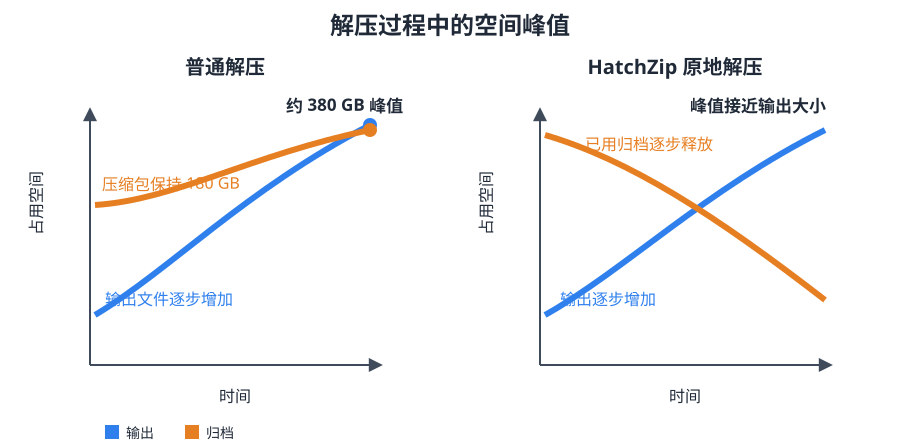

图中左侧的峰值来自“完整归档 + 完整输出”同时存在；右侧只是设计目标的示意。HatchZip 并没有让解压结果变小，它改变的是输入归档何时被释放。因此，空间够不够，不能只看最终输出大小，还要看解压过程中的最高占用。

## 二、HatchZip 到底改了哪一步？

普通解压可以先抽象成一条直线：从压缩包读取数据，解码，再把文件写入目标目录。压缩包在这个过程中是输入，直到任务完成都保持原样。

HatchZip 在这条路径上增加了一个提交边界：

```text
读取归档 → 解码 → 写出文件 → 确认输出安全 → 释放已用的归档数据
```

设计文档把归档拆成可以独立解码的 **unit**。一个 unit 中的文件已经写入磁盘、校验通过，并且相关状态已经记录后，程序才会尝试从归档末尾截短，或者在支持的文件系统上打洞释放中间空间。这个过程更接近“原地解压”或“消耗式解压”，不是创建压缩包时删除源文件。

这样做的代价也必须一起记住：归档在任务结束前就可能不再完整，不能把它当作普通备份。HatchZip 提供了 `--keep-archive`，表示走普通解压路径并保留完整归档；如果没有这个选项，空间换取依赖的就是归档可以被逐步消耗这一事实。

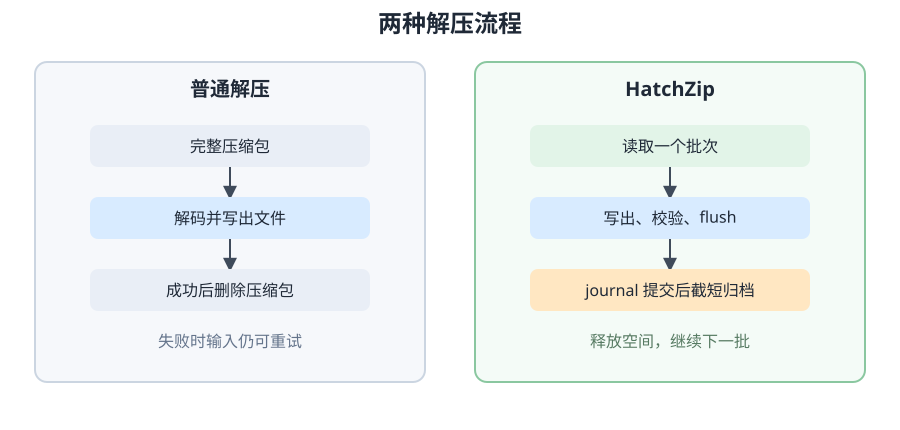

左边的流程把删除放在任务末尾，所以失败时还可以从原始输入重新开始；右边先把一批输出提交，再释放对应输入。这里的“确认”不是一句提示，而是后文会展开的 flush、journal 和截短顺序。

## 三、普通解压为什么要保留完整压缩包？

传统工具的取舍其实很直接。它们会读取目录，或对 tar、连续流顺序扫描条目，再解码文件并写到目标位置，最后做完校验。归档在整个过程中保持可读，用户可以重新解压、只提取其中一部分，也可以把它复制给别人。GNU tar 的文档明确写着，提取不会修改归档结构，同一个归档可以重复提取。

这会带来更高的空间峰值，却保留了输入的可重复性。一次解压失败时，用户可以修复目标目录后重试；目标盘临时不够时，也可以换一块盘重新操作。归档仍然是一个独立的、可验证的原件。

删除操作可以存在，但它和“边解压边释放”不是同一个时间点。WinRAR 的更新记录提到解压对话框中的 **Delete archive** 选项；7-Zip 的官方对话框文档也说明 **Delete files after compression** 只在归档成功创建后删除源文件。这些资料描述的是成功后的删除或移动语义，没有把删除提前到每个解压批次中。

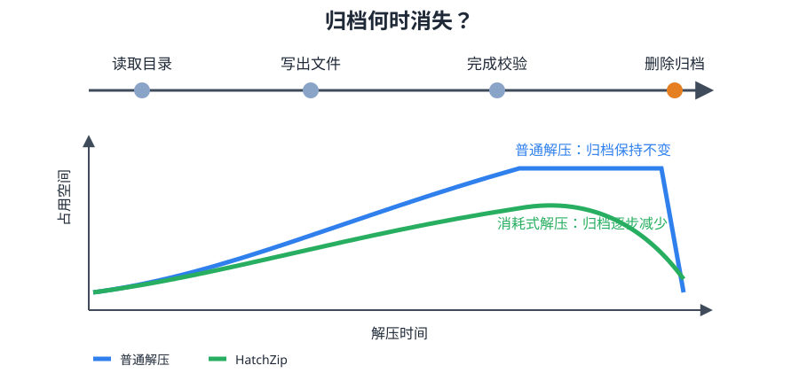

因此，普通解压的曲线通常是先升高，再在成功结束后突然下降。HatchZip 的曲线则把这次下降拆成很多小段。前者更容易理解和恢复，后者把峰值压低，但接受了归档逐步失去完整性的代价。

## 四、压缩包里的哪些部分可以先释放？

HatchZip 不能简单地“读到哪里就删到哪里”。它要先知道格式的边界：哪些字节可以独立解码，哪些字节还依赖前面的状态，哪些索引在归档尾部仍然需要保留。设计文档把这些可处理的范围称为 unit，并按格式选择处理方向：可从文件末尾截短的归档通常从后到前提交，压缩 tar 这类连续压缩流则通常从流开头向后顺序处理。

| 格式 | 主要释放单位 | 需要留意的布局 |
| --- | --- | --- |
| ZIP | 一个文件条目（local header 和数据） | 条目在前，central directory 和结尾记录在后 |
| 非固实 7z | 一个文件或一个数据块 | packed blocks 后面还有归档 header |
| 固实 7z | 一个 solid block | block 内的文件共享连续解码状态 |
| tar | 一个文件条目及其前置扩展记录 | header 和数据顺序排列，末尾是零块 |
| RAR | 普通 RAR：一个文件；solid RAR：整个归档 | header 和数据顺序排列，多卷时还要考虑卷边界 |
| `.tar.gz` / `.tar.xz` | 连续压缩流 | 通常从流开头向后顺序处理，释放依赖打洞能力 |

表格里的“主要”很重要，它表示设计文档中的处理粒度，不代表每个变体都能无条件采用同一种释放策略。ZIP 的条目通常可以从后往前提交；固实 7z 要等整个 solid block 解码完成；普通 RAR 可以按文件处理，solid RAR 则是整个归档的一个处理单元，当前实现只在 `--keep-archive` 下处理，原地解压会在未改动归档前被拒绝；连续压缩流则通常从流开头向后顺序处理，不能从任意中间位置重新开始。

文件从末尾截短在操作系统层面比较普遍，文件中间的空间则需要 hole punching。FAT32、exFAT 等文件系统不支持同样的中间释放方式，所以只有依赖文件中间打洞的连续压缩流或其他中间空间回收场景，才可能无法及时释放；普通可从文件末尾截短的释放单元仍可按批次处理。其他系统的接口和行为也不完全一致。所以 HatchZip 优先利用可以从末尾移除的布局，只有在解码器和文件系统都允许时才处理更细的中间空间。

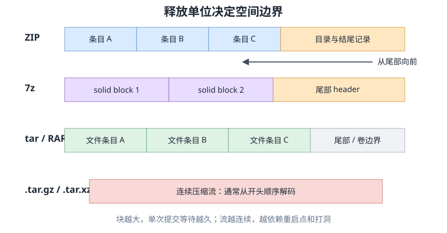

这也解释了为什么“压缩率高”不一定等于“容易原地解压”。固实压缩把多个文件放进同一个连续块，通常有利于压缩率，却把释放边界推迟到了整个 block。HatchZip 的空间检查会把这个最大单位算进去；如果一个固实块几乎等于整个归档，能省下的空间就会很有限。

## 五、一个批次是怎么处理的？

理解释放单位之后，再看一次批次提交就比较清楚了。设计文档给出的顺序可以概括成下面几步：

1. **选择批次。** 从上一次已经提交的位置继续，按照当前可用空间挑出一组尚未处理的 unit。
2. **写入临时文件。** 每个文件先写到带有临时后缀的 part 文件，避免半成品被误认为最终输出。
3. **校验输出。** 解码器在流结束时检查 CRC，程序还会把实际写入大小和归档声明的大小对照起来。
4. **把输出刷新到物理磁盘。** 只写进进程缓冲区还不够，批次要经过 flush，才能把“已经落盘”作为后续判断的前提。
5. **更新 journal。** 记录新的 `committed_len`，以及这批已经完成的链接或恢复信息。
6. **截短归档。** 归档被截到这批最低 unit 的起点，释放出的空间留给下一批。
7. **继续下一批。** 只要空间检查仍然允许，就从新的提交位置重复处理。

顺序可以压缩成一句话：**先让输出可恢复，再让输入消失。** 如果先截短归档、后写输出，断电或写入失败就可能同时丢掉输入和输出。HatchZip 的文档把 flush、journal 和 truncate 分成独立步骤，正是为了把这个危险窗口变成可恢复的状态边界。

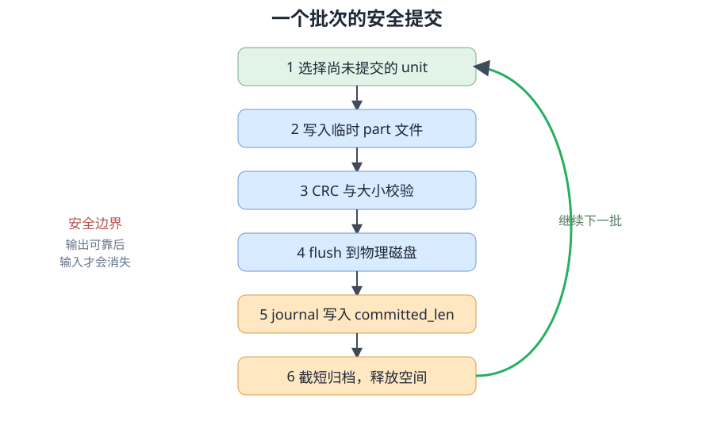

批次并不意味着一次把所有文件都写完。它只是把多个 unit 组织成一次提交，使磁盘空间、校验结果和恢复位置一起向前推进。链接和部分目录元数据会延后到最后处理，因为它们不是释放压缩数据所必需的主体内容。

## 六、ZIP 的目录索引被截掉之后，程序怎么继续读取？

ZIP 的物理布局里，文件条目在前面，central directory 和 end of central directory record 在文件尾部。PKWARE 的 ZIP 规范把这些记录作为描述文件名、偏移和大小的结构写入归档。恰好，HatchZip 从尾部开始释放时，最先会遇到的也是这段目录信息。

如果直接把尾部截掉，下一次打开剩余前缀时，普通 ZIP 读取器可能找不到目录。HatchZip 的设计文档描述了一个 sidecar 方案：在第一次截短前，把最后一个 unit 数据之后的尾部保存到 `<archive>.hatchzip-tail`，同时在 `<archive>.hatchzip` journal 里记录尾部起点和 CRC。

之后，内部的 reader 不再只看磁盘上的物理文件，而是把“还存在的归档前缀”和“保存下来的尾部”拼成逻辑视图。格式库看到的目录仍然位于应该出现的位置，已经截掉的区域按设计读作零。这样，程序可以继续定位剩余 unit，又不会把一个已经被消耗的前缀误认为完整 ZIP。

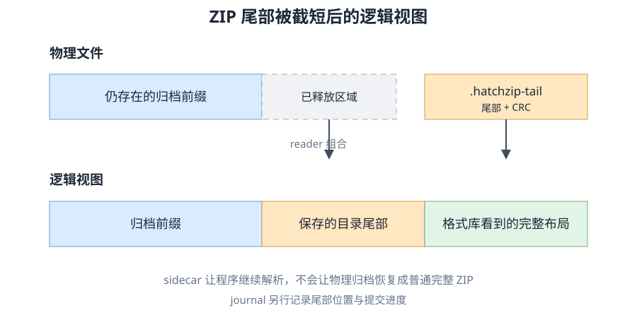

这里要区分两件事：sidecar 是 HatchZip 为恢复和继续解析保存的辅助状态，不等于归档本身仍然完整。把物理文件和 sidecar 分开复制、改名或交给别的解压器，都可能失去这层逻辑拼接关系。

## 七、大文件、连续压缩流和固实压缩会带来什么限制？

先看一个最直观的边界：压缩包里有一个 30 GB 的文件，当前磁盘只剩 5 GB。若这个文件是一个必须整体提交的 unit，那么写完它之前不能释放对应的归档数据，5 GB 当然不够。此时“边解压边删”并不会凭空产生空间。

只有当格式允许细分、文件系统支持 `hole punching`，且解码器能够从中间恢复时，HatchZip 才能把大文件按可恢复点拆成更小的推进片段：写出一段，flush，记录恢复位置，再释放已经确认的归档字节。设计文档用 256 MiB 的输出推进粒度来描述这一机制，但它是设计文档中的约数，不是所有格式、编码器和文件系统都固定保证的块大小，也不是普遍能力。

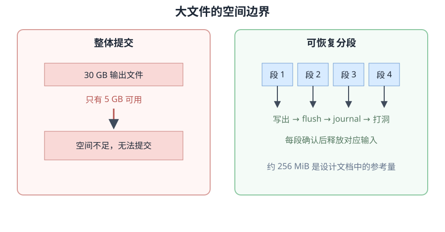

限制主要来自三处：

- `.tar.gz` 和 `.tar.xz` 的压缩流通常从流开头向后顺序处理，能否在中途释放取决于文件系统是否支持打洞，以及流本身有没有可恢复点。
- FAT32、exFAT 等文件系统不提供同样的中间空间回收能力，所以依赖文件中间打洞的连续压缩流或其他中间空间回收场景可能无法及时释放；普通可从文件末尾截短的 unit 仍可按批次处理。
- 固实 7z 需要从 solid block 的开头解码。block 越大，原地解压的最低空闲空间越接近“输出大小 + 最大 block”；如果整个归档只有一个大块，空间收益可能接近于零。solid RAR 把整个归档作为一个处理单元，当前实现只在 `--keep-archive` 下处理，原地解压会在未改动归档前被拒绝。

所以，格式表里的“支持”不能直接翻译成“任意归档都能少占一份空间”。实际能省多少，要看释放单位、解码重启点、文件系统和输出位置是否满足条件。

## 八、断电之后，程序如何知道哪些文件已经完成？

这部分不能只用“支持断点续传”一笔带过。消耗式解压的恢复关键，是让 journal 的声明永远落后于已经可靠落盘的内容，同时让归档截短位置永远不超过 journal 已经确认的位置。

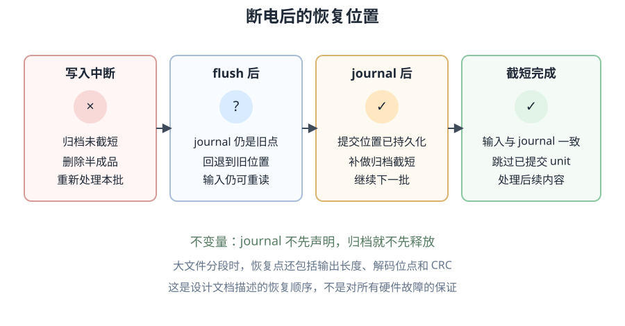

按设计文档的提交顺序，可以把常见情况分成四类：

| 中断位置 | 磁盘上的状态 | 恢复动作 |
| --- | --- | --- |
| 临时文件写入中 | 归档还没有截短，输出可能是半成品 | 丢弃半成品，从上一个安全位置重新处理 |
| flush 完成、journal 尚未更新 | 输出已经写过，但旧提交位置仍然有效 | 回退临时输出到旧位置，再从旧位置解码 |
| journal 已更新、归档尚未截短 | 新输出和提交位置已经持久化 | 按 journal 的 `committed_len` 补做截短，再继续下一批 |
| 截短已完成 | 输入和提交位置一致 | 从下一个未提交 unit 继续 |

journal 本身也需要原子替换：文档描述的是先写临时 journal、flush、再替换旧文件并刷新目录。对于大文件分段处理，journal 还会记录已经 flush 的输出长度、解码器的恢复位点和 CRC；恢复时不会越过最后一个已经持久化的点去读取被释放的输入。

这套机制能降低断电时的损失，但不能把已被消耗的原始字节变回一个独立完整的归档。来源损坏、文件系统异常或用户同时移动 sidecar，都属于需要另外处理的失败条件。设计文档描述的是恢复顺序和测试边界，不应被理解成对所有硬件故障的绝对保证。

## 九、为什么 7-Zip、WinRAR 通常不这样做？

先说结论：它们并非不能删除归档，而是通常把“归档是可重复读取的输入”作为默认前提，没有把“解压过程中逐步消耗归档”放在默认路径里。

GNU tar 的官方手册把这种取舍写得很清楚：提取不会修改归档，可以重复提取。7-Zip 的官方帮助则把 **Delete files after compression** 定义为归档成功创建后删除源文件；WinRAR 的更新记录也能看到解压对话框里的 **Delete archive** 选项。它们都说明了“删除可以是一个成功后的操作”，但没有把它描述成 HatchZip 这种逐批截短机制。

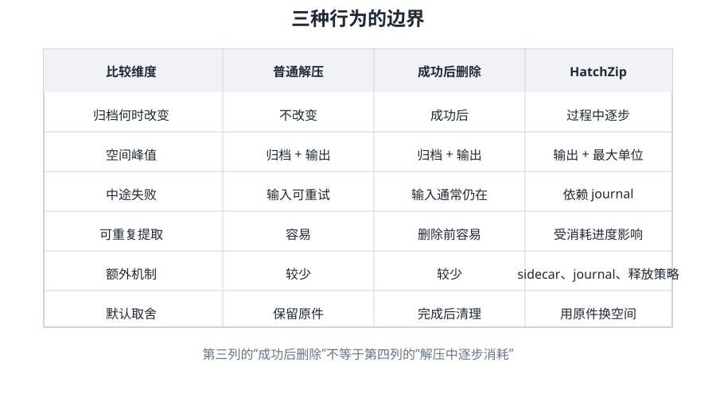

从这些资料可以做出一个有边界的工程推断：

1. **完整归档更适合重复使用。** 用户可以只提取一部分、换目标目录重试，或者在失败后重新开始。
2. **错误处理更简单。** CRC 失败、输出写满、用户取消和断电都只影响当前输出，不会同时改变输入的物理布局。
3. **格式差异不容易被隐藏。** ZIP 的 central directory、7z 的 solid block、连续 tar 流和 RAR 的卷结构，各自有不同的可释放单位，不能只加一个通用的删除开关。
4. **默认行为的风险更低。** 逐步消耗归档意味着一次误操作可能让唯一副本变得不可恢复，普通工具把这个决定留给用户在任务完成后执行。

这不是说 7-Zip 或 WinRAR 在所有版本、所有界面里都完全没有删除选项，而是说“删除源文件”和“在解压过程中提交并释放输入”承担的责任不同。HatchZip 需要额外的空间规划、sidecar、journal、路径安全检查和恢复逻辑，已经是解压引擎的结构变化。

## 十、HatchZip 适合谁？

判断是否适合时，先问的不是“它能不能删”，而是“这个归档是否值得被消耗”。下面的流程把空间和数据价值放在一起考虑。

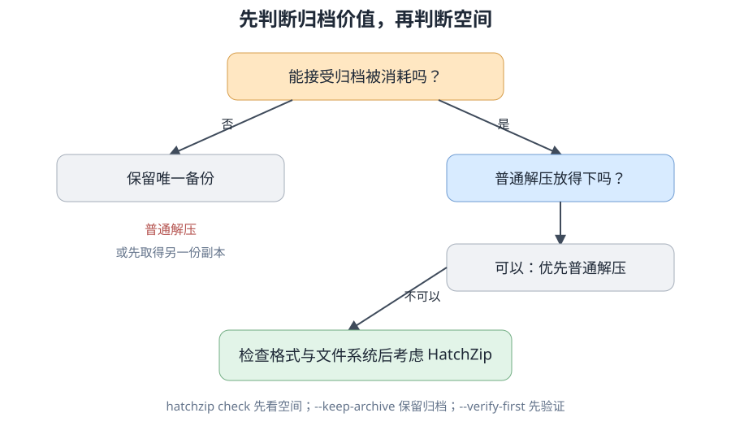

它更适合这些条件同时出现的场景：压缩包很大，解压结果更大；压缩包只是一次性下载物或可重新获取的中间文件；归档和输出在同一块磁盘；普通解压的峰值确实放不下，而释放单位和文件系统又能提供足够的空间回收。

下面这些情况要谨慎：

- 压缩包是唯一备份，或者以后还要反复解压；
- 归档来源不可靠，损坏后无法重新下载，也没有其他副本；
- 使用了很大的固实压缩块，空间检查显示仍需要接近完整输出加大块空间；
- 输出目录在另一块磁盘，释放源归档的空间对目标盘没有帮助；
- 文件系统不支持所需的中间空间回收，实际峰值仍接近普通解压。

使用前可以先调用 `hatchzip check` 查看空间计划。它会读取必要元数据并检查磁盘可用空间，不改变文件；对于 `.tar.gz` / `.tar.xz` 等压缩 tar，必要元数据可能需要先顺序扫描完整流。需要完整保留输入时使用 `--keep-archive`；来源难以重新获取时，可以用 `--verify-first` 先读完整个归档并检查文件校验，再决定是否接受消耗式处理。即使先验证过，归档在后续写出过程中仍会被消耗，所以**唯一备份不能使用消耗式解压**。

## 十一、结尾：它解决的是解压时的空间问题

把整个过程压缩成三个阶段，关系会更直观：

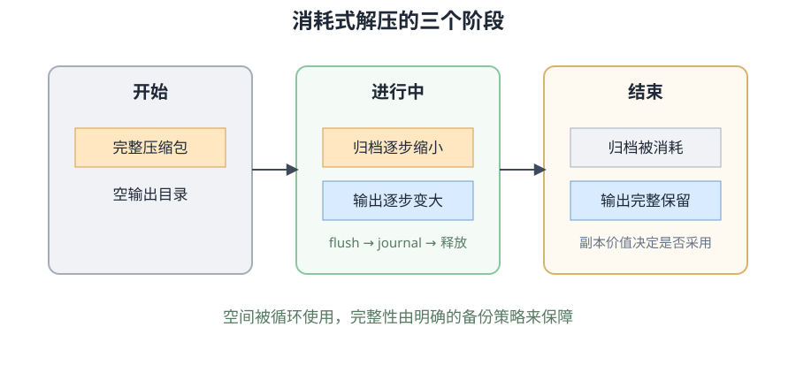

开始时，磁盘上有完整压缩包和空的输出目录。进行中，HatchZip 按释放单位选择批次，先把输出写稳、校验好、记录到 journal，再截短或打洞回收已经确认的归档空间。结束时，输出文件完整保留，归档可能只剩未处理前缀或辅助状态，或者已经被删除。

普通解压保留输入，换来更低的恢复复杂度和更好的重复使用体验。HatchZip 消耗输入，换来更低的空间峰值；它还要承担格式差异、文件系统能力、sidecar 一致性和崩溃恢复的成本。两种方式都合理，前提是先明确你更想保留哪一部分。

HatchZip 不会改变解压出的文件内容，但会改变归档文件的物理状态。